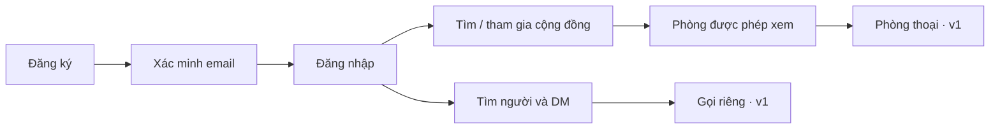

# SCDC — Trải nghiệm tổng thể

Trang này mô tả hành trình chính của người dùng qua các tính năng, cùng bố cục và điều hướng của ứng dụng. Luồng chi tiết, kiểm tra dữ liệu và thông báo của từng màn hình nằm trong tài liệu tính năng.

**Trạng thái:** wireframe hiện chỉ là mô tả bằng chữ. Chưa có prototype toàn hệ thống được kiểm tra.

## Hành trình

Sơ đồ gồm các chức năng của [phạm vi v1](../project/overview.md#scope). Phần đã có trong nền xem [MVP](../releases/mvp.md); trạng thái từng chức năng xem tài liệu tính năng.

## Bố cục và điều hướng

| Vùng | Vai trò | Component hiện tại |
|---|---|---|
| Xác thực | Đăng ký, đăng nhập và báo trạng thái tài khoản | [AuthScreen](../../clients/WebClient/src/components/AuthScreen.jsx) |
| Thanh server | Chọn DM hoặc cộng đồng; tạo hoặc tìm cộng đồng | [ServerRail](../../clients/WebClient/src/components/ServerRail.jsx) |
| Thanh bên | Danh sách cuộc trò chuyện hoặc danh sách phòng | [SubSidebar](../../clients/WebClient/src/components/SubSidebar.jsx) |
| Nội dung | Danh sách, tìm kiếm, quản lý hoặc cuộc trò chuyện đang mở | [App](../../clients/WebClient/src/App.jsx) |
| Panel phụ, hộp thoại | Hồ sơ, thành viên và cài đặt | [components](../../clients/WebClient/src/components) |

Trong nền `900e226`, Community và DM đã dùng API và Hub thật ([hồ sơ tích hợp](../records/verification/messaging/merge-2026-10-13.md)). Tin phòng và một số phần giao diện khác vẫn dùng dữ liệu mẫu và sẽ hoàn thiện trong v1. Bố cục hiện tại chưa qua nghiệm thu UX.

## Thiết kế theo tính năng

- [Tài khoản](../features/accounts/README.md): đăng ký, xác minh, phiên đăng nhập, khôi phục mật khẩu và hồ sơ.
- [Cộng đồng](../features/community/README.md): tìm và tham gia server, phòng và quyền.
- [Nhắn tin](../features/messaging/README.md): DM, tin phòng, lịch sử và kết nối lại.
- [Thoại và video](../features/media/README.md): gọi riêng, phòng thoại, camera và chia sẻ màn hình.

Mỗi tính năng phải thiết kế đủ các trạng thái: đang tải, trống, lỗi, mất kết nối, mất quyền và kết quả thao tác. Quy tắc giao diện chung xem [quy ước giao diện](design-system.md); trình duyệt và thiết bị hỗ trợ xem [chất lượng](../system/quality.md#quality-targets).

## Mobile, thông báo và gửi file

Ba phần này được thêm vào kế hoạch ngày 2026-11-01: [mobile](mobile.md), [thông báo](../features/notifications/README.md), [gửi file](../features/files/README.md). Vg thống nhất hành trình và điều hướng chung; mỗi người thiết kế giao diện cho mảng của mình. Hành trình mới phải được thiết kế trước khi đưa vào nghiệm thu.

## Còn mở

- Prototype, kiểm tra bàn phím, focus, bộ gõ, co giãn màn hình và thông báo cần được ghi lại theo từng tính năng và bản build.
- Ngôn ngữ, nhóm người dùng đầu tiên và cách đánh giá giá trị sản phẩm: [OQ-001, OQ-012](../project/open-questions.md#open-questions). Đây là đề xuất, chưa phải kết quả khảo sát.

---

Nguồn: DEC-173.
