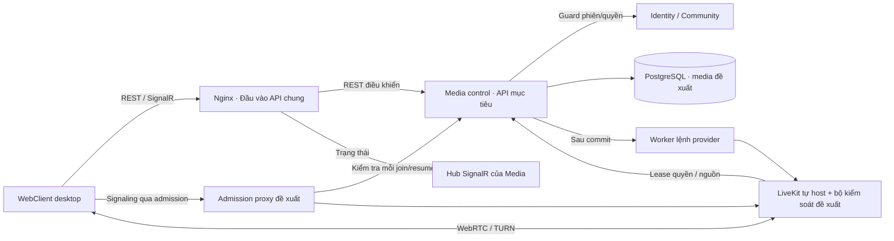

# SCDC — Tham gia, hạn mức và kết nối media

Trang này mô tả cơ chế chung cho [gọi riêng](direct-calls.md), [phòng thoại](voice-rooms.md) và [micro, camera, chia sẻ màn hình](video-screen-sharing.md): ai được tham gia, giới hạn số người, kết nối lại, cấp quyền LiveKit, và cách cắt media khi mất quyền.

**Trạng thái:** thiết kế mục tiêu (2026-10-04). Chưa có module Media, schema `media`, LiveKit, admission proxy hay worker. OpenAPI, danh mục realtime và fixture chỉ là thiết kế. Transaction và guard dưới đây giả định một ứng dụng duy nhất; phải xem lại khi tách microservice (DEC-116).

Khôi phục từ backup để [sau v1](../../project/overview.md#backup-scope). Khởi động lại DB và LiveKit, kết nối lại, chặn thế hệ cũ, ngắt đúng hạn và thời hạn lưu vẫn thuộc v1.

**Người phụ trách:** Thái (Media control, LiveKit, giao diện, kiểm thử). Vg cung cấp hợp đồng quyền và phiên của Identity, Community. Sáng phối hợp phần thông báo. Xem [phân công](../../project/planning.md#team).

## Quyền, hạn mức và luồng

### Các thành phần

- API, Hub và worker là các vai trò logic, chạy chung một tiến trình Media control ([D11](#v1-media-realtime), [D12](../../system/backend.md#v1-application-workers), [D13](../../system/backend.md#v1-realtime-hosting)). Bộ kiểm soát lease ở node LiveKit là phần riêng.
- REST và SignalR không truyền âm thanh, hình. LiveKit không tự tạo thành viên hay bỏ qua quyền Community.

### Ai kiểm tra gì

| Bên | Kiểm tra |
|---|---|
| Media | Sở hữu cuộc gọi, lượt tham gia, nguồn phát và hạn mức |
| Identity | Tài khoản hoạt động, đã xác minh; phiên còn hiệu lực; security stamp |
| Community | Epoch thành viên; phòng là phòng thoại, chưa xóa; quyền xem hiện tại |

Gọi riêng: mỗi lần vào và gia hạn phải kiểm tra phiên của **cả hai** người đã nhận cuộc gọi; một bên không hợp lệ thì không gia hạn cho cả cuộc. Không JOIN schema của module khác; có thông tin người dùng (`IUserDirectory`) không có nghĩa là có quyền.

### Hạn mức

| Giới hạn | Giá trị |
|---|---|
| Ngữ cảnh mỗi người | 1 (đang đổ chuông hoặc đang tham gia) |
| Người mỗi phòng | 10 (cuộc gọi riêng: 2) |
| Người toàn hệ thống | 20 |
| Màn hình chia sẻ mỗi phòng | 2 ([nguồn phát](video-screen-sharing.md#rules)) |
| Giữ chỗ khi kết nối lại | 30 giây (DEC-080) |

- Số người tính cả: đã giữ chỗ, đang kết nối, đang kết nối lại, đang thoát.
- Đổ chuông giữ ngữ cảnh của người dùng nhưng chưa tính vào hạn mức media.
- Bộ điều phối kiểm tra cùng lúc (nguyên tử) "một lượt mỗi người" và "hạn mức toàn hệ thống"; không dựa vào số kết nối của một tab.
- Gửi heartbeat hay vào lại không kéo dài 30 giây của cùng một lần mất kết nối.

### Trạng thái

| Trạng thái | Sự kiện | Kết quả |
|---|---|---|
| Đang kết nối | LiveKit xác nhận đã kết nối | Đã kết nối; điều khiển nguồn theo trạng thái thật |
| Đã kết nối | Mất mạng | Đang kết nối lại; giữ chỗ tối đa 30 giây, vẫn tính vào 10 và 20 |
| Đang kết nối lại | Mạng trở lại trong hạn, phiên và quyền còn | Kết nối lại với đúng ID lượt tham gia, không thêm chỗ |
| Đang kết nối lại | Quá 30 giây, hoặc mất phiên hay quyền | Kết thúc; quyền LiveKit cũ mất hiệu lực. Chỗ ở trạng thái "đang thoát" cho tới khi có bằng chứng LiveKit đã ngừng hoặc node đã bị cách ly. Vào lại phải xin mới |
| Bất kỳ | Rời, kết thúc, phòng bị xóa, phiên hay quyền bị thu hồi | Kết thúc lượt tham gia, thu hồi quyền LiveKit, báo trạng thái. Ngắt trong 5 giây (DEC-099), chưa đo |

**Thu hồi (DEC-099):** từ lúc commit thu hồi phiên, quyền hay xóa phòng, phải ngừng cả gửi và nhận media và chặn vào lại trong 5 giây. Không xác nhận được quyền thì dừng media liên quan.

## Giao diện

- Mất mạng: hiện "đang kết nối lại" và thời gian còn lại (MEDIA-S03); tự thử khi có mạng; hết hạn thì có nút gọi hoặc vào lại.
- Phòng đầy hay hệ thống đầy: MEDIA-S04. Không che các thông báo kết thúc, đầy, đang kết nối lại khi đổi bố cục.
- Không dùng danh sách trong bộ nhớ client làm nguồn quyền.
- Cần thiết kế đủ: chờ nhận, từ chối, bận, đang kết nối, trong cuộc gọi, mất mạng, không có quyền thiết bị, nguồn chia sẻ dừng, phòng đầy, mất quyền. Trạng thái thiết bị phải đúng thật.
- Media v1 chỉ trên máy tính: Chrome, Edge, Firefox, Safari, hai phiên bản ổn định mới nhất (DEC-082). Ghi hệ điều hành, thiết bị, phiên bản thật của từng ca.

Wireframe là đề xuất, chưa có prototype hay review.

## Dữ liệu

Schema `media` đề xuất; SQL hiện chưa có.

- ID nghiệp vụ dạng UUIDv7; `clientOperationId`, `clientInstanceId` dạng UUIDv4.
- `version`, `connectionEpoch`, `sourceEpoch` gửi dạng chuỗi số trong JSON, lưu bigint trong DB.
- Không đưa tên hay email người dùng vào tên phòng hay danh tính trên LiveKit.

| Bảng đề xuất | Nội dung |
|---|---|
| `rooms` | id, loại (`direct` hoặc `channel`), callId hoặc channelId, thế hệ, version, trạng thái. Mỗi phòng thoại chỉ có một thế hệ đang mở; phòng riêng chỉ có hai người đã nhận |
| `participations` | Phòng, người dùng, phiên, tab; epoch thành viên (nếu là phòng thoại); trạng thái; hạn kết nối; ID lần mất kết nối và hạn kết nối lại; `connectionEpoch`; version; thời điểm và lý do kết thúc |
| `user_claims` | Mỗi người dùng một dòng → cuộc gọi đang đổ chuông hoặc lượt tham gia. Chặn một người ở hai nơi. Đổ chuông không tính vào hạn mức 20 |
| `capacity`, `room_capacity` | Một dòng toàn hệ thống và một dòng mỗi phòng: số giữ chỗ, đang chạy, đang thoát; giới hạn 20, 10 (riêng: 2). Cấp đủ hai chỗ cho cuộc gọi riêng trong một transaction |
| `connection_grants` | ID quyền kết nối, lượt tham gia và epoch, nonce đã băm, hạn, đã dùng chưa. Không lưu JWT thô. Kết nối lại nhẹ có lease riêng, không dùng lại nonce để mở kết nối mới |
| `operations` | Người thực hiện, ID thao tác, endpoint và fingerprint, kết quả (không có bí mật). Duy nhất theo người thực hiện + `clientOperationId` |
| `provider_commands`, `provider_inbox` | ID lệnh hay sự kiện, thế hệ phòng, epoch lượt tham gia, kết nối và nguồn; nội dung không có bí mật; trạng thái thử lại. Đồng bộ với LiveKit sau commit |

Bảng `calls` ở [gọi riêng](direct-calls.md#contracts), `sources` ở [nguồn phát](video-screen-sharing.md#contracts); dùng chung transaction, guard và bộ đếm ở đây.

**Thời hạn lưu** ([vòng đời dữ liệu](../../system/data-lifecycle.md#inventory)): log 14 ngày, audit 90 ngày; chi tiết media đã kết thúc và dừng hẳn 7 ngày. Giữ dấu thao tác và dấu chặn. Không dọn lượt tham gia đang thoát khi LiveKit chưa xác nhận dừng. Không lưu âm thanh, hình hay bản ghi màn hình. Quyền LiveKit v1 không gồm ghi âm hay egress.

## Transaction, giữ chỗ, chống trùng

### Thứ tự khóa

Người dùng Identity (theo byte UUID) → server, phòng Community (nếu là phòng thoại) → hạn mức toàn hệ thống → hạn mức phòng → `user_claims` (theo byte UUID) → cuộc gọi, lượt tham gia, nguồn, thao tác → outbox.

- Mọi đường ghi Media dùng cùng thứ tự. Tra ID trước transaction chỉ là gợi ý; đọc lại sau khi có khóa.
- Guard Identity và Community giữ khóa dòng tới commit qua transaction dùng chung ([kiến trúc](../../system/architecture.md#boundaries)).
- [IAccountAccessGuard.AcquireAsync](../../../services/SCDC.Contracts/Identity/IAccountAccessGuard.cs) và [RelationalWorkScope](../../../services/SCDC.BuildingBlocks/Infrastructure/Persistence/RelationalWorkScope.cs) đã có; Media chưa dùng.

Bước tạo và nhận cuộc gọi: [gọi riêng](direct-calls.md#contracts). Vào phòng: [phòng thoại](voice-rooms.md#contracts).

### Hạn thời gian

1. **Mất kết nối:** lần đầu mất tạo ID lần mất và hạn kết nối lại cố định 30 giây. Vào lại trong hạn giữ ID và chỗ; heartbeat hay thử lại không kéo dài hạn. Khi `now >= hạn` thì kết thúc, mọi quyền cũ bị từ chối. Lần mất mới chỉ tính khi LiveKit đã xác nhận kết nối lại.
2. **Đang kết nối:** đề xuất hết hạn sau 30 giây từ lúc cấp chỗ (không phải mục tiêu p95 5 giây). Worker kiểm tra mỗi giây; lease LiveKit bị chặn tại hạn. Không kéo dài thời gian đổ chuông vì thiếu chỗ.

### Giải phóng chỗ

- Chỗ chỉ được trả khi có xác nhận dừng, hoặc bằng chứng node đã bị cách ly hay dừng. Request rời hay websocket đóng không đủ (media cũ có thể vẫn chạy). Health timeout không chứng minh node đã ngừng.
- Lượt đã kết thúc không vào lại được. Nếu chưa chứng minh LiveKit đã ngừng thì vào mới tạm trả 503, thay vì dùng lại chỗ và vượt 20.

### Chống trùng

- Mọi thao tác ghi (trừ heartbeat) mang `clientOperationId`. `expectedVersion` bắt buộc với cuộc gọi, nguồn, rời và cấp quyền.
- **Fingerprint:** HMAC-SHA256 trên JSON chuẩn hóa ([RFC 8785](https://www.rfc-editor.org/info/rfc8785/)) gồm `method`, `path` (có `/api/v1`), `actorId`, `sessionId` (server tự lấy) và `body` trừ `clientOperationId`. `clientInstanceId` nằm trong body; UUID viết thường; version dạng chuỗi; không có số thực. Key ring riêng; không log nội dung.
- Cùng ID và fingerprint: đọc lại kết quả (kiểm tra quyền hiện tại). Khác fingerprint: `Media.OperationConflict`.
- Kiểm tra thao tác **trước** `expectedVersion`, để gửi lại không thất bại chỉ vì version đã tăng.
- Không biến trạng thái cũ thành quyền vào hay phát mới. Quyền đã dùng hoặc hết hạn thì xin mới với ID mới.

### Giấy phép phát và quyền kết nối

- Bắt đầu một nguồn trả snapshot và `publishPermit`, chỉ cho đúng tab sở hữu. Permit ký ngắn hạn, gắn epoch nguồn, epoch kết nối và `publishDeadline`. Permit được bộ kiểm soát ở LiveKit kiểm tra; tên track do client đặt không đủ an toàn.
- Gửi lại cùng thao tác chỉ trả lại permit nếu giữ chỗ cũ chưa dùng và còn hạn; nếu không, permit là null.
- Quyền kết nối chỉ dựng lại được với cùng nonce và hạn chưa dùng; nếu không thì báo đã dùng hay hết hạn, không cấp nonce mới khi gửi lại.
- Không lưu bí mật trong kết quả thao tác; dựng lại permit hay quyền bằng khóa bảo vệ và dữ liệu đã commit.
- Kết nối lại nhẹ sau khi nonce ban đầu đã dùng phải khớp đúng SID LiveKit và lease kết nối; không dùng nonce đó để mở kết nối khác.

### Khác

- Gọi LiveKit sau commit; rollback DB không để lại gì trên LiveKit.
- Giao diện dùng `retry:false`; không tự gửi lại tạo, nhận cuộc gọi hay bắt đầu nguồn sau 401. Chưa rõ kết quả thì đọc trạng thái; người dùng thử lại với cùng ID. Kết nối lại kỹ thuật thì được tự thử (DEC-050).

## API

Schema mục tiêu: [media.openapi.json](../../contracts/media.openapi.json), 16 thao tác công khai và 3 nội bộ; chưa endpoint nào được làm. Công khai dùng tiền tố `/api/v1`; nội bộ dùng `/internal/media`, không mở bằng token người dùng. Xung đột version trả snapshot hiện tại, hoặc yêu cầu GET nếu không còn được đọc.

| Endpoint | Đầu vào → Trả về | Điều kiện |
|---|---|---|
| GET `/media/state` | `clientInstanceId` → cuộc gọi đến, đi và lượt tham gia của tài khoản | Phiên hợp lệ; đánh dấu tab sở hữu; không tự giành cuộc gọi đang ở tab khác |
| GET `/media/participations/{participationId}` | ParticipationSnapshot | Đúng người, phiên, tab sở hữu |
| POST `.../leave` | thao tác, tab, version → ParticipationSnapshot | Đúng tab; đã kết thúc thì gọi lại vẫn ổn |
| POST `.../connection-grants` | `initial` hoặc `resume`, thao tác, tab, version → ConnectionGrant | Trong hạn kết nối hay kết nối lại, quyền còn; không cấp thêm chỗ |
| POST `.../heartbeats` | tab, `connectionEpoch` → ParticipationSnapshot | Chỉ báo tab còn sống; không chứng minh media đã kết nối, không gia hạn quyền |

API cuộc gọi: [gọi riêng](direct-calls.md#contracts). API phòng: [phòng thoại](voice-rooms.md#contracts). API nguồn: [nguồn phát](video-screen-sharing.md#contracts).

**Nội bộ:**

- `POST /internal/media/admissions`: xác nhận vào, vào lại hay gia hạn lease cho kết nối LiveKit hiện tại.
- `POST /internal/media/provider-observations`: nhận trạng thái có epoch từ bộ kiểm soát ở LiveKit.
- `POST /internal/media/livekit-webhook`: nhận webhook đã xác thực.

Hai endpoint đầu cần danh tính service (mTLS) và chống dùng lại; không dùng token người dùng. Gia hạn không mở kết nối mới: phải khớp SID, node, epoch đã gắn, và luôn đọc lại quyền hiện tại. Webhook xác minh chữ ký trên nội dung gốc trước khi phân tích. Client không được tự gửi observation hay tự báo đã dừng để giải phóng chỗ.

### Mã lỗi

| HTTP và mã | Tình huống và giao diện |
|---|---|
| 400 `Common.ValidationFailed` | UUID, body, version, loại sai; hiện lỗi ở trường |
| 401 `Media.SessionInvalid` | Phiên hết hạn hay bị thu hồi; dừng thiết bị, không xin quyền bằng phiên cũ |
| 403 `Media.AccountIneligible` | Tài khoản chưa đủ điều kiện |
| 404 `Media.NotFound` | Không tồn tại hoặc không được biết (gồm phòng bị ẩn, đã xóa) |
| 409 `Media.Busy`, `Media.PeerBusy`, `Media.PeerUnavailable` | Đang ở nơi khác, người kia bận hay không khả dụng; không tự chuyển thiết bị |
| 409 `Media.RoomFull`, `Media.SystemFull`, `Media.ScreenLimit`, `Media.SourceLimit` | Hiện lý do; dừng bản xem trước thiết bị khi bị từ chối |
| 409 `Media.VersionConflict`, `Media.OperationConflict`, `Media.Expired`, `Media.GrantConsumed`, `Media.ConnectionInUse` | Đọc lại trạng thái; không tự nhận hay hồi sinh |
| 429 `Media.RateLimited` | Có `Retry-After`; ngưỡng còn là đề xuất |
| 503 `Media.AuthorityUnavailable`, `Media.ProviderUnavailable`, `Media.Draining` | Chưa xác nhận được quyền hay LiveKit; dừng hoặc chưa kết nối, báo thử lại |

## D11 — Media có Hub SignalR riêng

**Quyết định:** Media control có Hub SignalR riêng để nhận đăng ký sẵn sàng nhận cuộc gọi và phát trạng thái cuộc gọi, phòng thoại. WebClient kết nối qua Nginx Gateway. Messaging giữ Hub chat ([DEC-081](../../records/decisions/README.md#dec-081)). Thay cho đề xuất cũ dùng chung `/hubs/chat`.

**Lý do:** Media tự lo cập nhật realtime của mình; không thêm service thứ năm. **Đổi lại:** frontend quản lý hai kết nối realtime; xác thực, thu hồi, kết nối lại và đồng bộ phải kiểm thử cho từng kết nối.

- Hub và worker chạy cùng API Media, một bản chạy ([D21](../../system/environments.md#v1-service-replicas)).
- Hub không thay cơ chế dừng luồng media. Quyền, ngắt trong 5 giây và signaling, WebRTC, TURN của LiveKit theo hợp đồng riêng.

### Realtime, trạng thái online, kết nối lại

**Thông điệp** ([media-realtime.schema.json](../../contracts/media-realtime.schema.json), 8 loại, dự thảo; URL Hub chưa chọn): `RegisterMediaClient`, `UnregisterMediaClient`, `MediaClientAcknowledgement`, `IncomingCall`, `CallChanged`, `ParticipationChanged`, `RoomMediaChanged`, `MediaAccessRevoked`. Đây không phải frame SignalR hay signaling LiveKit.

**Trạng thái online (presence):**

- `RegisterMediaClient` chỉ báo kết nối đã xác thực có thể nhận cuộc gọi trên máy tính; không cho truyền `userId` hay `sessionId` để đăng ký thay người khác.
- Gắn kết nối SignalR với người dùng, phiên, `clientInstanceId`. Tab gửi lại mỗi 5 giây; hết hạn sau 15 giây. Heartbeat REST chỉ dùng khi đang tham gia.
- Registry không chứa token media.
- Trạng thái có thể đổi ngay sau khi kiểm tra; người vừa tắt máy có thể kết thúc "không trả lời" sau 30 giây thay vì báo vắng mặt ngay.
- Mobile chưa thuộc v1. Presence không chứng minh luồng media đang chạy.

**Ai nhận gì:**

- `IncomingCall`, `CallChanged`: chỉ hai bên, phiên đủ quyền.
- `ParticipationChanged`: tab sở hữu.
- `RoomMediaChanged`: người đang trong phòng, còn quyền xem và lease. Người chưa vào phòng thì GET snapshot khi chọn phòng, đề xuất poll mỗi 5 giây khi màn hình đang mở.
- Không phát cho toàn hệ thống hay cả server.
- Sự kiện chỉ có ID, version, trạng thái, lý do; không có JWT, quyền hay permit. `MediaAccessRevoked` chỉ báo ID và lý do, không gửi thông tin phòng.

**Thứ tự và kết nối lại:**

- Mỗi đối tượng có version; client bỏ bản cũ hay trùng. Thấy thiếu hay kết nối lại Hub thì GET lại trạng thái.
- Outbox gửi lại có thể trùng hay trễ, nhưng không được làm cuộc gọi đổ chuông hay nguồn đã dừng sống lại.
- Sự kiện không phải bằng chứng quyền; cấp quyền, vào và gia hạn đều đọc quyền hiện tại.
- Mất Hub không có nghĩa media mất mạng. Tab mất heartbeat mà LiveKit vẫn kết nối thì cần đối chiếu, không tự trả chỗ.
- Kết nối lại kỹ thuật (đề xuất): thử ngay, rồi chờ 1, 2, 4, 8 giây có jitter, dừng tại hạn. Thử lại của SDK cũng phải dừng tại hạn.
- LiveKit báo mất kết nối và đã kết nối bằng epoch; client báo mất mạng chỉ là gợi ý. Kết nối lại nhẹ dùng đúng epoch; kết nối lại hoàn toàn chỉ cấp epoch mới khi kết nối cũ đã ngừng. Callback với SID hay epoch cũ không được kết thúc epoch mới.

## Kiểm soát vào phòng và thu hồi tại LiveKit

### Admission proxy (đề xuất)

- Mọi signaling (WebSocket, HTTP join) đi qua admission proxy. Proxy xác thực JWT LiveKit và gọi endpoint nội bộ để kiểm tra lượt tham gia, phiên, security stamp, phòng hay cuộc gọi, quyền, hạn kết nối lại; từ chối nếu đã kết thúc hay bị thu hồi.
- Danh tính trên LiveKit ánh xạ tới lượt tham gia gắn với phiên, không chỉ ID người dùng.
- Token do LiveKit làm mới cũng phải qua cùng kiểm tra khi vào lại.
- Endpoint signaling trực tiếp của LiveKit không được mở ra ngoài. Cổng WebRTC, TURN chỉ phục vụ media sau signaling hợp lệ.

### Thu hồi

- Sau commit, sự kiện gỡ đăng ký và gọi RoomService để xóa người tham gia; đồng thời admission từ chối mọi token của lượt đã kết thúc.
- Phải thử: token cũ, token LiveKit đã làm mới, URL trực tiếp, kết nối lại trong và ngoài 30 giây, proxy hay bộ kiểm tra quyền lỗi, nhiều thiết bị.
- Chat và media có bằng chứng riêng.

TLS, domain, reverse proxy, TURN và UDP, region, cấu hình và bí mật theo [hướng dẫn tự host LiveKit](https://docs.livekit.io/transport/self-hosting/). Docker cho phát triển không phải topology production. Không chứng minh được admission và thu hồi thì Media chưa đủ điều kiện phát hành; giữ DEC-084, báo rủi ro, không tự chuyển sang Cloud.

### Vì sao cần lease tại node LiveKit

Theo [LiveKit](https://docs.livekit.io/frontends/reference/tokens-grants/), khi tự host thì xóa người tham gia không vô hiệu JWT cũ, và token được làm mới trong phiên. Vì vậy:

- Mỗi lần vào hay vào lại phải kiểm tra lượt tham gia và phiên hiện tại, kể cả token đã được LiveKit làm mới. Token ứng dụng không thay JWT LiveKit.
- JWT ban đầu chỉ có `roomJoin`, `canSubscribe`; `canPublish=false`; không có quyền admin, ghi, gửi data hay sửa metadata. Chỉ bật phát qua permit và bộ kiểm soát. TTL đề xuất 60 giây; không dùng TTL để chứng minh thu hồi.
- Chỉ cho phép các route signaling cụ thể theo bản build đã chốt. Tham khảo [LiveKit v1.13.7](https://github.com/livekit/livekit/blob/v1.13.7/pkg/service/rtcservice.go): `/rtc`, `/rtc/validate`, `/rtc/v1`, `/rtc/v1/validate` (chưa phải phiên bản đã chọn). Chặn hay bảo vệ mọi route SDK dùng, kể cả kết nối lại hoàn toàn. Cổng API và signaling của LiveKit chỉ nội bộ. Ghim phiên bản server, SDK, protocol và kiểm tra lại route trước khi thử. TURN và WebRTC không phải lớp xác thực.

Kiểm soát nguồn phát trước khi phát: [nguồn phát](video-screen-sharing.md#contracts).

**Lease quyền:**

- Mỗi lượt tham gia có lease ngắn, được kiểm tra ngay tại node chuyển tiếp cho cả phát và nhận. Proxy đóng websocket hay RoomService lỗi không được để luồng tiếp tục chạy khi không có lease.
- Không xác nhận được quyền hay lease hết hạn thì ngừng cả phát và nhận. Bộ kiểm soát lỗi cũng phải chặn chuyển tiếp. Không chỉ gửi lệnh xóa rồi coi là thành công.

**Ngân sách thời gian (đề xuất) để đạt 5 giây:**

- Đọc quyền hiện tại trong guard; trả lease TTL tối đa 3 giây, **tính từ lúc bắt đầu kiểm tra**.
- Node áp dụng với độ lệch đồng hồ đã đo ≤ 250 ms, watchdog ≤ 1 giây. Phản hồi trễ hay quá hạn bị bỏ; cache không kéo dài lease.
- Từ commit thu hồi, lease cũ hết trong tối đa 3 giây; cộng watchdog và lệch đồng hồ vẫn phải đo ≤ 5 giây. Không đo được thì dừng media liên quan.
- Gia hạn mỗi giây; không gọi LiveKit trong transaction DB.

**Khác:**

- Outbox gọi RemoveParticipant song song với lease kiểm tra stamp và guard Community; không chờ webhook mới ngừng quyền.
- Mất quyền một người: dừng cả gửi và nhận của người đó. Xóa phòng hay kết thúc cuộc gọi riêng: dừng cả phòng.
- Heartbeat từ trình duyệt không gia hạn lease.
- Node LiveKit hay bộ kiểm soát bị treo: phải có bằng chứng ngắt cục bộ vẫn chạy, hoặc cách ly hay dừng node. Không có bằng chứng thì không phát hành Media.
- Dừng khi không xác nhận được quyền có thể làm gián đoạn người vẫn còn quyền khi bộ kiểm tra lỗi; đó là đánh đổi đã chấp nhận (DEC-099). Giao diện báo lý do.

## Đồng bộ với LiveKit

**Webhook:** có chữ ký và có gửi lại nhưng không đảm bảo tới ([LiveKit](https://docs.livekit.io/intro/basics/rooms-participants-tracks/webhooks-events/)). Xác minh chữ ký trên nội dung gốc, loại trùng theo ID sự kiện. Không dùng webhook làm đồng hồ duy nhất cho thu hồi hay trả chỗ.

**Observation từ bộ kiểm soát:**

- Mang thế hệ node, SID phòng và người tham gia trên LiveKit, epoch lượt tham gia, kết nối, nguồn, và số thứ tự (dạng chuỗi).
- Chỉ nhận khi đúng thế hệ và epoch; cũ hay trùng thì bỏ; trạng thái kết thúc không sống lại.
- `connected` cần bằng chứng media sẵn sàng (không chỉ HTTP upgrade); `source_live` phải đã qua kiểm soát hạn mức; `quiesced` phải đảm bảo cả chuyển tiếp và nhận đã ngừng.
- Webhook cũ hay lệch epoch chỉ dùng để đối chiếu, không sửa bộ đếm.

**Worker lệnh:**

- Có `commandId` chống trùng; kiểm tra trạng thái mong muốn mới nhất trước khi gọi LiveKit.
- Gửi lại lệnh xóa có backoff, bị giới hạn bởi lease cục bộ; không kéo dài thời hạn 5 giây.
- Không gửi lại lệnh vào hay bắt đầu nguồn cũ sau khi đã kết thúc.
- Đề xuất đối chiếu mỗi giây (v1 có 20 người): so phòng, người tham gia, track thật với trạng thái; xử lý "bóng ma"; cảnh báo bộ đếm lệch.

**Khởi động lại DB (v1):** chặn thế hệ phòng và node cũ, chứng minh media cũ đã ngừng rồi mới mở vào phòng. Dùng trạng thái hiện tại, không hồi sinh token hay lượt đã kết thúc.

**Khôi phục từ backup (sau v1):** kết thúc mọi cuộc gọi, đổ chuông, lượt tham gia, quyền, nguồn được khôi phục; hủy lệnh và thông báo cũ chưa xử lý. Cấp thế hệ mới sau khi đã dừng hay cách ly node cũ, rồi trả claim và tính lại hạn mức. Người dùng vào lại bằng lượt mới.

## Tiêu chí chấp nhận và ca kiểm thử

| Mã | Tình huống | Kết quả mong đợi |
|---|---|---|
| AC-MEDIA-09 | Đang gọi hay ở phòng thì mất mạng, rồi có mạng lại | Tự kết nối lại; khi thành công thì giao diện, âm thanh, hình đúng trạng thái |
| AC-MEDIA-10 | Một người dùng hai thiết bị vào hai phòng hay cuộc gọi cùng lúc | Chỉ một lượt được cấp; nơi kia báo bận hoặc xung đột |
| AC-MEDIA-11 | Phòng đã 10 người, người thứ 11 vào; hệ thống đã 20 người, có yêu cầu mới | Từ chối, kể cả chỗ đang giữ cho kết nối lại; không cấp token hay chỗ dở dang |
| AC-MEDIA-13 | Mất mạng, kết nối lại ở giây 29 và sau giây 30 | Trong hạn: giữ đúng lượt và chỗ. Quá hạn: kết thúc, quyền cũ mất; chỉ vào mới; chỗ chỉ trả khi có bằng chứng LiveKit đã ngừng |
| AC-MEDIA-15 | Thu hồi phiên, quyền hoặc xóa phòng khi đang gửi và nhận | Cả gửi và nhận ngừng; token cũ hay token đã làm mới không vào lại được; trong 5 giây từ commit |
| AC-MEDIA-19 | Bộ kiểm tra quyền, worker hay mạng điều khiển lỗi khi WebRTC vẫn chạy | Lease hết thì node ngừng media trong thời hạn; không dựa vào websocket hay xác nhận xóa |
| AC-MEDIA-20 | Dùng URL LiveKit trực tiếp, token cũ, đường kết nối lại, hoặc nhân bản kết nối đang chạy | Không bỏ qua được kiểm soát; không thay kết nối đang chạy hay thêm chỗ |
| AC-MEDIA-22 | Webhook hay observation trùng, trễ, hoặc dùng epoch cũ | Bỏ sự kiện cũ; không hồi sinh, không sửa bộ đếm hay kết nối mới |
| AC-MEDIA-23 | Khởi động lại DB (v1), khôi phục backup (sau v1), khi node LiveKit cũ còn chạy | Chưa cho vào cho tới khi chặn và chứng minh node cũ ngừng; token cũ không phục hồi quyền |

| Mã | Thao tác | Cần quan sát | Cho |
|---|---|---|---|
| TC-MEDIA-05 | Một người trên hai thiết bị vào hay gọi cùng lúc | Một lượt mỗi người; không tính gấp đôi | AC-MEDIA-10 |
| TC-MEDIA-06 | Biên 10 mỗi phòng, 20 toàn hệ thống, chỗ kết nối lại | Không vượt khi yêu cầu đồng thời hay rollback | AC-MEDIA-11 |
| TC-MEDIA-07 | Ngắt mạng, có lại ở giây 29 và sau 30 | Kết nối lại đúng hạn và ID; hết hạn thì kết thúc, từ chối quyền cũ, chỉ trả chỗ khi có bằng chứng | AC-MEDIA-09, 13 |
| TC-MEDIA-08 | Thu hồi phiên, quyền, xóa phòng khi đang phát hay xem | Chặn API và cả gửi, nhận trên LiveKit trong 5 giây; không chỉ ẩn giao diện | AC-MEDIA-15 |
| TC-MEDIA-09 | LiveKit lỗi, callback lặp hay trễ, nhận và hủy cùng lúc | Không hồi sinh, không rò chỗ | AC-MEDIA-14 |
| TC-MEDIA-10 | Tải 20 người, 2 màn hình mỗi phòng, trên cấu hình mạng đã chốt | Đo theo DEC-085: tỷ lệ kết nối, CPU, băng thông, chi phí; ghi cấu hình và kết quả | OQ-007, 010 |
| TC-MEDIA-14 | Giữ luồng media nhưng chặn bộ kiểm tra quyền, RoomService, outbox; đo lệch đồng hồ và lease | Gửi và nhận ngừng trong 5 giây; không gia hạn bằng cache hay phản hồi trễ | AC-MEDIA-19 |
| TC-MEDIA-15 | Token đã làm mới hay cũ, IP và route trực tiếp, kết nối lại ngoài hạn, nhân bản danh tính | Từ chối mọi cách bỏ qua; không thay kết nối đang chạy | AC-MEDIA-20 |
| TC-MEDIA-17 | Webhook hay observation lặp, sai thứ tự; dùng lại SID hay epoch cũ | Bộ đếm và trạng thái mới đúng; chữ ký sai bị từ chối | AC-MEDIA-22 |
| TC-MEDIA-18 | Khởi động lại DB và LiveKit (v1); khôi phục (sau v1); lệnh xóa chưa xác nhận rồi thử vào mới | Chỗ đang thoát không bị cấp lại; chặn node cũ trước khi mở | AC-MEDIA-23 |
| TC-MEDIA-19 | Fixture hạn, hạn mức, HMAC; hết hạn nguồn; gửi lại thao tác | Đúng byte và kết quả; không cấp thêm bí mật, chỗ hay nguồn; không kéo dài hạn | AC-MEDIA-24 |

**Dữ liệu thử:** hai người gọi riêng, phòng nhiều người, người không có quyền, hai nguồn chia sẻ, khả năng ngắt mạng, từ chối thiết bị, làm backend hay LiveKit lỗi. Ghi kết quả thật theo từng ca; fixture hay bộ đếm JSON không chứng minh khóa DB hay LiveKit.

Chưa ca nào được chạy. Khi chạy, ghi commit, phiên bản LiveKit, môi trường, thiết bị theo [phương pháp đo](../../system/quality.md#quality-targets).

## Hiện trạng và gói kiểm chứng

Đối chiếu ngày 2026-10-06: chưa có module, schema, LiveKit, admission proxy hay worker. Media thuộc v1 (DEC-114), không phải điều kiện của MVP.

### Fixture và các gói

[media-lifecycle.json](../../fixtures/media-lifecycle.json): 16 trường hợp hạn mức, 14 kiểm soát vào, 8 kịch bản chuyển trạng thái, 4 bộ byte và HMAC mong đợi (còn chỗ toàn hệ thống nhưng phòng đầy, cuộc gọi riêng cần hai chỗ, đổ chuông, kết nối lại, đang thoát, epoch cũ, biên hạn, token đã thu hồi). Đây là kết quả mong đợi của mô hình, không chứng minh DB hay LiveKit thật.

| Gói | Cần có trước khi làm hay phát hành |
|---|---|
| MEDIA-GAP-01 | Review OpenAPI, danh mục realtime, giao diện theo DEC-099 đến 102; kiểm tra UUID, version, lỗi, byte fingerprint |
| MEDIA-GAP-02 | Migration Media, guard và bộ đếm chung; tranh chấp nhận, hủy, hết giờ, hai lần vào, hai lần phát, rollback, khởi động lại; không vượt 10, 20, 2 |
| MEDIA-GAP-03 | Ghim phiên bản server, SDK, protocol; chứng minh mọi đường vào, vào lại, route trực tiếp, JWT cũ hay đã làm mới, nhân bản danh tính, phát ngoài giữ chỗ đều bị chặn |
| MEDIA-GAP-04 | Chứng minh ngắt cả phát và nhận trong 5 giây, kể cả khi bộ kiểm tra quyền, worker, mạng lỗi; lệch đồng hồ; node treo; đo từ commit |
| MEDIA-GAP-05 | Mock hay prototype trên các trình duyệt máy tính: thiết bị bị từ chối, kết thúc, đổi; nhiều tab; nhận đầu tiên thắng; kết nối lại 29 và 30 giây; trạng thái nguồn thật |
| MEDIA-GAP-06 | Tải và chất lượng (DEC-085) với 20 người, đủ nguồn chia sẻ và camera, topology và TURN đã chọn; ghi phiên bản, cấu hình, băng thông, chi phí |
| MEDIA-GAP-07 | Runbook chặn và khởi động lại node, xoay bí mật và khóa, gửi lại callback, phát hành và rollback (v1); khôi phục backup (sau v1). Người phụ trách còn mở (OQ-011) |

Các gói V1-MEDIA-01 đến 05: [kế hoạch](../../project/planning.md#v1-media-packages).

## Còn mở

- **Chất lượng:** cách kết luận chất lượng hình ([chuẩn bị đo](../../system/quality.md#measurement-readiness)); môi trường, thiết bị, phiên bản, đồng hồ, kết quả đo (OQ-007).
- **Kỹ thuật và chi phí:** chọn extension hay fork LiveKit; ghim phiên bản server và SDK; host, domain, TURN, kho khóa; mức dùng, chi phí, công sức duy trì (OQ-008, 010; MEDIA-GAP-03, 06, 07).
- URL Hub Media, schema presence, HA, backplane khi nhiều bản Hub; luồng tích hợp Media với Messaging.
- Ngưỡng giới hạn tần suất cho Media.

---

Nguồn: DEC-050 (kết nối lại tự động), DEC-077 (phòng đã xóa), DEC-080 (30 giây), DEC-082 (trình duyệt), DEC-084 (LiveKit tự host), DEC-085 (chất lượng), DEC-099 (ngắt trong 5 giây), DEC-114, DEC-116, [DEC-129](../../records/decisions/README.md#dec-129) (D11), [DEC-171](../../records/decisions/README.md#dec-171).
