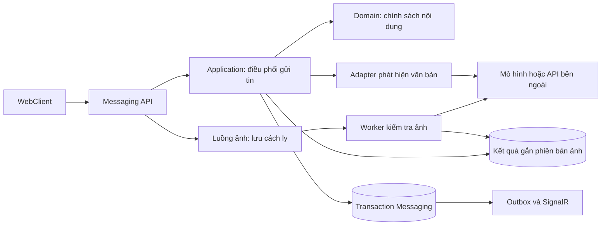

# SCDC — Phát hiện hình ảnh và tin nhắn nhạy cảm trong Messaging

Tài liệu đề xuất cách phát hiện nội dung có nguy cơ gây hại trong văn bản và ảnh gửi qua Messaging. Mục tiêu là hỗ trợ quyết định hiển thị nội dung, đồng thời giữ đúng quyền truy cập, transaction, chống gửi trùng và độ tin cậy của hệ thống.

**Trạng thái — 2026-11-28:** bản đề xuất để thảo luận, chưa triển khai, chưa chọn mô hình hoặc nhà cung cấp và chưa bổ sung vào điều kiện nghiệm thu v1. Các thiết kế bên dưới chưa phải quyết định đã chốt. Việc phát hiện và chính sách xử lý là hai phần riêng.

<a id="current"></a>

## 1. Hiện trạng và mục tiêu

Messaging trên `main` đang có DM văn bản, lịch sử, sửa/xóa tin, chống gửi trùng, SignalR và outbox. Phần [gửi file](../files/README.md) chưa có implementation; vì vậy phát hiện ảnh cần hoàn thiện tải lên, lưu trữ, metadata và kiểm soát tải xuống trước.

Tính năng đề xuất áp dụng cho DM trước. Tin phòng có ACL Community và chat nhóm được xem xét khi các luồng tương ứng đã tích hợp; không suy rằng chúng đã có trên `main` từ thiết kế này. Thoại, video và chia sẻ màn hình trực tiếp không thuộc phạm vi trang này.

Mục tiêu của đợt đầu:

- Phân loại từng bản nội dung trước khi công bố cho người nhận.
- Trả kết quả có cấu trúc, có phiên bản và có thể đối chiếu khi gửi lại.
- Phân biệt nội dung bị chính sách từ chối, nội dung chưa đủ cơ sở kết luận và lỗi kỹ thuật.
- Đo khả năng nhận diện tiếng Việt, độ trễ và chi phí trên dữ liệu thử trước khi bật xử lý tự động.

Không cam kết mô hình phát hiện đúng mọi trường hợp. Kết quả phân loại không tự cấp quyền đọc tin, khóa tài khoản hoặc thay đổi vai trò Community.

<a id="categories"></a>

## 2. “Nhạy cảm” cần được định nghĩa bằng chính sách

Các nhóm dưới đây là danh sách xem xét, không phải toàn bộ đều bị chặn. Một tin có thể thuộc nhiều nhóm.

| Nhóm đề xuất | Đầu vào cần xem xét | Điểm cần phân biệt |
|---|---|---|
| Nội dung tình dục, khỏa thân | Văn bản, ảnh | Nội dung trực diện với ngữ cảnh y tế hoặc giáo dục |
| Bạo lực, hình ảnh thương tích | Văn bản, ảnh | Mô tả hoặc ảnh đồ họa với tin tức, tác phẩm và thảo luận thông thường |
| Thù ghét và đe dọa | Văn bản, chữ trong ảnh | Đối tượng bị nhắm tới, lời đe dọa và ngữ cảnh trích dẫn |
| Quấy rối, xúc phạm | Văn bản, chữ trong ảnh | Tiếng lóng, cách xưng hô, đùa giữa bạn bè và công kích người khác |
| Tự gây hại | Văn bản, ảnh | Nội dung khuyến khích/hướng dẫn với chia sẻ trải nghiệm, tìm hỗ trợ hoặc phòng ngừa |
| Thông tin riêng tư, bí mật | Văn bản, chữ trong ảnh | Số liên hệ, thông tin định danh hoặc khóa truy cập; cần bộ phát hiện riêng, không mặc định mô hình nội dung gây hại có hỗ trợ |

Không dùng một danh sách từ cấm làm kết luận duy nhất cho mọi ngữ cảnh. Ảnh có chữ cần xem cả nội dung hình ảnh và văn bản trích xuất; OCR là một tín hiệu, không thay cho phân tích ảnh.

Đề xuất tách kết quả thành hai mức:

| Kết quả phát hiện | Ý nghĩa |
|---|---|
| `completed` | Đã phân tích đủ các đầu vào và nhóm mà chính sách yêu cầu; trả nhãn và điểm theo từng nhóm |
| `inconclusive` | Thiếu tín hiệu, nhóm không được hỗ trợ hoặc kết quả không đủ cơ sở áp dụng chính sách |
| `unavailable` | Timeout, hết hạn mức, lỗi mô hình hoặc lỗi đầu vào kỹ thuật; không kết luận nội dung vi phạm |

Sau đó policy của ứng dụng mới chọn `allow`, `hold` hoặc `reject`. Ngưỡng theo từng nhóm phải được đánh giá trên dữ liệu thử; điểm của hai mô hình không được coi là tương đương. Chính sách cảnh báo, làm mờ và cho phép người dùng xác nhận xem còn cần chốt.

<a id="architecture"></a>

## 3. Vị trí trong kiến trúc và tổ chức mã nguồn

Đề xuất bắt đầu bằng worker và adapter thuộc Messaging, giữ bốn service nghiệp vụ hiện có. Mô hình không sở hữu message, không truy cập database Identity/Community và không tự phát SignalR. Việc tách một service suy luận riêng chỉ được xem xét khi có nhu cầu triển khai hoặc tài nguyên riêng; không phải điều kiện để có tính năng này.



Đây là sơ đồ đề xuất sau khi Messaging được tổ chức theo owner; không mô tả toàn bộ code đã tồn tại.

```text
services/Messaging/
├── SCDC.Messaging.Api/
│   ├── Controllers/                 # Gửi tin, tải ảnh và đọc trạng thái
│   └── Realtime/                    # Chuyển sự kiện đã commit tới client
├── SCDC.Messaging.Application/
│   ├── Messages/SendMessage/        # Kiểm tra nội dung, quyền và tạo tin
│   ├── Messages/EditMessage/        # Kiểm tra bản sửa trước khi thay thế
│   ├── Moderation/CheckAttachment/  # Điều phối kiểm tra ảnh
│   └── Abstractions/               # Cổng detector, storage và transaction
├── SCDC.Messaging.Domain/
│   └── Moderation/                 # Nhãn, kết quả và policy thuần .NET
└── SCDC.Messaging.Infrastructure/
    ├── Moderation/                 # Adapter mô hình, OCR và ánh xạ kết quả
    ├── Workers/                    # Lease, retry và tiếp tục sau restart
    ├── Attachments/                # Đọc ảnh cách ly bằng quyền nội bộ
    └── Persistence/                # Kết quả, job và outbox
```

Application quyết định gọi detector lúc nào, dùng kết quả nào và có tiếp tục gửi tin hay không. Infrastructure thực hiện HTTP/SDK, đọc byte ảnh, SQL và cơ chế retry. Domain áp dụng policy lên các kết quả đã chuẩn hóa; không phụ thuộc DTO hoặc tên nhãn riêng của nhà cung cấp. Có thể tái sử dụng các cổng permit hiện có, không cần tạo interface bọc lại từng lớp chỉ để đổi tên.

Ảnh đính kèm tin nhắn không tự thuộc Media control; service đó đang chịu trách nhiệm cuộc gọi và phòng thoại. Quyền sở hữu file phải được chốt cùng [thiết kế gửi file](../files/README.md).

<a id="text-flow"></a>

## 4. Luồng đề xuất cho văn bản

Đợt đầu đề xuất kiểm tra văn bản trong request gửi tin, trước transaction ghi message. Ảnh được chuẩn bị và kiểm tra bất đồng bộ trước khi người dùng gửi tin chứa ảnh. Cách này giữ ý nghĩa hiện tại của phản hồi gửi thành công: tin đã được lưu và đủ điều kiện công bố.

1. API xác thực actor. Application kiểm tra đầu vào theo [quy tắc văn bản](text-policy.md) và kiểm tra sơ bộ quyền đối với cuộc trò chuyện.
2. Kiểm tra thao tác gửi đã hoàn tất hay chưa bằng quyền hiện tại. Nếu đã commit, xác minh khóa/nội dung và trả trạng thái hiện hành theo hợp đồng gửi lại; không tự quét lại rồi thay kết quả thao tác cũ.
3. Với thao tác mới, gọi detector ngoài transaction. Đầu vào gồm văn bản đúng bản chuẩn hóa sẽ lưu và kết quả ảnh tương ứng nếu có. Nếu cần phân tích chung ảnh với chú thích, kết quả phải gắn với cả hai đầu vào.
4. Áp dụng policy. `reject` trả mã lý do cố định; `hold` chưa công bố nội dung; lỗi kỹ thuật trả trạng thái không thể kiểm tra. Không tự coi timeout là nội dung được phép.
5. Khi được phép, xin permit đúng mục đích của thao tác rồi mở transaction Messaging. Không giữ permit ngắn hạn hoặc khóa database trong lúc chờ mô hình.
6. Trong transaction, kiểm fence và quyền hiện tại, tra lại SendOperation để xử lý tranh chấp, kiểm lại phiên bản và trạng thái ảnh, rồi ghi message, sequence, SendOperation, tham chiếu ảnh, quyết định áp dụng và outbox cùng lúc.
7. Chỉ sau commit mới trả thành công và phát `MessageChanged` qua outbox. Dispatcher vẫn kiểm quyền của từng người nhận.

Nếu hai request cùng khóa cùng chạy detector, chỉ một thao tác được commit theo cơ chế hiện hành. Đợt đầu có thể phát sinh hai lần gọi mô hình; không hứa “đúng một lần” với dịch vụ bên ngoài. Tối ưu cache hoặc giành việc không được thay ràng buộc chống trùng ở database.

Phân tích đồng bộ làm tăng độ trễ request. Cần đo lại [mục tiêu chất lượng](../../system/quality.md), đặt ngân sách thời gian toàn request và deadline cho adapter. Nếu không đạt, phải thiết kế API chấp nhận thao tác đang chờ, trạng thái UI và quy trình công bố sau kiểm tra trước khi đổi sang bất đồng bộ hoàn toàn.

Worker công bố tin sau thời gian chờ không được giữ JWT hoặc tái sử dụng permit cũ. Hợp đồng Identity hiện tại chưa mặc định cho phép Messaging tiếp tục một thao tác được chấp nhận bằng context resuming; phương án đó cần thiết kế, phân quyền và kiểm thử hợp đồng riêng.

<a id="image-flow"></a>

## 5. Luồng đề xuất cho ảnh

1. Người dùng có quyền tải ảnh lên vùng lưu cách ly, chưa có URL công khai hoặc URL cho người nhận.
2. Kiểm tra loại file thực, khả năng giải mã, dung lượng và giới hạn tài nguyên. Tạo bản ảnh chuẩn hóa bất biến để kiểm tra và sử dụng khi hiển thị.
3. Ghi metadata và job kiểm tra bền. Worker nhận việc bằng lease trong transaction ngắn, sau đó gọi detector/OCR ngoài transaction.
4. Worker ghi kết quả chỉ khi attachment ID, phiên bản byte ảnh và lease token vẫn khớp. Kết quả cũ không được ghi đè kết quả của phiên bản mới.
5. UI đọc trạng thái bằng GET. Chỉ ảnh được policy cho phép mới có thể đính kèm trong request gửi tin; việc được phép không tự tạo message.
6. Khi gửi tin, Messaging kiểm lại actor, quyền cuộc trò chuyện, quyền sử dụng attachment và trạng thái ảnh. Request từ client không được tự khai `approved=true`.
7. Đường tải ảnh và thumbnail tiếp tục kiểm quyền hiện tại. Ảnh được phân loại là hợp lệ vẫn không được truy cập bằng URL đoán được hoặc sau khi mất quyền.

Theo [OWASP File Upload Cheat Sheet](https://cheatsheetseries.owasp.org/cheatsheets/File_Upload_Cheat_Sheet.html), cần kiểm tra loại file, giới hạn kích thước, dùng tên do hệ thống tạo và lưu ngoài vùng phục vụ công khai. Header `Content-Type` không đủ làm bằng chứng file an toàn. Phát hiện nội dung nhạy cảm không thay kiểm tra mã độc hoặc an toàn bộ giải mã.

Đề xuất bắt đầu với ảnh tĩnh và định dạng được cho phép rõ ràng. GIF/ảnh nhiều frame, SVG và định dạng khác chưa hỗ trợ phải bị từ chối rõ, không chỉ quét một frame rồi công bố toàn bộ. Worker chỉ đọc object do hệ thống quản lý; không tải URL tùy ý từ request người dùng.

Trong thời gian chờ, UI dùng nhãn “Đang kiểm tra ảnh”. Nếu kiểm tra thất bại, người gửi có thể yêu cầu kiểm tra lại hoặc bỏ ảnh; GET trạng thái không tự tạo tin và client không tự gửi lại POST gửi tin.

<a id="state-and-data"></a>

## 6. Trạng thái, dữ liệu và tính nhất quán

Các trạng thái sau dành cho submission/attachment đang kiểm tra, tách khỏi sequence và version của message đã công bố:

| Trạng thái đề xuất | Có thể công bố? | Hành vi |
|---|---|---|
| `pending` hoặc `checking` | Chưa | Chờ worker hoặc lời gọi detector hoàn tất |
| `approved` | Có điều kiện | Vẫn phải kiểm quyền, phiên bản nội dung và policy còn áp dụng khi gửi |
| `needs_review` | Chưa | Không đủ cơ sở kết luận; cần luồng review được chốt hoặc người gửi sửa nội dung |
| `rejected` | Không | Hiển thị mã lý do; không công bố nội dung gốc |
| `check_failed` | Chưa | Lỗi kỹ thuật; retry có giới hạn, giữ nguyên danh tính đầu vào |
| `cancelled` | Không | Bỏ hoặc xóa submission; kết quả trả về muộn không được làm sống lại |

Một bản ghi kết quả tối thiểu cần:

- `checkId`, owner, định danh nội dung và revision/phiên bản object bất biến.
- Dấu liên kết đầu vào; với văn bản dùng HMAC riêng hoặc cơ chế bảo vệ tương đương, không lưu hash không khóa của câu ngắn để tra cứu công khai.
- `detectorVersion`, `modelVersion` thực tế nếu nhà cung cấp trả về, `policyVersion`, nhóm được hỗ trợ và nhóm thực sự đã phân tích.
- Nhãn, điểm, trạng thái kỹ thuật, quyết định policy và mã lý do cố định.
- Thời điểm kiểm tra, hạn dùng kết quả, lần thử, lease token và phiên bản thay đổi trạng thái.

Cache phải phân biệt nội dung, loại đầu vào, phiên bản mô hình và policy. Cache không cấp quyền truy cập và không tiết lộ nội dung người khác qua API kiểm tra. Không dùng điểm bằng 0 của một nhóm không được hỗ trợ để suy ra nội dung an toàn.

**Sửa tin:** kiểm tra bản mới trước khi thay bản đang công bố. Bản sửa bị từ chối hoặc lỗi không ghi đè nội dung cũ. Trong transaction cuối vẫn kiểm `expectedVersion`; kết quả phân tích của bản cũ không áp dụng cho bản sửa mới hơn. Bản nháp sửa đang chờ không được xuất hiện trong lịch sử hoặc realtime của người nhận.

**Gửi lại:** đối chiếu lệnh bất biến, gồm văn bản và danh sách attachment ID/phiên bản. Nếu mở rộng fingerprint hiện tại, phải có phiên bản mới và giữ cách đọc thao tác cũ. Không chỉ đưa kết quả detector vào fingerprint rồi cho phép client thay nội dung gốc.

**Xóa và thay đổi policy:** xóa tin giữ tombstone cùng dấu chống trùng hiện hành. Quy trình rà lại lịch sử theo policy mới là một thao tác riêng có version và outbox; không để một kết quả cũ tự đổi message hoặc làm sống lại nội dung đã xóa. Nội dung lịch sử đã tồn tại chưa được coi là đã kiểm tra.

**Ảnh bỏ dở:** metadata phải phân biệt ảnh tạm và ảnh đã được message tham chiếu. Job dọn kiểm lại tham chiếu và trạng thái trước khi xóa object; việc upload thành công không đồng nghĩa ảnh đã được gửi.

<a id="technology"></a>

## 7. Phương án công nghệ để thử nghiệm

| Phương án | Cách dùng trong đề xuất | Điều phải xác minh |
|---|---|---|
| Quy tắc và danh sách mẫu | Tín hiệu phụ cho mẫu rõ ràng, định dạng hoặc bí mật kỹ thuật | Ngữ cảnh tiếng Việt, lỗi nhận diện và khả năng cập nhật |
| API phân loại được quản lý | Adapter Infrastructure gửi đầu vào và ánh xạ kết quả về kiểu nội bộ | Nhóm được hỗ trợ, quyền xử lý dữ liệu, vùng xử lý, độ trễ, hạn mức và chi phí |
| Mô hình tự host | Giữ suy luận trong môi trường kiểm soát, thay adapter mà giữ policy | Giấy phép, dữ liệu đánh giá, CPU/GPU, vận hành và cập nhật |

Ứng viên tham khảo: [OpenAI Moderation](https://developers.openai.com/api/docs/guides/moderation) hỗ trợ văn bản và ảnh nhưng không phải nhóm phân loại nào cũng hỗ trợ ảnh; ngưỡng dựa trên điểm cần được hiệu chỉnh khi mô hình thay đổi. [Azure AI Content Safety](https://learn.microsoft.com/en-us/azure/ai-services/content-safety/overview) có API phân tích văn bản và ảnh. Đây là thông tin khảo sát ngày 2026-11-28, không phải lựa chọn nhà cung cấp.

Chưa có bằng chứng ứng viên nào đạt yêu cầu tiếng Việt của SCDC. Không ghi độ chính xác, giá hoặc tốc độ cam kết trước khi đo. Không mặc định dịch toàn bộ chat sang tiếng Anh; nếu thử dịch, phải đánh giá thêm sai lệch và luồng dữ liệu.

Nếu thử mô hình sinh văn bản, nội dung tin và OCR chỉ là dữ liệu cần phân loại. Các câu yêu cầu “bỏ qua quy tắc” trong đầu vào không được trở thành lệnh hệ thống; đầu ra phải qua schema và allowlist nhãn, không được gọi công cụ hoặc trực tiếp thực hiện hành động quản trị.

<a id="failure-and-privacy"></a>

## 8. Lỗi, quyền riêng tư và quan sát

| Tình huống | Xử lý đề xuất |
|---|---|
| Detector timeout, không sẵn sàng hoặc hết hạn mức | Trả `503 CONTENT_CHECK_UNAVAILABLE` cho gửi văn bản mới; ảnh chuyển `check_failed`. Không công bố tự động |
| Policy từ chối nội dung | Trả `422 CONTENT_REJECTED` với mã nhóm được phép hiển thị, không trả raw response mô hình |
| Nội dung chưa đủ cơ sở quyết định | Trả trạng thái chờ review theo hợp đồng được chốt; không gắn nhãn “vi phạm” chỉ vì chưa kết luận |
| Ảnh chưa kiểm tra xong | Trả `409 ATTACHMENT_NOT_READY`; giữ bản nháp và cho đọc trạng thái |
| Actor mất quyền hoặc phiên hết hạn khi đang kiểm tra | Bước gửi cuối từ chối theo hợp đồng quyền hiện hành; kết quả detector không thay permit |
| Worker chết hoặc nhận việc lặp | Lease và retry tiếp tục được; kết quả lặp không tạo thêm tin, sequence hoặc sự kiện |
| Bản nội dung đổi trong lúc xử lý | Bỏ kết quả không còn khớp revision; kiểm tra bản mới |

API nhà cung cấp chỉ được bật với cấu hình rõ ràng và secret phía server. Trước khi gửi dữ liệu thật cần chốt loại dữ liệu được gửi, thời hạn nhà cung cấp giữ dữ liệu và thông báo cho người dùng. Đợt khảo sát chỉ dùng dữ liệu thử; không lấy DM hoặc ảnh riêng tư đang có làm tập thử tự động.

Log và audit dùng ID, revision, phiên bản policy/model, mã trạng thái, thời lượng và số lần thử. Không ghi nội dung tin, byte ảnh, OCR, URL ký hoặc raw response nhà cung cấp. Kết quả và dữ liệu dẫn xuất phải có quyền đọc, thời hạn lưu và cách dọn riêng; không tự áp thêm thời hạn giữ bản sao nội dung vào [chính sách dữ liệu](../../system/data-lifecycle.md).

Không cấp quyền xem DM cho chủ server chỉ vì có tính năng phát hiện. Nếu mở luồng review thủ công, phải chốt vai trò được xem, phạm vi nội dung, audit và cách phản hồi khi nhận diện nhầm trước khi triển khai.

Theo dõi độ trễ detector và toàn request, tỷ lệ lỗi, backlog, tuổi job lâu nhất, số lần retry, tỷ lệ `hold`/`reject`, chi phí theo loại đầu vào và thay đổi tỷ lệ theo phiên bản. Tách lỗi hạ tầng khỏi số nội dung bị policy từ chối.

<a id="evaluation"></a>

## 9. Đánh giá và ca kiểm thử dự kiến

Chuẩn bị tập văn bản tiếng Việt có dấu/không dấu, tiếng lóng, viết tắt, emoji, Unicode biến thể, trích dẫn và ngữ cảnh giáo dục. Ảnh thử gồm ảnh thường, chữ trong ảnh, ảnh nén hoặc mờ và định dạng không được hỗ trợ. Dữ liệu cần có quyền sử dụng, nhãn tham chiếu được rà chéo và tập kiểm tra tách khỏi tập dùng chỉnh ngưỡng; không tự thu thập hoặc lưu nội dung bất hợp pháp làm fixture.

Đo precision, recall và tỷ lệ chặn nhầm theo từng nhóm và ngôn ngữ, kèm số mẫu và confusion matrix. Không dùng một con số accuracy tổng để che nhóm có ít mẫu. Chốt ngưỡng chấp nhận và ngân sách độ trễ/chi phí trước nghiệm thu; hiện chưa có số liệu để kết luận đạt.

| Mã dự kiến | Ca cần kiểm chứng |
|---|---|
| TC-SENS-01 | Văn bản/ảnh được cho phép đi hết luồng gửi và hiển thị |
| TC-SENS-02 | Nội dung bị policy từ chối không tới lịch sử, Hub, thumbnail hoặc đường tải ảnh của người nhận |
| TC-SENS-03 | Timeout, lỗi và nhóm không được hỗ trợ không bị hiểu là kết quả an toàn |
| TC-SENS-04 | Gửi lại cùng khóa/nội dung không tạo thêm tin; đổi nội dung hoặc ảnh cùng khóa bị từ chối |
| TC-SENS-05 | Sửa tin phải kiểm bản mới; nhận diện nhầm hoặc lỗi không ghi đè bản đang công bố |
| TC-SENS-06 | Mất quyền giữa lúc phân tích, tải ảnh và commit vẫn bị chặn ở bước cuối |
| TC-SENS-07 | Kết quả cũ, job lặp và worker restart không làm sống lại submission đã hủy/xóa |
| TC-SENS-08 | Ảnh đã duyệt bị thay byte/phiên bản không được gửi bằng kết quả cũ |
| TC-SENS-09 | Kết quả và metadata riêng tư không đọc được bởi người ngoài; log không chứa nội dung |
| TC-SENS-10 | Toàn bộ văn bản và các ảnh của tin được kiểm đúng bản; chú thích và OCR có ngữ cảnh mâu thuẫn không bị bỏ qua |
| TC-SENS-11 | Policy/model mới không tự dùng lại cache cũ; rollback không tự công bố các nội dung đang chờ |
| TC-SENS-12 | Đo tải, độ trễ, hạn mức và chi phí bằng adapter thật; UI giữ bản nháp và không tự gửi lại POST |

Chạy unit test cho policy/Application, integration test với PostgreSQL/storage, lỗi giả lập ở adapter, rồi E2E qua gateway với detector thử thực tế. Mock chỉ chứng minh điều phối, không chứng minh độ chính xác mô hình hoặc độ trễ nhà cung cấp.

<a id="rollout"></a>

## 10. Trình tự triển khai đề xuất

1. Chốt nhóm nội dung, hành động và phạm vi dữ liệu; đối chiếu lại phạm vi sản phẩm và giao thức gửi tin.
2. Đánh giá offline bằng dữ liệu thử, chọn adapter và ghi phiên bản, kết quả, chi phí.
3. Tích hợp văn bản vào Application sau khi ranh giới Messaging rõ ràng; mặc định tính năng tắt, chạy trên stack thử.
4. Hoàn thiện luồng file và kiểm tra ảnh cách ly, kiểm chứng quyền từ upload tới tải xuống.
5. Kiểm thử chặn nhầm, lỗi mạng, gửi lại, sửa/xóa và tải; chỉ bật enforcement khi tiêu chí đã được xác nhận.

Khi đổi model/policy, giữ kết quả và cấu hình đủ để đối chiếu thao tác cũ. Rollback phải chỉ rõ cách xử lý nội dung đang chờ; tắt detector không tự chuyển `pending`, `needs_review` hoặc `check_failed` thành được phép.

<a id="open-questions"></a>

## 11. Còn mở trước khi triển khai

- Nhóm nào thuộc phạm vi đợt đầu, thế nào là `allow`/`hold`/`reject`, và có cần cảnh báo/làm mờ thay chặn không?
- Chỉ DM hay thêm tin phòng/chat nhóm; có đưa tính năng vào v1 hoặc đợt bổ sung nào?
- Dùng API ngoài hay mô hình tự host; dữ liệu nào được gửi, vùng xử lý và thời hạn lưu ra sao?
- Chọn bộ dữ liệu, ngưỡng từng nhóm, mức chặn nhầm chấp nhận được, deadline và ngân sách chi phí nào?
- Ai sở hữu ảnh, metadata, worker và vòng đời lưu trữ; định dạng, dung lượng và số ảnh mỗi tin là bao nhiêu?
- Có review thủ công hay không; ai có quyền xem, xử lý nhầm và trả kết quả cho người dùng?
- Hợp đồng cho `hold`, ảnh đang chờ, sửa tin và fingerprint phiên bản mới cụ thể thế nào; rollout giữa các phiên bản có tương thích không?

---

Nguồn dự án: [ranh giới service](../../system/architecture.md#boundaries), [tổ chức backend](../../system/backend.md), [vòng đời tin](message-lifecycle.md), [quy tắc văn bản](text-policy.md), [gửi file](../files/README.md), [dữ liệu](../../system/data-lifecycle.md), [chất lượng](../../system/quality.md). Chưa có mã REQ/DEC riêng cho tính năng đề xuất này.
