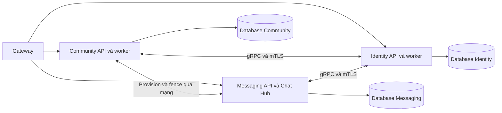

# Chuẩn bị tách Community thành service riêng

Community cần có API, worker và database riêng để triển khai độc lập với Messaging. Nền Identity đã sẵn sàng; phần cần hoàn thiện trước khi chuyển lưu lượng là giao tiếp tạo phòng và thu hồi quyền giữa Community với Messaging.

**Trạng thái:** chuẩn bị để xem xét ngày 2026-11-25, dựa trên `main@7a2a88b`. Các mục triển khai và nghiệm thu dưới đây là đầu ra cần đạt; task S3-10 chưa hoàn tất.

## Hiện trạng và mục tiêu

| Thành phần | Hiện tại trên main | Mục tiêu khi tách Community |
|---|---|---|
| Host | `SCDC.Api` đăng ký cả Community và Messaging | `SCDC.Community.Api` chạy riêng; Messaging có host của mình hoặc tạm ở host cũ trong giai đoạn chuyển tiếp |
| Tổ chức code | Một project `Modules/Community`, trộn ca sử dụng và truy cập SQL | Bốn project Api, Application, Domain, Infrastructure theo cấu trúc v1 |
| Dữ liệu | Schema `community` trong `scdc_chat`, dùng connection và role riêng | Database riêng trên instance PostgreSQL chung với Messaging; tên đề xuất `scdc_community` |
| Identity | Permit và tra cứu tài khoản đã qua gRPC/mTLS; Identity gọi fence về host chung | Giữ hợp đồng hiện hành; Identity gọi đúng endpoint Community mới |
| Messaging | Tạo phòng và cài hàng rào thu hồi quyền qua các đối tượng trong cùng tiến trình | Các adapter gRPC/mTLS gọi owner; mỗi owner chỉ mở transaction trong database của mình |
| Worker | `CommunityAccessWorker`, `ChannelProvisionWorker` chạy trong API chung | Hai worker chạy cùng tiến trình API Community |
| Gateway | Auth/users tới Identity; các route Community, DM và Hub còn tới `chat-service` | Route Community tới host mới; DM và `/hubs/chat` tới Messaging |

Nguồn code: [host hiện tại](../../../services/SCDC.Api/Program.cs), [đăng ký Community](../../../services/Modules/Community/CommunityModule.cs), [đăng ký Messaging](../../../services/Modules/Messaging/MessagingModule.cs), [gateway](../../../clients/WebClient/nginx.conf). [Cấu trúc v1](../../system/backend.md#v1-code-layout) và [bố trí database](../../system/environments.md#v1-postgres-instances) đã được chốt.

Sơ đồ đích cho ba service liên quan trực tiếp đến lần tách:



## Task liên quan

| Task | Vai trò đối với lần tách | Tình trạng và phụ thuộc |
|---|---|---|
| S3-01, S3-02, S3-03 | Checklist, Identity qua mạng và database Identity riêng | Đã hoàn tất; dùng làm nền và kinh nghiệm chuyển dữ liệu |
| S3-07 | Host Messaging riêng | Chưa ghi nhận hoàn tất; đã đủ phụ thuộc để bắt đầu |
| S3-08 | Database Messaging riêng và chuyển dữ liệu | Chờ S3-07 theo task hiện hành |
| S3-09 | Tạo phòng giữa Community và Messaging qua mạng | Chờ S3-07 theo task hiện hành; giao tiếp này cần có khi hai host tách nhau |
| S3-10 | Tách phần Community còn lại, host và database riêng | Task chính; hiện phụ thuộc S3-03, S3-08, S3-09 |
| E4-06 | Rà quy tắc Community và phần nghiệp vụ còn thiếu | Có thể làm song song; giữ nguyên các quy tắc đã chốt trong lần tách |
| S3-11, S3-12 | Rà giao tiếp nội bộ và nghiệm thu STEP-3 | Identity đã có gRPC/mTLS. S3-11 là task có điều kiện; S3-12 nghiệm thu cả bốn service |

Phân công hiện hành: Vg làm S3-09/S3-10, Sáng kiểm tra; Sáng làm S3-07/S3-08, Vg kiểm tra. Nguồn phân công và phạm vi: [kế hoạch](../../project/planning.md#team), [task STEP-3](../../project/tasks/step-3.md), [E4-06](../../project/tasks/step-4-early.md#e4-06--rà-quy-tắc-community-theo-các-quyết-định-đã-chốt).

## Phạm vi lần tách

Giữ các hành vi đang có: tạo, xem, tìm và tham gia server; vai trò, gán vai trò; tạo và xem phòng chữ; ACL; trạng thái thao tác đang xử lý. Chuyển các controller, worker và tiến trình điều phối đi cùng dữ liệu mà chúng sở hữu.

API công khai giữ các đường dẫn Community hiện hành dưới `/api/v1/servers`, gồm route tìm kiếm, thành viên, vai trò, phòng và `access-operations`. Cần giữ cách phân biệt 403/404, version, membership ID, cursor, khóa chống trùng và phản hồi 202 khi chưa hoàn tất.

Các tính năng mở rộng tiếp tục ở STEP-4: duyệt tham gia, lời mời, chuyển chủ/rời server và xóa phòng thuộc COM-W08 đến COM-W11; tin phòng và realtime thuộc Messaging; phòng thoại thuộc Media. Lần tách bảo toàn cả các bảng đã có nhưng chưa có đầy đủ nghiệp vụ, như `invites` và `bans`.

## Giao tiếp cần hoàn thiện

| Luồng | Code hiện tại | Phần cần chuẩn bị cho host riêng |
|---|---|---|
| Community → Identity | `IIdentityPermitIssuer`, `IUserDirectory` đã có adapter từ S3-02 | Cấu hình peer Community, endpoint, chứng chỉ, deadline và quyền RPC cụ thể |
| Identity → Community | `CommunityIdentityFenceEndpoint` nhận fence Identity trong API chung | Chuyển endpoint về Community; cập nhật endpoint và ánh xạ peer/owner bên Identity |
| Community → Messaging khi tạo phòng | `ChannelProvisionCoordinator` nhận `IChannelProvisioning` do module Messaging đăng ký | Adapter và handler mạng cho Prepare, Confirm, Cancel, Get; giữ operation ID, fingerprint, phiên bản quyết định và cơ chế tiếp tục sau restart |
| Community → Messaging khi thu hồi quyền | `CommunityPolicyCoordinator` lấy cả hai `ICommunityFenceOwner`; owner Messaging mở connection của Messaging ngay trong tiến trình chung | Giữ owner Community cục bộ; owner Messaging phải gọi mạng và nhận receipt sau commit |
| Permit xác nhận phòng sẵn sàng | Có `IChannelReadyPermitIssuer` và `IChannelProvisioning.ActivateAsync` trong hợp đồng .NET | Chốt phần cần dùng trong lần tách và phần dành cho tin phòng STEP-4; đối chiếu kiểu dữ liệu và danh tính RPC |

Hai điểm cần giải quyết khi thiết kế hợp đồng:

- [Proto Messaging](../../contracts/grpc/messaging/coordination.proto) đã mô tả Prepare, Confirm, Cancel, Get, nhưng chưa có Activate như hợp đồng .NET. Host hiện tại chưa map dịch vụ ChannelProvisioning qua gRPC.
- Fence gRPC đang map là fence do **Identity** phát. `CommunityFenceBatch` chứa scope quyền Community chưa có đầy đủ RPC tương ứng; cần thiết kế riêng phần cài hàng rào quyền Community tại Messaging. Có file proto và project mã sinh chưa đồng nghĩa luồng này đã chạy qua mạng.

Mỗi lời gọi giữ deadline và ID chống trùng theo [hợp đồng hiện hành](../../system/backend.md#s2-10--hợp-đồng-giữa-module). RPC chạy ngoài transaction đang nhận thay đổi; khi mất phản hồi, worker đối chiếu cùng operation thay vì tạo thao tác khác. Chỉ xác nhận thu hồi sau khi owner đã ghi receipt bền.

Danh tính service được xác minh bằng mTLS và giới hạn quyền theo RPC. `ChannelReadyPermitIssuer` hiện xin permit dành cho owner Messaging; thiết kế phải giải quyết rõ đường cấp permit này khi Community có danh tính riêng, thay vì suy quyền từ owner trong payload.

Nguồn: [coordinator tạo phòng](../../../services/Modules/Community/Infrastructure/ChannelProvisionCoordinator.cs), [coordinator quyền](../../../services/Modules/Community/Infrastructure/Access/CommunityPolicyCoordinator.cs), [hợp đồng provision](../../../services/SCDC.Contracts/Messaging/ChannelProvisioning.cs), [hợp đồng fence Community](../../../services/SCDC.Contracts/Community/AccessCoordination.cs), [issuer phòng sẵn sàng](../../../services/Modules/Community/Infrastructure/ChannelReadyPermitIssuer.cs).

## Code và dữ liệu cần chuyển

```text
services/Community/
  SCDC.Community.Api/             HTTP, gRPC, worker, health, bootstrap
  SCDC.Community.Application/     Ca sử dụng và interface cần dùng
  SCDC.Community.Domain/          Trạng thái, quy tắc và quyền
  SCDC.Community.Infrastructure/  SQL, cursor, outbox, adapter gọi mạng
  SCDC.Community.Grpc/            Project hợp đồng đã có
```

Một số ca sử dụng hiện gọi trực tiếp Npgsql và `RelationalWorkScope`. Cần đưa truy cập dữ liệu vào Infrastructure qua interface; Application và Domain giữ chiều phụ thuộc đã chốt. Các project Community không tham chiếu implementation của Messaging hay Identity.

| Nhóm dữ liệu | Phần cần giữ khi chuyển |
|---|---|
| Server và thành viên | `servers`, `server_members`, `invites`, `bans`; giữ ID, owner, membership ID, trạng thái, version và timestamp |
| Vai trò và quyền | `roles`, `permissions`, `role_permissions`, `member_roles`, `channel_role_overrides`, `channel_user_overrides` |
| Phòng và chống trùng | `channels`, `operations`, `channel_provisions`; giữ quan hệ channel/space ID, fingerprint và quyết định đang xử lý |
| Thu hồi và đồng bộ | `access_scopes`, `access_changes`, `access_change_acks`, `access_fences`, `fence_receipts`, outbox và inbox của Community |
| Catalog và migration | Ledger `community.schema_migrations`, constraint, index, trigger, helper, sequence, owner và quyền runtime |

STEP-2 đã bỏ khóa ngoại chéo và chuyển helper về owner. Bộ chuyển Community phải kiểm tra catalog nguồn sau các migration này; không chạy lại toàn bộ migration lịch sử hay sao chép schema của bản MVP cũ. Số dòng và hash theo từng bảng được chốt trên bản sao thực tế trước khi mở writer đích.

Giữ volume key ring Community, application name theo môi trường, purpose cursor và khóa HMAC của thao tác. Consumer giữ quyền đọc Redis; Identity tiếp tục là bên công bố trạng thái phiên. Công cụ chuyển Identity hiện chuyên cho Identity; Community cần phần preflight, baseline, chuyển và đối chiếu riêng theo cùng checklist.

## Trình tự triển khai đề xuất

1. **Chốt giao tiếp Community–Messaging.** Đối chiếu interface .NET với proto, phạm vi Activate, fence quyền và danh tính RPC; xác định endpoint khi Messaging còn ở host cũ.
2. **Dựng bốn project Community.** Phân tách ca sử dụng khỏi SQL, chuyển controller và worker, giữ route và hành vi hiện có. Host mới chưa nhận lưu lượng thật.
3. **Hoàn thiện adapter và cấu hình.** Nối Identity, provision và fence qua mạng; thêm chứng chỉ, secret file, health/readiness, Swagger và telemetry Community. Ngừng đăng ký owner từ module khác trong host Community.
4. **Chuẩn bị database và công cụ chuyển.** Tạo baseline Community riêng, role và quyền owner, manifest đối chiếu; bảo toàn công việc đang xử lý và khóa. Chạy migration như bước riêng trước API.
5. **Diễn tập trên dữ liệu thử.** Chạy các host thật, thử lỗi mạng và restart, kiểm tra API/DM cũ, thu hồi và hai nhánh phục hồi.
6. **Chuyển dev sau khi diễn tập đạt.** Đóng writer và worker nguồn Community; chuyển và đối chiếu dữ liệu; đổi endpoint RPC và gateway; bật đúng writer đích rồi kiểm chứng.
7. **Ghi nghiệm thu.** Ghi kết quả EX-00 đến EX-08, cập nhật S3-10 và tài liệu vận hành theo phần đã kiểm chứng.

Theo phụ thuộc hiện hành, S3-10 nhận lưu lượng sau S3-08/S3-09. Có thể chuẩn bị cấu trúc code và hợp đồng Community ngay song song với S3-07. Nếu muốn **Community chạy độc lập trước Messaging**, Messaging có thể tạm ở `SCDC.Api`, nhưng phải cung cấp provision và fence qua mạng, đồng thời cập nhật phụ thuộc task theo phương án đó; không cần đợi host Messaging đổi tên mới thiết kế được các adapter.

## Tiêu chí nghiệm thu lần tách

- Community build, khởi động và restart độc lập; chỉ có connection và quyền runtime tới database mình sở hữu. Application/Domain không phụ thuộc framework lưu trữ hay implementation service khác.
- Hồi quy API và browser Community đạt, gồm tìm kiếm, tham gia, vai trò, phòng, ACL, 403/404, thao tác trùng và phản hồi chưa rõ kết quả. DM và `/hubs/chat` tiếp tục qua gateway đúng owner.
- Tạo phòng qua hai host thật không sinh thêm space khi gửi lại, mất phản hồi sau commit, hủy hoặc restart worker. Dữ liệu provision và trạng thái cuối không lùi.
- Thu hồi Identity vẫn tới cả Community và Messaging. Thay đổi quyền Community ghi đủ fence/receipt; thu hồi HTTP và các kết nối thuộc phạm vi triển khai đạt yêu cầu 5 giây. Phần realtime tin phòng tương lai tiếp tục nghiệm thu ở COM-W05.
- Tắt Community không làm DM ngừng hoạt động khi Identity và Messaging còn sẵn sàng. Khi Messaging mất kết nối, Community vẫn đọc được phần độc lập; các thao tác cần Messaging giữ trạng thái chưa hoàn tất và tiếp tục đúng khi khôi phục.
- Token, phiên, cursor và dữ liệu cũ tiếp tục dùng đúng quyền; đối chiếu catalog, ID, giá trị, hash, version/epoch, ledger và công việc dở dang đạt trước khi mở ghi.
- Có diễn tập phục hồi trước và sau mốc đích bắt đầu ghi. Sau khi đích đã ghi hoặc chưa xác định được, giữ nguồn cũ đóng ghi và xử lý chênh lệch trước khi quay lại; đổi route không tự đồng bộ database ngược.

Các bộ kiểm thử hiện có để mở rộng: [test Community](../../../tests/SCDC.Api.Tests/Community), [test host Identity qua mạng](../../../tests/SCDC.Api.Tests/Infrastructure/IdentityNetworkTests.cs), [browser Community](../../../clients/WebClient/e2e/community.spec.js), [browser DM](../../../clients/WebClient/e2e/dm-mvp/mvp.spec.js). Áp dụng [checklist tách service](../../guides/operations.md#service-extraction) và [mẫu hồ sơ](../templates/service-extraction.md) cho kết quả thực tế.

## Điểm cần chốt khi xem xét

| Nội dung | Đề xuất để triển khai |
|---|---|
| Thứ tự | Chuẩn bị Community ngay; chốt nhận lưu lượng theo thứ tự hiện hành hay trước khi Messaging có host riêng |
| Phạm vi hợp đồng | Hoàn thiện provision và fence cho các luồng hiện hành; xác định rõ Activate và permit nào thuộc lần tách, phần nào thuộc STEP-4 |
| Tên và định tuyến | Dự kiến `community-service`, database `scdc_community`; giữ URL công khai, bổ sung health và Swagger phân biệt theo service |
| Phối hợp | Vg và Sáng thống nhất chủ sở hữu các adapter và thứ tự merge; ước lượng sau khi chốt phạm vi RPC và công cụ chuyển |

Nguồn: [STEP-3](../../project/tasks/step-3.md), [STEP-4](../../project/tasks/step-4.md), [E4-06](../../project/tasks/step-4-early.md), [D12, D40, D43, D47](../../system/backend.md), [D02 và D48–D52](../../system/database.md), [D03](../../system/environments.md#v1-postgres-instances), [baseline S3-03](../verification/architecture/s3-03-2026-11-25.md).
