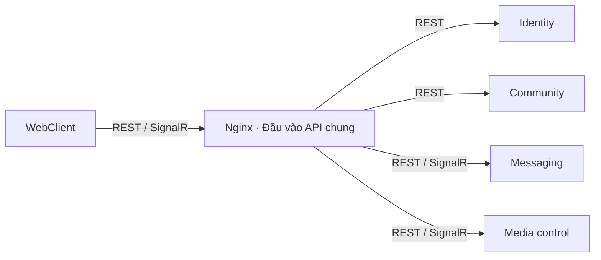

# SCDC — Quy ước API

Nguồn chung cho giao thức API, lỗi và hợp đồng máy đọc. Quyền và nghiệp vụ cụ thể nằm trong từng chủ đề.

<a id="contracts"></a>

<a id="3-hợp-đồng-và-lỗi-chung"></a>

## 3. Hợp đồng và lỗi chung

API hiện tại dùng prefix `/api/v1`. ID dùng định danh ổn định; actor lấy từ phiên xác thực. Thời điểm truyền theo UTC. Hợp đồng DM đề xuất truyền `sequence`/`version` dưới dạng chuỗi số nguyên để client xử lý chính xác.

Theo DEC-061, lỗi dùng `application/problem+json` với các trường `type`, `title`, `status`, `detail`, `instance`, `errorCode`, `traceId`; lỗi validation có thêm `errors`. Các trường mở rộng xuất hiện ở cấp ngoài cùng, không nằm trong object `extensions`.

```json
{
  "type": "https://scdc.dev/problems/validation",
  "title": "Validation failed.",
  "status": 400,
  "detail": "One or more validation errors occurred.",
  "instance": "/api/v1/auth/register",
  "errorCode": "Common.ValidationFailed",
  "traceId": "example-trace-id",
  "errors": { "username": ["Username is required."] }
}
```

| HTTP | Ý nghĩa và cách dùng |
|---|---|
| 400 | Validation đầu vào theo `ErrorType.Validation` hiện tại |
| 401 | Thiếu hoặc không còn phiên hợp lệ; cần xác thực lại |
| 403 | Không đủ quyền/điều kiện cho thao tác được phép biết |
| 404 | Không tồn tại; hợp đồng DM đề xuất cũng dùng cho tài nguyên người gọi không được biết |
| 409 | Xung đột dữ liệu, phiên bản hoặc khóa thao tác |
| 429 | Vượt giới hạn / bị khóa tạm; chi tiết retry của endpoint tương lai cần đặc tả |
| 503 | Phụ thuộc tạm không đáp ứng |

Hợp đồng đề xuất DM áp dụng cùng ánh xạ validation 400 này; các mã lỗi DM còn cần rà soát trước triển khai. Client xử lý theo `errorCode` và `errors`, không phụ thuộc câu chữ `detail`. Không đưa stack trace, mật khẩu, token hoặc nội dung chat vào response lỗi hay log.

OpenAPI cho endpoint đã triển khai được sinh từ source: `/swagger/v1/swagger.json` trong môi trường Development; UI tại `/swagger`. Hợp đồng tương lai vẫn được đánh dấu đề xuất trong đặc tả tính năng, chưa coi là endpoint có thể gọi. Thay đổi schema phải cập nhật frontend, backend, mock, docs và dữ liệu thử liên quan.

Nguồn: [ApiProblemDetails](../../services/SCDC.Api/Errors/ApiProblemDetails.cs), [ApiErrorMapper](../../services/SCDC.Api/Errors/ApiErrorMapper.cs), [ApiErrorDefaults](../../services/SCDC.Api/Errors/ApiErrorDefaults.cs).

<a id="v1-internal-protocol"></a>

## D04 — Giao thức gọi nội bộ đồng bộ

Trạng thái: đã xác nhận phương án B ngày 2026-10-11 — [DEC-122](../records/decisions/README.md#dec-122). Những lời gọi trực tiếp giữa bốn service nghiệp vụ v1 cần request–response dùng gRPC + Protobuf: bên gọi chờ kết quả từ bên nhận.

| Nội dung | Lựa chọn |
|---|---|
| Giao thức | gRPC trên HTTP/2 |
| Hợp đồng và định dạng | `.proto`, Protobuf |
| Client nội bộ | Sinh mã từ hợp đồng `.proto`; vị trí nguồn đã chọn tại [D46](#v1-grpc-contract-sources), project hợp đồng và project reference tại [D47](backend.md#v1-grpc-code-generation); version còn cần thiết kế |

Lợi ích là hợp đồng kiểu dữ liệu, mã client sinh tự động và payload nhị phân gọn. Đánh đổi là bổ sung tooling `.proto`/generated code và cấu hình HTTP/2 bên cạnh API HTTP hiện có. Chưa có kết quả đo hiệu năng cho cấu hình v1. Nguồn đặc điểm giao thức: [Microsoft — gRPC và HTTP API](https://learn.microsoft.com/en-us/aspnet/core/grpc/comparison?view=aspnetcore-10.0).

API phía WebClient giữ các lựa chọn REST/SignalR đã xác nhận tại DEC-081. Tích hợp provider và webhook theo hợp đồng của provider, chưa được D04 chuyển sang gRPC. Luồng nghiệp vụ cụ thể xác định trong từng chủ đề; sự kiện sau commit dùng outbox/worker và gRPC theo [D27](#v1-integration-event-transport), chưa thêm broker trong cấu hình ban đầu. Endpoint, timeout/retry và cơ chế nhất quán chi tiết cần thiết kế riêng. Xác thực danh tính service dùng mTLS theo [D20](#v1-service-authentication); cấu hình và quyền gọi RPC cần thiết kế chi tiết. Ánh xạ status/lỗi nghiệp vụ gRPC chưa chốt; ProblemDetails ở trên là hợp đồng HTTP.

[D07 — truyền lệnh thu hồi](access-revocation.md#v1-revocation-transport) đã chốt gRPC trực tiếp cho yêu cầu cài hàng rào và kết quả xác nhận theo DEC-126. Các luồng khác tiếp tục xác định trong tài liệu chủ đề; cơ chế chuyển sự kiện sau commit đã xác nhận riêng tại [D27](#v1-integration-event-transport).

Giao thức không tự thay được transaction/guard giữa các module trong MVP. Hợp đồng mạng phải được thiết kế riêng cho quyền tới commit, lỗi mạng và ngưỡng thu hồi theo [thu hồi truy cập](access-revocation.md); một lần kiểm tra HTTP hoặc gRPC không tự đáp ứng các yêu cầu đó. Xác thực danh tính service theo [D20](#v1-service-authentication). Nguồn phân biệt request–response với sự kiện và lỗi liên service: [Microsoft — giao tiếp microservice](https://learn.microsoft.com/en-us/azure/architecture/microservices/design/interservice-communication).

<a id="v1-grpc-contract-sources"></a>

## D46 — Vị trí nguồn hợp đồng gRPC

Trạng thái: đã chọn phương án A ngày 2026-10-12 theo ủy quyền của người dùng — [DEC-164](../records/decisions/README.md#dec-164). Nguồn `.proto` nội bộ giữa bốn service theo D04/D27 tập trung tại `docs/contracts/grpc/`, chia theo service triển khai endpoint RPC. Project hợp đồng và cách cấp mã C# đã chọn tại [D47](backend.md#v1-grpc-code-generation). Hợp đồng SMTP/LiveKit/provider giữ theo bên cung cấp.

File `.proto` mô tả phương thức RPC và cấu trúc thông điệp, dùng làm nguồn sinh mã client/server. Mỗi hợp đồng có một nguồn chỉnh sửa; bên gọi không duy trì bản sao riêng. Nguồn: [Microsoft — gRPC services](https://learn.microsoft.com/en-us/aspnet/core/grpc/basics?view=aspnetcore-10.0).

| Nội dung | A — Tập trung theo service trong danh mục hợp đồng | B — Đặt cạnh mã của service cung cấp RPC |
|---|---|---|
| Đường dẫn mục tiêu | `docs/contracts/grpc/{identity,community,messaging,media}/` | `services/{Identity,Community,Messaging,Media}/Protos/` |
| Lợi ích | Tìm và review hợp đồng liên service tại một nơi, cùng danh mục OpenAPI/JSON Schema hiện có | Hợp đồng gần mã triển khai, thuận tiện nếu tách repository theo service về sau |
| Bất lợi | Build cần lấy nguồn schema ngoài thư mục mã service | Nguồn hợp đồng nằm tại nhiều thư mục service; bên gọi cần tham chiếu đúng vị trí |

Chọn A để giữ nguồn hợp đồng tại [danh mục máy đọc](../contracts/README.md) hiện có và thuận tiện rà soát giao tiếp liên service. Đánh đổi là build cần tham chiếu schema ngoài thư mục mã service. Cây thư mục mục tiêu:

```text
docs/contracts/grpc/
├── identity/
├── community/
├── messaging/
└── media/
```

Mỗi nhóm do service triển khai endpoint RPC duy trì, bên gọi cùng review thay đổi. Thư mục chung không chia sẻ domain model hoặc quyền sở hữu dữ liệu giữa service.

Với [D27](#v1-integration-event-transport), RPC nhận sự kiện Community → Messaging thuộc nhóm Messaging; Community vẫn sở hữu ý nghĩa nghiệp vụ của sự kiện do mình phát. Schema sự kiện, envelope và cách import cần thiết kế riêng; vị trí RPC không chuyển quyền sở hữu nghiệp vụ.

[Danh mục hợp đồng](../contracts/README.md) dẫn tới nguồn `.proto` khi được tạo, không chứa thêm bản chỉnh sửa riêng. Hành vi, quyền và ngoại lệ giữ trong tài liệu chủ đề; schema máy đọc giữ tại nguồn hợp đồng. `Protos/` trong phương án B đã so sánh chỉ là thư mục nguồn, không mặc định thêm project.

D46 chỉ xác nhận vị trí nguồn và trách nhiệm duy trì hợp đồng; project hợp đồng và cách cấp mã C# đã chọn riêng tại [D47](backend.md#v1-grpc-code-generation). Công cụ/phiên bản sinh mã, namespace, versioning, CI và phương thức/trường cụ thể cần thiết kế tiếp. [D44](backend.md#v1-shared-library-distribution) không áp cho hợp đồng/mã sinh; kiểu Protobuf giữ ngoài Domain, hợp đồng Application và `SCDC.Shared.Core` theo [D43/D45](backend.md#v1-code-layout). Chưa tạo thư mục, `.proto`, project hoặc cấu hình.

<a id="v1-integration-event-transport"></a>

## D27 — Chuyển sự kiện sau commit bằng gRPC

Trạng thái: đã xác nhận phương án A ngày 2026-10-12 — [DEC-145](../records/decisions/README.md#dec-145). Sự kiện sau commit đi từ outbox qua worker của owner, chuyển bằng gRPC tới service nhận; chưa bổ sung broker trong cấu hình v1 ban đầu.

[D04](#v1-internal-protocol) đã chọn gRPC + Protobuf cho lời gọi trực tiếp cần request–response. D27 dùng giao thức đó cho việc bàn giao sự kiện nền, xác thực service bằng mTLS theo [D20](#v1-service-authentication).

Nhu cầu cụ thể đã có trong [đặc tả realtime Community](../features/messaging/channel-messaging.md#channel-messaging): Community sở hữu thay đổi cộng đồng/thành viên/yêu cầu/lời mời, còn Messaging phát thông báo qua ChatHub. Cần đường chuyển thông tin Community → Messaging khi tách service. Các thông báo browser `CommunityChanged`, `MembershipChanged`, `JoinRequestChanged` và `MemberInvitationChanged` giữ hợp đồng hiện có; tên/schema sự kiện nội bộ v1 chưa chốt. Đặc tả này chưa chứng minh dispatcher đã có runtime.

| Bước | Yêu cầu |
|---|---|
| Lưu sự kiện | Dữ liệu nghiệp vụ và outbox cùng commit trong DB owner |
| Chuyển nền | Worker owner đọc outbox của mình, lưu tiến độ theo bên nhận và gọi gRPC; chạy cùng API theo D12 |
| Xác nhận nhận | Service nhận kiểm tra danh tính/quyền gọi và chỉ xác nhận sau khi lưu bền sự kiện hoặc công việc cần xử lý trong DB mình |
| Mất xác nhận | Worker thử lại cùng định danh sự kiện; bên nhận chống xử lý trùng, tiến độ gửi không dựa vào bộ nhớ tiến trình |
| Xử lý/phát thông báo | Service nhận xử lý từ dữ liệu đã lưu; Messaging kiểm tra quyền hiện hành trước phát tới connection |

Lựa chọn giảm thành phần vận hành trên hạ tầng một máy, tận dụng gRPC/mTLS đã chọn. Đánh đổi là nhóm tự quản lý danh sách bên nhận, giao nhận bền, thử lại và lỗi từng phần. Tách lớp vận chuyển khỏi xử lý sự kiện để có thể chuyển sang broker về sau; chưa chọn sản phẩm hoặc quy trình chuyển. Nguồn so sánh giao tiếp: [Microsoft — giao tiếp microservice](https://learn.microsoft.com/en-us/azure/architecture/microservices/design/interservice-communication).

Việc bàn giao sự kiện xử lý nền sau commit, không yêu cầu HTTP nghiệp vụ chờ bàn giao hoàn tất. Mỗi lần gọi gRPC vẫn chờ xác nhận nhận bền; xác nhận này không có nghĩa công việc đã xử lý xong hoặc trình duyệt đã nhận thông báo. Timeout/mất xác nhận không chứng minh bên nhận chưa lưu. Cần thiết kế định danh/version, xử lý trùng/đảo thứ tự, lỗi không thể xử lý, lượng chờ và đối soát sau restart. Service chỉ đọc/ghi DB mình.

D27 không thay [D07 — truyền lệnh hàng rào](access-revocation.md#v1-revocation-transport), [D16 — chuẩn bị phòng](../features/community/channels.md#v1-channel-preparation-transport) hoặc [D08 — ghi tin trực tiếp](../features/messaging/message-lifecycle.md#v1-message-intake). Sự kiện không thay cơ chế giữ quyền tới commit hoặc chứng minh cutoff 5 giây. Job email và outbox → Hub trong cùng owner không tự thuộc transport liên service này.

Danh mục sự kiện/consumer đầy đủ, schema/`.proto`, quyền gọi chi tiết, cơ chế lưu nhận/chống trùng, ordering, retry/backlog/retention và cách chuyển transport chưa chốt. Chưa thay hợp đồng máy đọc, code hoặc cấu hình.

<a id="v1-service-authentication"></a>

## D20 — Xác thực danh tính service

Trạng thái: đã xác nhận phương án A ngày 2026-10-11 — [DEC-138](../records/decisions/README.md#dec-138). Lời gọi gRPC giữa bốn service nghiệp vụ v1 dùng mTLS để xác thực hai chiều và mã hóa đường truyền, gồm các lời gọi từ API và worker.

| Nội dung | Yêu cầu |
|---|---|
| Danh tính service | Mỗi service có chứng chỉ và khóa riêng; danh tính cụ thể còn cần thiết kế |
| Xác minh kết nối | Hai phía kiểm tra chứng chỉ theo cấu hình trust và ánh xạ về danh tính service được tin cậy |
| Quyền gọi RPC | Service nhận kiểm tra danh tính được phép gọi thao tác; chứng chỉ hợp lệ không tự cho phép mọi RPC |
| Vận hành | Cấp bí mật phát triển/demo theo [D36](environments.md#v1-secret-provisioning); cấp, gia hạn, thu hồi chứng chỉ và bảo vệ khóa chi tiết còn mở |

Lựa chọn dùng chứng chỉ để xác minh danh tính service, chưa cần chọn bên cấp token runtime cho các lời gọi này. Đánh đổi là phải quản lý vòng đời chứng chỉ, khóa và trust. Phương án TLS + token của service đã được so sánh nhưng không được chọn tại D20. gRPC hỗ trợ xác thực bằng chứng chỉ client theo [gRPC — Authentication](https://grpc.io/docs/guides/auth/) và [Microsoft — gRPC authentication](https://learn.microsoft.com/en-us/aspnet/core/grpc/authn-and-authz?view=aspnetcore-10.0).

Ví dụ Messaging phải nhận diện Community và kiểm tra quyền gọi RPC trước khi xử lý yêu cầu chuẩn bị phòng. Quyền của actor, fence/epoch và điều kiện tới commit vẫn theo [D05](access-revocation.md#v1-authorization-coordination); xác thực service không thay kiểm tra này.

Worker thu hồi/bù/dọn dùng danh tính service để tiếp tục công việc đã được chấp nhận theo quyền hệ thống được cấp; không phụ thuộc việc giữ access token người dùng còn hiệu lực. Điều này không cấp quyền tiếp tục tạo/phát nội dung bằng phiên/quyền người dùng đã mất hiệu lực. Credential/service principal của worker và context actor cần thiết kế riêng.

Nguồn cấp khóa riêng cho phát triển/demo theo [D36](environments.md#v1-secret-provisioning). CA/provider, danh tính cụ thể, định dạng/quyền file và bảo vệ khóa, cấp/gia hạn/thu hồi, trust theo môi trường, kết thúc TLS/proxy, ma trận quyền RPC và cách truyền context actor còn mở. Nếu có proxy kết thúc TLS, phải thiết kế cách bảo toàn và xác minh danh tính service gọi; kết nối mTLS tới proxy chưa tự chứng minh danh tính service gốc. D20 không chọn service mesh, thay Identity public auth hoặc cấu hình Gateway/LiveKit. Chưa đổi code, chứng chỉ, secrets hoặc topology; cần kiểm chứng xác thực và vòng đời chứng chỉ trước triển khai.

<a id="v1-user-token-signing"></a>

## D28 — Khóa ký access token người dùng

Trạng thái: đã xác nhận phương án A ngày 2026-10-12 — [DEC-146](../records/decisions/README.md#dec-146). Access token người dùng v1 dùng chữ ký bất đối xứng: Identity giữ khóa riêng để ký, các service xác minh chữ ký bằng khóa công khai được tin cậy.

| Nội dung | Yêu cầu |
|---|---|
| Quyền ký | Khóa riêng chỉ thuộc Identity; không phân phối cho các service xác minh hoặc WebClient |
| Xác minh | Các service dùng khóa công khai được tin cậy để kiểm tra chữ ký; khóa này không cấp khả năng ký thay Identity |
| Vận hành | Thiết kế nguồn khóa tin cậy, phân phối và vòng đời khóa trước triển khai |

Lựa chọn giữ quyền ký tại Identity; đánh đổi là phải quản lý phân phối khóa công khai và thay khóa. Phương án chia sẻ khóa bí mật giữa các service đã được so sánh nhưng không được chọn. Microsoft khuyến nghị khóa bất đối xứng cho access token; cơ chế ký bằng khóa riêng và xác minh bằng khóa công khai được mô tả trong [Microsoft — JWT bearer](https://learn.microsoft.com/en-us/aspnet/core/security/authentication/configure-jwt-bearer-authentication?view=aspnetcore-10.0) và [RFC 7518](https://www.rfc-editor.org/rfc/rfc7518.html#section-3). MVP hiện dùng khóa đối xứng HS256 tại [TokenService](../../services/Modules/Identity/Infrastructure/Security/TokenService.cs); chưa thay code.

[D20](#v1-service-authentication) xác thực service gọi gRPC; D28 xác minh chữ ký token người dùng. Chữ ký hợp lệ chưa chứng minh phiên, tài khoản hoặc quyền hiện hành còn hiệu lực. [D30](access-revocation.md#v1-session-validation) chọn đọc trạng thái xác thực trong Redis do Identity quản lý. Hàng rào ghi tới commit và cutoff vẫn theo [D05](access-revocation.md#v1-authorization-coordination); xác minh chữ ký cục bộ không loại bỏ các phụ thuộc nghiệp vụ vào Identity.

Phân phối khóa công khai ban đầu theo [D29](#v1-user-token-key-distribution); nguồn cấp khóa riêng cho phát triển/demo theo [D36](environments.md#v1-secret-provisioning). Thuật toán, đường dẫn/định dạng và bảo vệ khóa khi lưu, cách kiểm tra trust, vòng đời khóa và hợp đồng token chi tiết còn cần thiết kế. D28 chưa chọn JWKS/provider, thay issuer/audience/claims, xác thực tại Gateway hoặc khóa/token của LiveKit. Chưa đổi khóa, secrets, hợp đồng máy đọc hoặc cấu hình.

<a id="v1-user-token-key-distribution"></a>

## D29 — Phân phối khóa công khai ban đầu

Trạng thái: đã xác nhận phương án A ngày 2026-10-12 — [DEC-147](../records/decisions/README.md#dec-147). Cấp bộ khóa công khai tin cậy qua cấu hình triển khai từng service theo môi trường. Khóa riêng vẫn chỉ thuộc Identity theo [D28](#v1-user-token-signing).

| Nội dung | Yêu cầu |
|---|---|
| Nguồn khóa công khai | Cấu hình triển khai được kiểm soát theo môi trường; không gắn cố định một khóa trong source |
| Cập nhật | Phối hợp cập nhật các service xác minh khi thay/thu hồi khóa; hỗ trợ bộ khóa cũ/mới cùng tồn tại khi cần |
| Phạm vi ban đầu | Bốn service trên [máy phát triển/demo hiện có](environments.md#v1-available-infrastructure); môi trường công khai cần đánh giá riêng |

Lựa chọn giảm công việc tích hợp ban đầu, chưa xây cơ chế tự lấy/cập nhật khóa từ Identity khi chạy. Đánh đổi là phải có quy trình cập nhật phối hợp; phương án tự cập nhật từ Identity đã được so sánh nhưng không được chọn cho cấu hình ban đầu. Thư viện .NET hỗ trợ cấu hình nhiều khóa xác minh qua [IssuerSigningKeys](https://learn.microsoft.com/en-us/dotnet/api/microsoft.identitymodel.tokens.tokenvalidationparameters.issuersigningkeys?view=msal-web-dotnet-latest).

Có khóa công khai tại service không loại bỏ phụ thuộc nghiệp vụ vào Identity; kiểm tra phiên/quyền và D05 giữ nguyên. Định dạng/file và nguồn cấu hình cụ thể cho khóa công khai, reload/restart, thuật toán, thời hạn chuyển tiếp và cách thu hồi chưa chốt. Nguồn cấp khóa riêng cho phát triển/demo đã chọn tại [D36](environments.md#v1-secret-provisioning); đường dẫn, quyền và bảo vệ file còn mở. Chưa chọn JWKS/HTTP/provider, thay D04 hoặc đổi code, khóa hay cấu hình.

<a id="v1-public-routing"></a>

## D09 — Định tuyến API công khai

Trạng thái: đã xác nhận phương án A ngày 2026-10-11 — [DEC-127](../records/decisions/README.md#dec-127). WebClient truy cập REST và SignalR của ứng dụng qua một đầu vào API chung. Lớp định tuyến (Gateway) chuyển request tới service sở hữu chức năng; nghiệp vụ và kiểm tra quyền vẫn do service thực hiện.



Sơ đồ thể hiện đường vào API mục tiêu, chưa là topology triển khai. Gateway là thành phần định tuyến, không thêm service nghiệp vụ vào bốn service đã chọn tại D01. Media control đã chọn Hub riêng tại [D11](../features/media/participation-lifecycle.md#v1-media-realtime); route cụ thể tới từng service cần thiết kế trước chuyển đổi.

Địa chỉ API chung giúp frontend giữ cách gọi ổn định khi bố trí service thay đổi; đánh đổi là thêm cấu hình và phụ thuộc vào lớp định tuyến. WebClient hiện dùng `/api/v1` tương đối và proxy `/api`/`/hubs` theo [môi trường hiện tại](environments.md). Vai trò reverse proxy được mô tả tại [Microsoft — API Gateway](https://learn.microsoft.com/en-us/azure/architecture/microservices/design/gateway).

D09 chỉ chốt mô hình định tuyến REST/SignalR; công nghệ Nginx được chọn riêng tại [D10](#v1-gateway-technology). Một đầu vào chung là ranh giới logic, chưa chọn số instance hoặc HA. Host/domain, TLS, xác thực tại gateway, tổng hợp dữ liệu/BFF và topology cần thiết kế riêng. gRPC nội bộ giữ D04/D07; signaling riêng của LiveKit và đường WebRTC/RTP/TURN không thuộc quyết định này. Chưa thay cấu hình hoặc code.

<a id="v1-gateway-technology"></a>

## D10 — Công nghệ Gateway

Trạng thái: đã xác nhận phương án B ngày 2026-10-11 — [DEC-128](../records/decisions/README.md#dec-128). Nginx OSS thực hiện lớp định tuyến API công khai của D09, chuyển tiếp REST/SignalR tới service sở hữu. Nghiệp vụ và kiểm tra quyền vẫn tại service.

Lựa chọn tận dụng nền cấu hình Nginx hiện có cho phạm vi định tuyến, không cần thêm ứng dụng .NET chỉ để chuyển tiếp. Đánh đổi là quản lý cấu hình proxy và quy trình kiểm tra/reload riêng; chưa có phép đo so sánh hiệu năng với YARP. [Nginx hiện tại](../../clients/WebClient/nginx.conf) phục vụ SPA và proxy `/api`/`/hubs` tới API monolith, chưa chứng minh định tuyến v1 tới bốn service.

WebSocket cần cấu hình chuyển tiếp theo [tài liệu Nginx](https://nginx.org/en/docs/http/websocket.html). Trước bàn giao phải kiểm chứng negotiate và các transport SignalR được sử dụng qua Gateway; lựa chọn công nghệ chưa là bằng chứng chúng hoạt động trên topology v1.

D10 chỉ chốt công nghệ. Nginx phục vụ static WebClient và làm Gateway trong cùng container theo [D22](environments.md#v1-gateway-webclient-hosting)/DEC-140; số replica/HA, domain/TLS, xác thực gateway và BFF cần thiết kế riêng. gRPC nội bộ và đường LiveKit giữ phạm vi D09. Chưa pin phiên bản/image, thay cấu hình hoặc triển khai Gateway v1.
