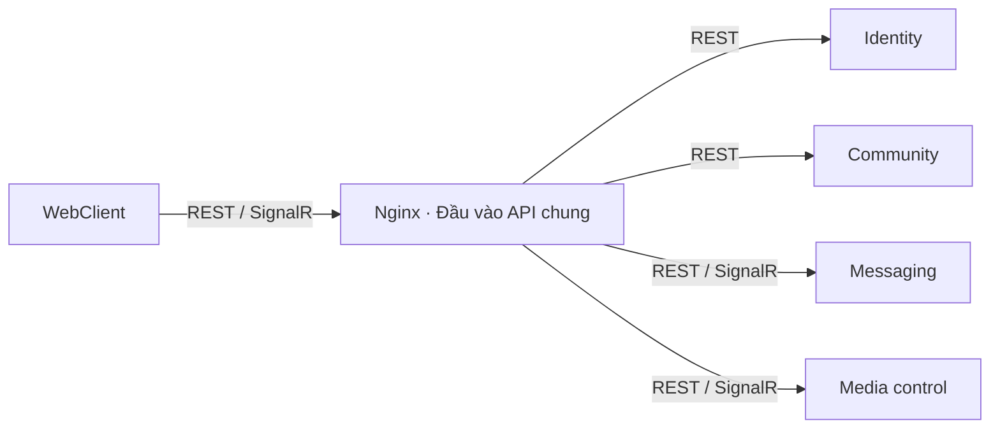

# SCDC — Quy ước API

Trang này quy định cách viết API công khai (định dạng, mã lỗi) và các quyết định v1 về giao tiếp: giữa trình duyệt và service, giữa các service với nhau, và cách xác thực. Quyền và nghiệp vụ cụ thể nằm trong tài liệu từng tính năng.

**Trạng thái:** quy ước API công khai đang dùng trong nền `900e226`. Các quyết định v1 (D04, D09, D10, D20, D27 đến D29, D46) đã chốt. Nginx đã phục vụ WebClient và proxy tới monolith; cơ chế và cách kiểm chứng S1-02 được ghi [bên dưới](#s1-02-preparation).

<a id="contracts"></a>

<a id="3-hợp-đồng-và-lỗi-chung"></a>

## API công khai

- Tiền tố `/api/v1`.
- ID là định danh cố định. Người thực hiện lấy từ phiên đăng nhập, không lấy từ request.
- Thời gian theo UTC.
- `sequence` và `version` của DM gửi dạng chuỗi số nguyên để client xử lý chính xác ([DirectConversationsController](../../services/SCDC.Api/Controllers/Messaging/DirectConversationsController.cs), [MessageResponse](../../services/Modules/Messaging/Application/ITextMessageSender.cs)).

### Lỗi

Lỗi trả `application/problem+json` (DEC-061) với các trường `type`, `title`, `status`, `detail`, `instance`, `errorCode`, `traceId`; lỗi validation có thêm `errors`. Các trường thêm nằm ở cấp ngoài cùng, không nằm trong object `extensions`.

```json
{
  "type": "https://scdc.dev/problems/validation",
  "title": "Validation failed.",
  "status": 400,
  "detail": "One or more validation errors occurred.",
  "instance": "/api/v1/auth/register",
  "errorCode": "Common.ValidationFailed",
  "traceId": "example-trace-id",
  "errors": { "username": ["Username is required."] }
}
```

| HTTP | Khi nào |
|---|---|
| 400 | Dữ liệu đầu vào không hợp lệ |
| 401 | Chưa đăng nhập hoặc phiên không còn hợp lệ |
| 403 | Không đủ quyền hoặc điều kiện, với tài nguyên người gọi được phép biết |
| 404 | Không tồn tại; DM cũng dùng cho tài nguyên người gọi không được phép biết |
| 409 | Xung đột dữ liệu, phiên bản hoặc khóa thao tác |
| 429 | Vượt giới hạn hoặc bị khóa tạm |
| 503 | Phụ thuộc tạm thời không phản hồi |

- Client xử lý theo `errorCode` và `errors`, không dựa vào câu chữ `detail`.
- Không đưa stack trace, mật khẩu, token hay nội dung chat vào response lỗi hoặc log.

### Tài liệu API

- Endpoint đã làm: Swagger sinh từ code, tại `/swagger/v1/swagger.json` và `/swagger` khi chạy Development.
- Endpoint chưa làm: ghi trong tài liệu tính năng với nhãn "đề xuất"; chưa gọi được.
- Đổi schema thì sửa luôn frontend, backend, mock, tài liệu và dữ liệu thử liên quan.

Code: [ApiProblemDetails](../../services/SCDC.Api/Errors/ApiProblemDetails.cs), [ApiErrorMapper](../../services/SCDC.Api/Errors/ApiErrorMapper.cs), [ApiErrorDefaults](../../services/SCDC.Api/Errors/ApiErrorDefaults.cs).

---

## Thiết kế v1: trình duyệt gọi service

<a id="v1-public-routing"></a>

### D09 — Một cổng vào chung

**Quyết định:** WebClient gọi REST và SignalR qua một cổng vào chung (Gateway). Gateway chuyển request tới service sở hữu chức năng; nghiệp vụ và kiểm tra quyền vẫn ở service.



**Lý do:** frontend gọi cùng một địa chỉ dù service đổi chỗ. **Đổi lại:** thêm cấu hình và phụ thuộc vào Gateway. Tham khảo [mẫu API Gateway](https://learn.microsoft.com/en-us/azure/architecture/microservices/design/gateway).

- Gateway chỉ định tuyến, không phải service nghiệp vụ thứ năm.
- Media control có Hub riêng ([D11](../features/media/participation-lifecycle.md#v1-media-realtime)).
- Không áp dụng cho gRPC nội bộ, signaling của LiveKit và luồng WebRTC, TURN.
- Hiện WebClient gọi `/api/v1` tương đối, proxy `/api` và `/hubs` ([môi trường](environments.md)).

<a id="v1-gateway-technology"></a>

### D10 — Dùng Nginx OSS làm Gateway

**Quyết định:** Nginx OSS chuyển tiếp REST và SignalR tới service sở hữu.

**Lý do:** đã có cấu hình Nginx; không cần thêm ứng dụng .NET (như YARP) chỉ để chuyển tiếp. **Đổi lại:** phải tự quản lý cấu hình proxy, kiểm tra và reload. Chưa so sánh hiệu năng với YARP.

- [Nginx hiện tại](../../clients/WebClient/nginx.conf) phục vụ SPA và proxy tới API monolith; chưa chứng minh định tuyến tới bốn service.
- WebSocket cần cấu hình chuyển tiếp ([Nginx](https://nginx.org/en/docs/http/websocket.html)). Trước bàn giao phải thử negotiate và các transport SignalR qua Gateway.
- Nginx vừa phục vụ file WebClient vừa làm Gateway trong cùng container ([D22](environments.md#v1-gateway-webclient-hosting)).

<a id="s1-02-preparation"></a>

### S1-02 — Nginx trước monolith

[S1-02](../project/tasks/step-1.md) đưa WebClient, REST và SignalR qua Nginx trước ứng dụng API hiện tại. Phần này mô tả định tuyến và cách kiểm chứng theo D09, D10 và D22.

**Trạng thái:** đã triển khai và kiểm thử trên nhánh `tech/s1-02-nginx-gateway`; [7 ca gateway đạt, chờ review](../records/verification/gateway/s1-02-2026-11-12.md). S1-01 đã hoàn tất theo [xác nhận của người dùng ngày 2026-11-12](../records/planning/s1-01-confirmation-2026-11-12.md).

#### Định tuyến

| Request | Xử lý trong container `web-client` |
|---|---|
| `/`, route giao diện và file build | Nginx trả HTML, CSS, JavaScript; route giao diện dùng SPA fallback |
| `/api` và `/api/…` | Chuyển nguyên đường dẫn, query và request tới `chat-service:8080`; API xử lý xác thực, quyền và lỗi |
| `/hubs` và `/hubs/…` | Chuyển negotiate, WebSocket, Server-Sent Events và Long Polling tới API; dùng HTTP/1.1, Upgrade và Connection, tắt buffering, timeout đọc và gửi 3.600 giây |
| `/swagger` và `/swagger/…` | Chuyển tới Swagger của API trong Development |
| `/healthz` | Nginx trả `healthy`; endpoint này không kiểm tra API hay database |
| `/health` (S1-03) | Chuyển tới service mẫu `sample-service:8080/health`, trả JSON nhận diện service mẫu |

[Cấu hình Nginx](../../clients/WebClient/nginx.conf) ưu tiên các prefix API, Hub và Swagger trước quy tắc file tĩnh. Request như `/api/not-found.js` được API xử lý thay vì rơi vào file JavaScript hoặc SPA. Trang HTML không cache; asset của bản build được cache theo tên có hash.

[Dockerfile](../../clients/WebClient/Dockerfile) chép cấu hình vào template của image Nginx. Entry point lấy nameserver từ `/etc/resolv.conf` và chỉ thay biến `NGINX_LOCAL_RESOLVERS`; các biến Nginx khác được giữ lại. Cách lấy resolver theo container áp dụng cho cả Docker và Podman, không gắn cứng địa chỉ DNS của một engine. Nginx dùng resolver với cache 5 giây và upstream trong biến để phân giải lại tên API khi IP thay đổi. Tham khảo [resolver](https://nginx.org/en/docs/http/ngx_http_core_module.html#resolver), [proxy_pass](https://nginx.org/en/docs/http/ngx_http_proxy_module.html#proxy_pass) và [entrypoint lấy resolver](https://github.com/nginx/docker-nginx/blob/master/entrypoint/15-local-resolvers.envsh).

Nginx chuyển Host, địa chỉ client và giao thức tới API. Gateway không tự gửi lại request upstream; client và API đối chiếu thao tác gửi lại bằng khóa nghiệp vụ. Access log của `/hubs` được tắt; error log của route này chỉ giữ mức critical vì lỗi kết nối thông thường có thể chứa URL và token.

[Compose phát triển](../../compose.yaml) tiếp tục dùng cổng 3000 cho gateway, 5026 cho debug API và 5432 cho database. [Hướng dẫn gateway](../guides/development.md#gateway) ghi địa chỉ và lệnh kiểm tra. [S1-03 bổ sung service mẫu](backend.md#s1-03-sample-service); S1-04 làm CI; S1-05 làm giám sát. Tách service, chat phòng, Media, gRPC và mTLS nằm ở các gói khác.

#### Kiểm chứng

[Stack nghiệm thu](../../compose.gateway-test.yaml) dùng database `scdc_gateway_test`, khóa và volume riêng; chỉ Nginx có cổng publish. [Script chạy](../../scripts/test_gateway.py) tạo project riêng cho mỗi lần, chạy test và dọn dữ liệu thử. Các ca đăng ký hoặc gửi tin không dùng database phát triển.

```bash
make test-gateway ENGINE=podman
```

Cần Node.js 24, npm và Chromium của Playwright, hoặc Google Chrome với `SCDC_E2E_BROWSER_CHANNEL=chrome`. Cách chọn engine, đổi cổng và giữ stack nằm trong [hướng dẫn phát triển](../guides/development.md#gateway).

[Project E2E gateway](../../clients/WebClient/playwright.config.js) chạy [các ca gateway](../../clients/WebClient/e2e/gateway.spec.js) và [ca tích hợp Community với DM](../../clients/WebClient/e2e/mergeMvp.spec.js):

| Ca | Điều kiện đạt |
|---|---|
| SPA, asset, route API và query | Giao diện và asset tải được; API giữ prefix, query, HTTP 400/401/404 và JSON; request không bị trả nhầm HTML |
| Negotiate | Không có token bị từ chối; phiên hợp lệ nhận danh sách transport của API |
| WebSockets | Tin DM đã lưu được nhận qua WebSocket thật đi qua Nginx |
| Server-Sent Events | Tin DM được nhận khi ép dùng transport SSE qua Nginx |
| Long Polling | Tin DM được nhận khi ép dùng transport Long Polling qua Nginx |
| Restart và đổi IP API | Hai trang chat kết nối lại; tin cũ còn; gửi nhận được tin mới sau restart và sau khi API đổi IP; container Nginx giữ nguyên; log không chứa token |
| Community và DM trên giao diện | Hai phiên trình duyệt gửi nhận DM, chuyển sang Community rồi tải lại lịch sử DM qua cùng gateway |

[Hồ sơ S1-02 ngày 2026-11-12](../records/verification/gateway/s1-02-2026-11-12.md) ghi môi trường, image, 7 ca E2E và 77 test frontend đã đạt. Phạm vi này chưa chứng minh định tuyến tới bốn service hay tải và SLA thu hồi quyền của v1.

## Thiết kế v1: service gọi service

<a id="v1-internal-protocol"></a>

### D04 — gRPC cho lời gọi chờ kết quả

**Quyết định:** khi một service gọi service khác và chờ kết quả, dùng gRPC trên HTTP/2 với hợp đồng `.proto` (Protobuf). Mã client được sinh từ `.proto`.

**Lý do:** hợp đồng có kiểu, mã client tự sinh, dữ liệu nhị phân gọn. **Đổi lại:** thêm công cụ `.proto`, mã sinh và cấu hình HTTP/2. Chưa đo hiệu năng. Tham khảo [gRPC và HTTP API](https://learn.microsoft.com/en-us/aspnet/core/grpc/comparison?view=aspnetcore-10.0), [giao tiếp microservice](https://learn.microsoft.com/en-us/azure/architecture/microservices/design/interservice-communication).

- WebClient vẫn dùng REST và SignalR (DEC-081).
- Nhà cung cấp bên ngoài và webhook dùng hợp đồng của họ.
- ProblemDetails ở trên là cho HTTP; cách ánh xạ lỗi gRPC chưa chốt.
- gRPC không thay được transaction và guard dùng chung của MVP. Quyền tới commit, lỗi mạng và thời hạn thu hồi cần thiết kế riêng ([thu hồi truy cập](access-revocation.md)).
- Ví dụ đã chốt: lệnh cài hàng rào thu hồi ([D07](access-revocation.md#v1-revocation-transport)).

<a id="v1-integration-event-transport"></a>

### D27 — Sự kiện sau commit: outbox, worker, gRPC

**Quyết định:** sự kiện sau commit được lưu trong outbox của service sở hữu, worker của service đó gửi bằng gRPC tới service nhận. Chưa dùng broker.

**Ví dụ:** Community sở hữu thay đổi về cộng đồng, thành viên, yêu cầu, lời mời; Messaging phát thông báo qua ChatHub ([tin phòng](../features/messaging/channel-messaging.md#channel-messaging)). Khi tách service, cần đường chuyển Community → Messaging. Các thông báo gửi trình duyệt (`CommunityChanged`, `MembershipChanged`, `JoinRequestChanged`, `MemberInvitationChanged`) giữ nguyên; sự kiện nội bộ chưa đặt tên và schema.

| Bước | Yêu cầu |
|---|---|
| Lưu | Dữ liệu nghiệp vụ và outbox cùng commit trong DB của service sở hữu |
| Gửi | Worker đọc outbox, lưu tiến độ theo từng bên nhận, gọi gRPC; chạy cùng API (D12) |
| Xác nhận | Bên nhận kiểm tra danh tính và quyền gọi; chỉ xác nhận sau khi đã lưu bền sự kiện hoặc việc cần làm vào DB của mình |
| Mất xác nhận | Worker gửi lại với cùng ID sự kiện; bên nhận chống xử lý trùng; tiến độ không phụ thuộc bộ nhớ |
| Xử lý | Bên nhận xử lý từ dữ liệu đã lưu; Messaging kiểm tra quyền hiện tại trước khi gửi tới kết nối |

**Lý do:** ít thành phần phải vận hành trên một máy; dùng lại gRPC và mTLS đã chọn. **Đổi lại:** nhóm tự quản lý danh sách bên nhận, giao nhận bền, gửi lại và lỗi một phần. Tách lớp truyền khỏi lớp xử lý để có thể chuyển sang broker sau.

- Request HTTP nghiệp vụ không chờ việc gửi sự kiện.
- Xác nhận nhận bền không có nghĩa bên nhận đã xử lý xong, hay trình duyệt đã nhận.
- Timeout hay mất xác nhận không chứng minh bên nhận chưa lưu.
- D27 không thay [D07](access-revocation.md#v1-revocation-transport) (hàng rào), [D16](../features/community/channels.md#v1-channel-preparation-transport) (chuẩn bị phòng) hay [D08](../features/messaging/message-lifecycle.md#v1-message-intake) (ghi tin). Sự kiện không giữ quyền tới commit và không chứng minh ngắt trong 5 giây.
- Job email và outbox → Hub trong cùng một service không thuộc phạm vi này.

<a id="v1-grpc-contract-sources"></a>

### D46 — Đặt file `.proto` ở `docs/contracts/grpc/`

**Quyết định:** file `.proto` cho gRPC giữa bốn service đặt tập trung, chia theo service cài đặt RPC:

```text
docs/contracts/grpc/
├── identity/
├── community/
├── messaging/
└── media/
```

**Lý do:** xem và review mọi hợp đồng liên service ở một chỗ, cùng với OpenAPI và JSON Schema trong [thư mục hợp đồng](../contracts/README.md). **Đổi lại:** khi build, service phải lấy file ngoài thư mục code của mình. Phương án đặt `.proto` cạnh code mỗi service (`services/*/Protos/`) không được chọn.

- Mỗi hợp đồng chỉ có một bản để sửa; bên gọi không giữ bản sao.
- Service cài đặt RPC duy trì file; bên gọi cùng review thay đổi.
- Thư mục chung không có nghĩa dùng chung domain model hay dữ liệu.
- RPC nhận sự kiện Community → Messaging (D27) nằm trong nhóm `messaging/`; Community vẫn sở hữu ý nghĩa nghiệp vụ của sự kiện.
- Kiểu Protobuf không được dùng trong Domain, hợp đồng Application hay `SCDC.Shared.Core` ([D43, D45](backend.md#v1-code-layout)).
- Project hợp đồng C# và cách sinh mã xem [D47](backend.md#v1-grpc-code-generation).

Tham khảo [gRPC services](https://learn.microsoft.com/en-us/aspnet/core/grpc/basics?view=aspnetcore-10.0).

## Thiết kế v1: xác thực

<a id="v1-service-authentication"></a>

### D20 — mTLS giữa các service

**Quyết định:** mọi lời gọi gRPC giữa bốn service (từ API và worker) dùng mTLS: hai bên xác thực nhau bằng chứng chỉ và mã hóa đường truyền.

| Mục | Yêu cầu |
|---|---|
| Danh tính | Mỗi service có chứng chỉ và khóa riêng |
| Kiểm tra kết nối | Hai bên kiểm tra chứng chỉ theo cấu hình tin cậy, ánh xạ về danh tính service |
| Quyền gọi | Bên nhận kiểm tra service gọi có được phép gọi thao tác đó; chứng chỉ hợp lệ không cho gọi mọi RPC |
| Bí mật | Cấp cho phát triển và demo theo [D36](environments.md#v1-secret-provisioning) |

**Lý do:** xác minh danh tính bằng chứng chỉ, chưa cần bên cấp token cho service. **Đổi lại:** phải quản lý vòng đời chứng chỉ, khóa và cấu hình tin cậy. Tham khảo [gRPC auth](https://grpc.io/docs/guides/auth/), [Microsoft](https://learn.microsoft.com/en-us/aspnet/core/grpc/authn-and-authz?view=aspnetcore-10.0).

- **Ví dụ:** Messaging phải nhận ra Community và kiểm tra quyền gọi trước khi chuẩn bị phòng. Quyền của người dùng, epoch và điều kiện tới commit vẫn theo [D05](access-revocation.md#v1-authorization-coordination).
- **Worker** (thu hồi, bù, dọn) dùng danh tính service để làm tiếp việc đã được chấp nhận; không cần token người dùng còn hạn. Nhưng không được dùng điều này để tiếp tục tạo hay phát nội dung bằng quyền người dùng đã mất.
- Nếu có proxy kết thúc TLS, phải thiết kế cách giữ và kiểm tra danh tính service gọi.
- D20 không chọn service mesh, không thay xác thực người dùng, không cấu hình Gateway hay LiveKit.

<a id="v1-user-token-signing"></a>

### D28 — Ký access token bằng khóa bất đối xứng

**Quyết định:** Identity giữ khóa riêng để ký access token; các service khác xác minh bằng khóa công khai.

**Lý do:** chỉ Identity ký được token. **Đổi lại:** phải phân phối khóa công khai và thay khóa. Phương án dùng chung một khóa bí mật cho mọi service không được chọn. Tham khảo [JWT bearer](https://learn.microsoft.com/en-us/aspnet/core/security/authentication/configure-jwt-bearer-authentication?view=aspnetcore-10.0), [RFC 7518](https://www.rfc-editor.org/rfc/rfc7518.html#section-3).

- Khóa riêng không bao giờ gửi cho service khác hay WebClient.
- MVP hiện dùng khóa đối xứng HS256 trong [TokenService](../../services/Modules/Identity/Infrastructure/Security/TokenService.cs); chưa đổi code.
- Chữ ký hợp lệ chưa chứng minh phiên, tài khoản hay quyền còn hiệu lực; phiên kiểm tra qua Redis ([D30](access-revocation.md#v1-session-validation)), quyền ghi theo [D05](access-revocation.md#v1-authorization-coordination).
- D20 xác thực service; D28 xác thực token người dùng. Hai việc khác nhau.

<a id="v1-user-token-key-distribution"></a>

### D29 — Cấp khóa công khai qua cấu hình triển khai

**Quyết định:** mỗi service nhận bộ khóa công khai tin cậy qua cấu hình triển khai theo môi trường. Không gắn cứng khóa trong code.

**Lý do:** ít việc tích hợp ban đầu, chưa cần cơ chế tự tải khóa từ Identity. **Đổi lại:** cần quy trình cập nhật phối hợp các service khi thay hay thu hồi khóa. Thư viện .NET hỗ trợ nhiều khóa cùng lúc qua [IssuerSigningKeys](https://learn.microsoft.com/en-us/dotnet/api/microsoft.identitymodel.tokens.tokenvalidationparameters.issuersigningkeys?view=msal-web-dotnet-latest), nên khóa cũ và mới có thể cùng tồn tại khi chuyển.

Phạm vi ban đầu: bốn service trên [máy phát triển và demo](environments.md#v1-available-infrastructure). Môi trường công khai đánh giá riêng.

## Còn mở

- **D04, D27:** endpoint, timeout, gửi lại, cơ chế nhất quán; ánh xạ lỗi gRPC; danh sách sự kiện và bên nhận; schema và `.proto`; ID, version, chống trùng, thứ tự, lỗi không xử lý được, hàng đợi tồn, thời hạn lưu; đối chiếu sau khởi động lại; cách chuyển sang broker.
- **D46:** công cụ và phiên bản sinh mã, namespace, quản lý phiên bản hợp đồng, CI, các phương thức cụ thể.
- **D09, D10:** route cụ thể tới từng service; host, domain, TLS; xác thực tại Gateway; BFF; số bản và HA; phiên bản image Nginx.
- **D20:** CA, danh tính cụ thể, định dạng và quyền file khóa, cấp, gia hạn, thu hồi chứng chỉ; tin cậy theo môi trường; ma trận quyền RPC; cách truyền thông tin người thực hiện; danh tính worker.
- **D28, D29:** thuật toán; đường dẫn, định dạng và bảo vệ khóa; vòng đời khóa; issuer, audience, claims; định dạng file khóa công khai; nạp lại hay khởi động lại khi đổi khóa; thời gian chuyển tiếp. Chưa chọn JWKS, xác thực tại Gateway, hay khóa của LiveKit.

---

Nguồn: DEC-061 (lỗi), DEC-081 (REST, SignalR), [DEC-122](../records/decisions/README.md#dec-122) (D04), [DEC-127](../records/decisions/README.md#dec-127) (D09), [DEC-128](../records/decisions/README.md#dec-128) (D10), [DEC-138](../records/decisions/README.md#dec-138) (D20), [DEC-145](../records/decisions/README.md#dec-145) (D27), [DEC-146](../records/decisions/README.md#dec-146) (D28), [DEC-147](../records/decisions/README.md#dec-147) (D29), [DEC-164](../records/decisions/README.md#dec-164) (D46).
