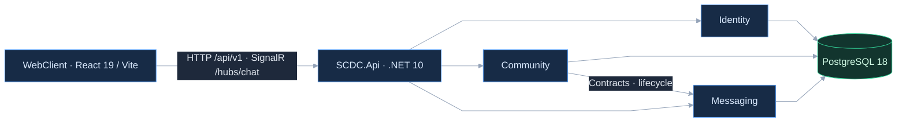
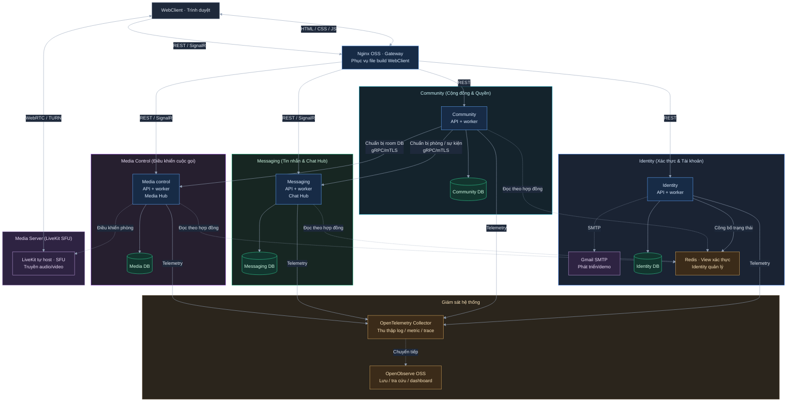
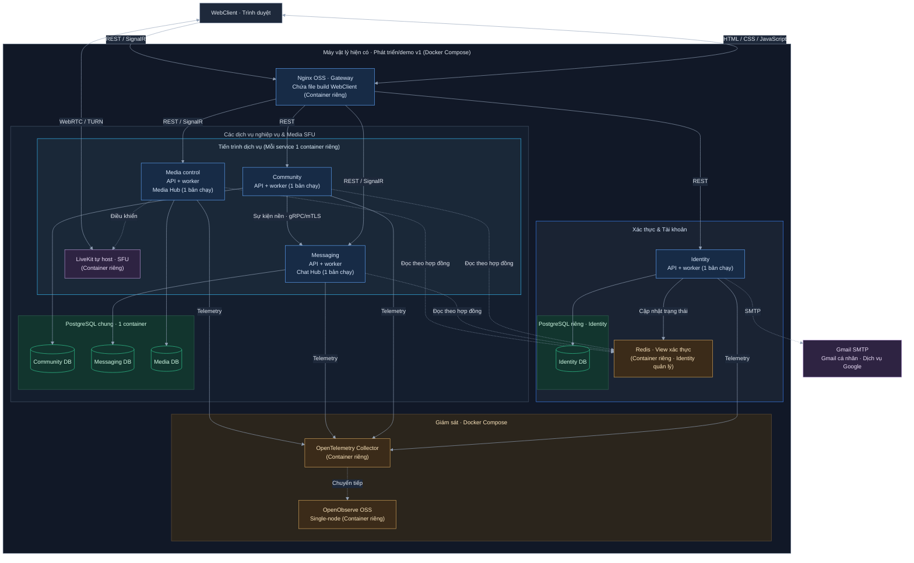

# SCDC — Kiến trúc hệ thống

Trang này mô tả kiến trúc hiện tại (MVP), ranh giới dữ liệu giữa các module, và kiến trúc mục tiêu v1 cùng danh sách các quyết định đã chốt. Người mới đọc nên bắt đầu từ [tóm tắt v1](#summary).

**Trạng thái:** code là MVP, một ứng dụng API (modular monolith), đối chiếu commit `900e226` ngày 2026-10-13 ([MVP](../releases/mvp.md), [hồ sơ tích hợp](../records/verification/messaging/merge-2026-10-13.md)). Kiến trúc microservice v1 đã chốt hướng nhưng **chưa chuyển code**.

## Phần bổ sung và ranh giới trách nhiệm

Phân công người xem [kế hoạch](../project/planning.md#team); trang này chỉ mô tả trách nhiệm theo thành phần.

- Bốn service nghiệp vụ vẫn là nền của v1. [Thông báo](../features/notifications/README.md), [gửi file](../features/files/README.md) và [mobile](../experience/mobile.md) đang thiết kế; phân công không tự thêm service, tiến trình, database hay đổi topology. Sơ đồ sẽ được bổ sung khi hợp đồng và vị trí chạy được chốt.
- Identity sở hữu token, link và dữ liệu email; phần gửi thư (worker) theo [hợp đồng email](../features/accounts/email-links.md).
- Media control sở hữu vòng đời cuộc gọi và phòng, tích hợp LiveKit; thông báo cuộc gọi phối hợp với [thông báo](../features/notifications/README.md).

## Hiện tại (MVP)

- WebClient gọi API qua HTTP `/api/v1` và SignalR `/hubs/chat`.
- API (cùng ChatHub và worker outbox) chạy Identity, Community, Messaging trên một PostgreSQL.
- Chưa có: worker email (đang ở nhánh `feat/identity`, xem [email](../features/accounts/email-links.md#status)), Media. Health endpoint chưa kiểm tra DB.

Code: [Program.cs](../../services/SCDC.Api/Program.cs), [Compose](../../compose.yaml), [HealthController](../../services/SCDC.Api/Controllers/HealthController.cs). Cấu hình xem [môi trường](environments.md); cách chạy xem [hướng dẫn phát triển](../guides/development.md).

## Ranh giới dữ liệu

| Module | Trách nhiệm | Schema và hợp đồng |
|---|---|---|
| Identity | Danh tính, hồ sơ, mật khẩu, xác minh, phiên | `identity`; `IUserDirectory`, `IAccountAccessGuard` |
| Community | Server, thành viên, lời mời, phòng, quyền | `community`; `IChannelAccessGuard` |
| Messaging | DM, tin phòng, lịch sử, chống trùng, realtime | `messaging`; `IChatSpaceLifecycle`, `IRealtimeAccessRevoker` |
| Media (v1) | Cuộc gọi, phòng thoại, lượt tham gia, nguồn phát, hạn mức | Còn đề xuất; xem [Media](../features/media/README.md) |

**Quy tắc:**

- Mỗi module chỉ đọc ghi dữ liệu của mình. Gọi module khác qua [SCDC.Contracts](../../services/SCDC.Contracts); không tham chiếu code cài đặt, không JOIN bảng của module khác.
- View SQL để quan sát không thay được hợp đồng nghiệp vụ. Tiền tố API hay vị trí tài liệu không quyết định module nào sở hữu dữ liệu.
- Có interface không có nghĩa đã có bên dùng hay đã chạy đủ; xem trạng thái ở từng trang tính năng.
- MVP được dùng transaction chung trong một ứng dụng. Khi tách service, phải thay bằng hợp đồng mạng và chính sách nhất quán. Chi tiết: [backend](backend.md), [database](database.md), [Community](../features/community/mechanics.md), [thu hồi truy cập](access-revocation.md).

## Kiến trúc v1

Đã chốt bốn service nghiệp vụ; mỗi quyết định được người dùng xác nhận trước khi ghi vào [hồ sơ quyết định](../records/decisions/README.md). Đề xuất chưa xác nhận giữ trạng thái chờ. Yêu cầu từ môn học chỉ là "dùng microservice" (DEC-116); số service, Gateway, broker hay Kubernetes là lựa chọn của nhóm.

### Tóm tắt

Mười điểm chính của v1; sơ đồ tại [sơ đồ v1](#v1-components), toàn bộ quyết định D01–D52 tại [các quyết định theo nhóm](#các-quyết-định-theo-nhóm).

| # | Nội dung | Quyết định |
|---|---|---|
| 1 | Bốn service nghiệp vụ: Identity, Community, Messaging, Media control | [DEC-119](../records/decisions/README.md#dec-119) |
| 2 | Mỗi service sở hữu database riêng; không JOIN hay đọc DB của service khác | [DEC-120](../records/decisions/README.md#dec-120) |
| 3 | Gọi đồng bộ giữa service bằng gRPC + Protobuf, xác thực bằng mTLS | [DEC-122](../records/decisions/README.md#dec-122), [DEC-138](../records/decisions/README.md#dec-138) |
| 4 | Sự kiện sau commit: outbox trong DB của owner, worker chuyển qua gRPC; chưa dùng broker | [DEC-145](../records/decisions/README.md#dec-145) |
| 5 | Một cổng vào Nginx cho REST/SignalR, đồng thời phục vụ WebClient | [DEC-127](../records/decisions/README.md#dec-127), [DEC-140](../records/decisions/README.md#dec-140) |
| 6 | Access token ký bất đối xứng; service xác minh JWT cục bộ rồi kiểm tra phiên trong Redis do Identity quản lý | [DEC-146](../records/decisions/README.md#dec-146), [DEC-148](../records/decisions/README.md#dec-148) |
| 7 | Thu hồi quyền chat/media có hiệu lực trong 5 giây | [Thu hồi truy cập](access-revocation.md) |
| 8 | Media dùng LiveKit tự host; Media control giữ vòng đời cuộc gọi/phòng | [DEC-084](../records/decisions/README.md#dec-084), [DEC-142](../records/decisions/README.md#dec-142) |
| 9 | Mỗi service một bản chạy (API + worker + Hub nếu có), chia 4 project Api/Application/Domain/Infrastructure, nhóm mã theo tính năng | [DEC-139](../records/decisions/README.md#dec-139), [DEC-158](../records/decisions/README.md#dec-158), [DEC-159](../records/decisions/README.md#dec-159) |
| 10 | Một Git repository chung; thư viện kỹ thuật nhỏ dùng chung, nghiệp vụ không dùng chung | [DEC-157](../records/decisions/README.md#dec-157), [DEC-160](../records/decisions/README.md#dec-160) |

### D01 — Bốn service nghiệp vụ

**Quyết định:** tách thành bốn service, mỗi service triển khai riêng. (Không tính WebClient, database, worker, LiveKit.)

| Service | Trách nhiệm |
|---|---|
| Identity | Tài khoản, hồ sơ, xác thực, email, phiên |
| Community | Cộng đồng, thành viên, lời mời, vai trò, phòng, quyền |
| Messaging | DM, tin phòng, lịch sử, đồng bộ |
| Media control | Cuộc gọi, phòng thoại, lượt tham gia, nguồn phát, hạn mức. (LiveKit lo truyền âm thanh và hình) |

**Lý do:** phát hành và mở rộng từng nhóm nghiệp vụ riêng. **Đổi lại:** thêm hợp đồng mạng, lỗi một phần, kiểm thử tích hợp giữa service.

Hệ quả: [IAccountAccessGuard](../../services/SCDC.Contracts/Identity/IAccountAccessGuard.cs) hiện nhận transaction của bên gọi và giữ khóa Identity; phải thiết kế lại khi tách. Community với Messaging, Community với Media cũng cần hợp đồng quyền và vòng đời. Một lần kiểm tra JWT hay gọi API không giữ được quyền tới commit; hướng thay thế là hàng rào ghi ([D05](access-revocation.md#v1-authorization-coordination)).

### Các quyết định theo nhóm

| Nhóm | Đã chốt | Trang |
|---|---|---|
| Dữ liệu | Mỗi service một database (D02); hai instance PostgreSQL (D03); migration là bước riêng (D48), viết bằng SQL (D49), một công cụ chung (D50); giữ dữ liệu MVP (D51), chuyển offline (D52) | [database](database.md), [môi trường](environments.md#v1-postgres-instances) |
| Giao tiếp nội bộ | gRPC cho lời gọi chờ kết quả (D04); sự kiện qua outbox, worker, gRPC, chưa dùng broker (D27); file `.proto` ở `docs/contracts/grpc/` (D46) | [quy ước API](api-conventions.md#v1-internal-protocol) |
| Xác thực, quyền | mTLS giữa service (D20); ký token bằng khóa bất đối xứng (D28), cấp khóa công khai qua cấu hình (D29); kiểm tra phiên qua Redis (D30), không gọi Identity dự phòng (D31); hàng rào ghi (D05), authority tự điều phối (D06), gọi gRPC trực tiếp (D07) | [quy ước API](api-conventions.md#v1-service-authentication), [thu hồi](access-revocation.md) |
| Cổng vào | Một cổng chung (D09) bằng Nginx OSS (D10), chung container với WebClient (D22) | [quy ước API](api-conventions.md#v1-public-routing) |
| Tạo phòng | Chỉ báo xong khi dữ liệu nền đã sẵn (D14); Community điều phối (D15) qua gRPC (D16); tra cứu tiến trình bằng GET (D18); chờ ngắn, hủy, bù (D19, thay một phần D17) | [phòng](../features/community/channels.md#v1-channel-provisioning) |
| Realtime, worker | Ghi tin trực tiếp, giữ khả năng dùng hàng đợi (D08); Media có Hub riêng (D11); worker (D12) và Hub (D13) chạy cùng API; mỗi service một bản chạy (D21) | [backend](backend.md#v1-application-workers), [tin nhắn](../features/messaging/message-lifecycle.md#v1-message-intake) |
| Triển khai | Docker Compose cho ứng dụng (D23), PostgreSQL và LiveKit (D26), Redis (D32); LiveKit (D24) và PostgreSQL (D25) trên cùng máy; bí mật qua file và Compose secrets (D36); cập nhật offline | [môi trường](environments.md) |
| Giám sát | OpenTelemetry và Collector chung (D33), tự host (D34), OpenObserve OSS (D35) | [giám sát](observability.md) |
| Email, backup | Gmail SMTP cho phát triển và demo (D37); backup sau v1, lưu Google Drive (D38) | [email](../features/accounts/email-links.md#v1-email-delivery-model), [môi trường](environments.md#v1-postgres-backup-storage) |
| Tổ chức code | Một repository (D39); 4 project mỗi service (D40); nhóm theo chức năng (D41); cho phép thư viện chung nhỏ (D42); cây project (D43); ProjectReference (D44); một `SCDC.Shared.Core` (D45); project hợp đồng gRPC riêng (D47) | [backend](backend.md#v1-code-layout) |

Mã DEC tương ứng của từng quyết định ghi ở cuối mỗi trang và trong [hồ sơ quyết định](../records/decisions/README.md). Các nhóm có thể được quyết định xen kẽ; quyết định của nhóm này không tự xác nhận nhóm khác.

**Yêu cầu giữ nguyên:** Messaging dùng REST và SignalR (DEC-081); Media dùng LiveKit tự host (DEC-084); thu hồi chat và media trong 5 giây, không xác nhận được quyền thì dừng media ([thu hồi](access-revocation.md)). Đây là đầu vào thiết kế, chưa phải bằng chứng đã chạy.

### Sơ đồ v1

#### Kiến trúc logic

- Mỗi service sở hữu database riêng.
- Redis là nơi Identity công bố trạng thái phiên ([D30](access-revocation.md#v1-session-validation)); không phải backplane, broker hay Redis của LiveKit. Đường nối tới Redis thể hiện quyền ghi và đọc, chưa phải giao thức đồng bộ đã kiểm thử.
- Gmail (nét đứt) dùng cho phát triển và demo; tích hợp v1 cần kiểm thử.
- Điều khiển LiveKit theo [vòng đời tham gia](../features/media/participation-lifecycle.md). Các lời gọi thu hồi không vẽ hết ở đây ([D05 đến D07](access-revocation.md#v1-authorization-coordination)).
- Collector nhận telemetry của bốn service; giám sát Nginx, database, Redis, LiveKit cần thiết kế riêng.

#### Triển khai trên máy phát triển và demo

- Mọi thành phần nằm trên [máy Linux hiện có](environments.md#v1-available-infrastructure), mỗi thành phần một container, do Docker Compose quản lý. Bản công khai chạy ở đâu chưa chọn.
- Mỗi service một tiến trình API (kèm worker và Hub nếu có). Số bản Gateway, database, Redis, LiveKit, Collector và HA chưa chọn.
- Đường Community → Messaging minh họa sự kiện nền phục vụ thông báo Community qua ChatHub ([D27](api-conventions.md#v1-integration-event-transport)). Các lời gọi gRPC khác không vẽ.
- Backup (sau v1) không có trong sơ đồ.

### Công nghệ

| Thành phần | Trạng thái |
|---|---|
| SignalR | Đã chọn; Hub chat cùng API Messaging, Hub Media riêng cùng API Media control |
| LiveKit tự host | Đã chọn; cùng máy, container riêng |
| gRPC, Protobuf, mTLS | Đã chọn cho giao tiếp nội bộ |
| Nginx OSS | Đã chọn làm Gateway |
| Redis | Đã chọn cho trạng thái phiên; chưa cần làm backplane |
| OpenTelemetry, OpenObserve OSS | Đã chọn |
| Gmail SMTP | Đã chọn cho phát triển và demo |
| Docker Compose | Đã chọn |
| Broker (RabbitMQ…) | Không dùng ban đầu; giữ khả năng thêm sau |
| Kho file (MinIO…) | Chưa chọn; gửi file đang thiết kế ([gửi file](../features/files/README.md)) |
| Kiểm thử tải (k6…) | Chưa chọn ([chất lượng](quality.md#quality-targets)) |

## Còn mở

- Cấu hình chi tiết, HA và topology cho mọi thành phần; nơi chạy bản công khai.
- Giao thức chi tiết: tạo và xóa phòng giữa service, nhất quán và phục hồi Redis, quyền gọi RPC, vòng đời khóa và chứng chỉ, danh sách sự kiện.
- Admission, TURN và bộ kiểm soát fail-close của LiveKit.
- Solution, cấu hình sinh mã, CI/CD; trình tự tách service, mapping dữ liệu, bằng chứng.
- Vị trí chạy của thông báo, gửi file và mobile ([DEC-173](../records/decisions/README.md#dec-173)).
- Kiểm chứng tải trên một máy vật lý.

Phạm vi đầy đủ: [tổng quan](../project/overview.md#scope). Các gói chuyển đổi: [kế hoạch v1](../project/planning.md#v1-architecture-packages).

---

Nguồn: DEC-081, DEC-084, DEC-116, [DEC-119](../records/decisions/README.md#dec-119) (D01) và DEC-120 đến 170 cho các quyết định D02 đến D52, [DEC-171 đến 173](../records/decisions/README.md#dec-171) (phân công và phần bổ sung).
