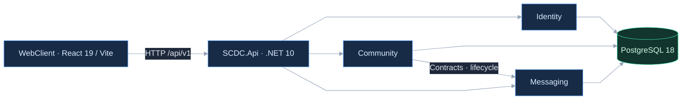
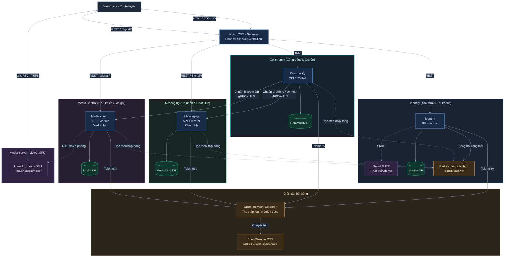
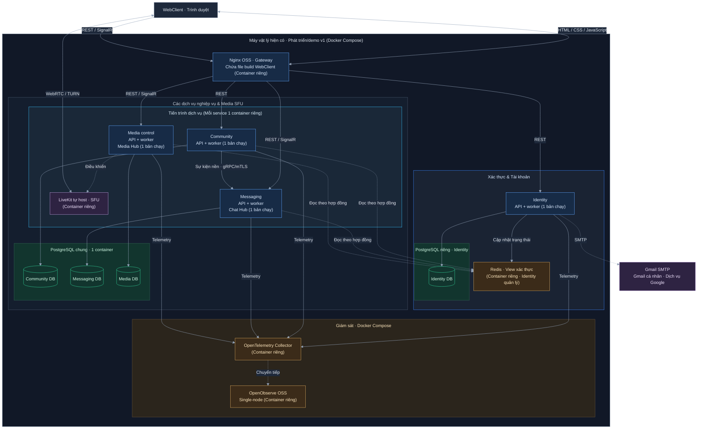

# SCDC — Kiến trúc hệ thống

Đối chiếu source `main` sau khi hợp nhất Community ngày 2026-10-08. MVP dùng một API host Modular Monolith; microservice thuộc v1 theo DEC-116. Phương án mục tiêu chưa được triển khai.

## Mục lục

- [Hệ thống hiện tại](#current)
- [Ranh giới dữ liệu](#boundaries)
- [Kiến trúc mục tiêu](#target)
- [Sơ đồ thành phần v1](#v1-components)
- [Kiến trúc logic v1](#v1-logical-architecture)
- [Triển khai phát triển/demo](#v1-demo-deployment)

## Hệ thống hiện tại

MVP hợp nhất có WebClient, API với ChatHub/worker outbox và PostgreSQL. Worker email và Media chưa nằm trong stack này. Nhánh `feat/identity` đã có worker Gmail SMTP, theo [hiện trạng email](../features/accounts/email-links.md#status). Health endpoint hiện không kiểm tra DB.

Nguồn: [Program.cs](../../services/SCDC.Api/Program.cs), [Compose](../../compose.yaml), [HealthController](../../services/SCDC.Api/Controllers/HealthController.cs). Cấu hình và topology tại [môi trường](environments.md); thao tác tại [hướng dẫn phát triển](../guides/development.md).

## Ranh giới dữ liệu

| Module | Trách nhiệm | Schema / hợp đồng |
|---|---|---|
| Identity | Danh tính, hồ sơ, mật khẩu, xác minh và phiên | `identity`; `IUserDirectory`, `IAccountAccessGuard` |
| Community | Server, membership, invitation, channel và quyền | `community`; `IChannelAccessGuard` |
| Messaging | DM, tin phòng, lịch sử, chống trùng và realtime | `messaging`; `IChatSpaceLifecycle`, `IRealtimeAccessRevoker` |
| Media — mục tiêu v1 | Call, room, participation, nguồn phát và quota | Schema/interface còn đề xuất; xem [Media](../features/media/README.md) |

Các interface được đối chiếu tại [SCDC.Contracts](../../services/SCDC.Contracts). Có interface không chứng minh consumer hoặc runtime đầy đủ đã tồn tại; trạng thái theo khả năng nằm trong từng chủ đề.

Mỗi module chỉ đọc/ghi dữ liệu mình sở hữu. Lời gọi liên module qua Contracts; không tham chiếu implementation hoặc JOIN trực tiếp bảng module khác trong mã ứng dụng. Các view quan sát SQL không thay hợp đồng nghiệp vụ. Prefix API và vị trí tài liệu không quyết định module sở hữu dữ liệu.

MVP có thể dùng transaction trong cùng host theo hợp đồng đã chốt. Khi tách service phải thay giả định shared transaction/row lock bằng hợp đồng mạng và chính sách nhất quán phù hợp. Chi tiết tại [backend](backend.md), [database](database.md), [tích hợp Community](community.md) và [thu hồi truy cập](access-revocation.md).

## Thiết kế kiến trúc v1

Trạng thái: đang thiết kế; đã chốt bốn service nghiệp vụ theo [DEC-119](../records/decisions/README.md#dec-119), chưa chuyển đổi code. Bắt đầu ngày 2026-10-11 theo yêu cầu của người dùng. Trước mỗi quyết định, trình bày phương án, tác động và khuyến nghị để người dùng lựa chọn. Chỉ ghi quyết định đã xác nhận vào [hồ sơ DEC](../records/decisions/README.md); các đề xuất chưa xác nhận giữ trạng thái chờ ý kiến.

### Đầu vào đã xác nhận

- MVP dùng một API host Modular Monolith; chuyển microservice thuộc v1 — [DEC-116](../records/decisions/README.md#dec-116). Môn học chưa đặt số service, Gateway, broker hoặc Kubernetes bắt buộc.
- v1 gồm Identity, Community, Messaging và Media control — [DEC-119](../records/decisions/README.md#dec-119). Đây là lựa chọn thiết kế của người dùng, không phải yêu cầu bổ sung của môn học.
- Mỗi service sở hữu database và tài khoản truy cập riêng — [DEC-120](../records/decisions/README.md#dec-120); bố trí tại [database](database.md#v1-database-layout).
- Identity dùng instance PostgreSQL riêng; ba database còn lại dùng chung instance thứ hai — [DEC-121](../records/decisions/README.md#dec-121), [bố trí instance](environments.md#v1-postgres-instances). Có thể dùng database cloud cho Identity; provider chưa chọn.
- Lời gọi trực tiếp giữa service cần request–response dùng gRPC + Protobuf — [DEC-122](../records/decisions/README.md#dec-122), [giao thức nội bộ](api-conventions.md#v1-internal-protocol).
- Sự kiện sau commit lưu trong outbox rồi worker owner chuyển qua gRPC/mTLS; bên nhận xác nhận sau lưu bền, tiến độ và chống xử lý trùng phải phục hồi được — [DEC-145](../records/decisions/README.md#dec-145), [D27 — chuyển sự kiện](api-conventions.md#v1-integration-event-transport). Chưa thêm broker trong cấu hình ban đầu; giữ khả năng chuyển transport về sau.
- Phối hợp quyền tới commit bằng hàng rào ghi bền tại từng database — [DEC-123](../records/decisions/README.md#dec-123), [cơ chế thu hồi](access-revocation.md#v1-authorization-coordination).
- Identity và Community tự điều phối thu hồi thuộc phần phiên/quyền mình sở hữu, lưu tiến trình trong database tương ứng — [DEC-124](../records/decisions/README.md#dec-124), [trách nhiệm điều phối](access-revocation.md#v1-revocation-coordinator).
- Lệnh cài hàng rào và kết quả xác nhận đi qua gRPC trực tiếp; authority phục hồi từ tiến trình bền khi kết quả chưa rõ — [DEC-126](../records/decisions/README.md#dec-126), [D07 — truyền lệnh thu hồi](access-revocation.md#v1-revocation-transport).
- Messaging ghi tin trực tiếp vào DB cùng outbox; tách transport và giữ hợp đồng ghi để chuyển sang hàng đợi tiếp nhận về sau — [DEC-125](../records/decisions/README.md#dec-125), [D08 — tiếp nhận tin](../features/messaging/message-lifecycle.md#v1-message-intake).
- WebClient gọi REST/SignalR qua một đầu vào API chung, định tuyến tới service sở hữu; nghiệp vụ và kiểm tra quyền vẫn tại service — [DEC-127](../records/decisions/README.md#dec-127), [D09 — định tuyến API](api-conventions.md#v1-public-routing).
- Đầu vào API chung dùng Nginx OSS — [DEC-128](../records/decisions/README.md#dec-128), [D10 — công nghệ Gateway](api-conventions.md#v1-gateway-technology); cấu hình/HA và topology máy chủ còn mở.
- Media control sở hữu Hub SignalR riêng cho thông báo/cuộc gọi/phòng thoại, qua Nginx; Messaging giữ Hub chat — [DEC-129](../records/decisions/README.md#dec-129), [D11 — realtime Media](../features/media/participation-lifecycle.md#v1-media-realtime).
- Công việc nền ứng dụng v1 ban đầu chạy trong tiến trình API của từng service, lưu dữ liệu phục hồi tại DB của owner — [DEC-130](../records/decisions/README.md#dec-130), [D12 — cách chạy worker](backend.md#v1-application-workers).
- Hub chat chạy cùng API Messaging; Hub Media chạy cùng API Media control trong cấu hình v1 ban đầu — [DEC-131](../records/decisions/README.md#dec-131), [D13 — vị trí Hub](backend.md#v1-realtime-hosting).
- Chỉ báo tạo phòng hoàn tất/công bố sẵn sàng sau khi dữ liệu nền đúng loại phòng đã được chuẩn bị tại Community và Messaging hoặc Media — [DEC-132](../records/decisions/README.md#dec-132), [D14 — hoàn tất tạo phòng](../features/community/channels.md#v1-channel-provisioning); giao thức/phục hồi chi tiết chưa chốt.
- Community lưu tiến độ tạo phòng bền trong DB mình và điều phối chuẩn bị/phục hồi; owner tự ghi DB của mình — [DEC-133](../records/decisions/README.md#dec-133), [D15 — điều phối tạo phòng](../features/community/channels.md#v1-channel-creation-coordination). Phục hồi chi tiết chưa chốt.
- Lệnh chuẩn bị dữ liệu phòng và kết quả đi qua gRPC trực tiếp; owner trả kết quả đã chuẩn bị sau commit — [DEC-134](../records/decisions/README.md#dec-134), [D16 — truyền lệnh chuẩn bị phòng](../features/community/channels.md#v1-channel-preparation-transport). Hợp đồng mạng chi tiết chưa chốt.
- Tạo phòng giữ kết quả thành công `201/200`; phần `202`/pending công khai của [DEC-135](../records/decisions/README.md#dec-135) đã được thay bởi DEC-137 — [D17 — phản hồi tạo phòng](../features/community/channels.md#v1-channel-creation-response).
- Mất phản hồi/reload mà client còn khóa thao tác thì dùng GET tra cứu cùng tiến trình tạo phòng theo actor, loại thao tác, server và `clientOperationId` — [DEC-136](../records/decisions/README.md#dec-136), [D18 — tìm lại tiến trình](../features/community/channels.md#v1-channel-operation-recovery). GET chỉ đọc; URL/schema và quyền đọc chi tiết chưa chốt.
- Tạo phòng v1 chờ ngắn; thành công và hủy loại trừ nhau. Hủy phải lưu bền và chặn công bố muộn trước lỗi xác định; phần đã commit được bù/dọn nền, kết quả chưa rõ vẫn dùng GET — [DEC-137](../records/decisions/README.md#dec-137), [D19 — hủy tạo phòng](../features/community/channels.md#v1-channel-creation-interruption). Thời hạn và giao thức chi tiết chưa chốt.
- Lời gọi gRPC giữa bốn service dùng mTLS để xác thực danh tính service, gồm API và worker — [DEC-138](../records/decisions/README.md#dec-138), [D20 — xác thực service](api-conventions.md#v1-service-authentication). CA, vòng đời chứng chỉ, cấu hình trust, quyền RPC và context actor cần thiết kế chi tiết.
- Access token người dùng dùng chữ ký bất đối xứng; Identity giữ khóa riêng, các service xác minh bằng khóa công khai được tin cậy theo [D28](api-conventions.md#v1-user-token-signing)/[DEC-146](../records/decisions/README.md#dec-146). Ban đầu cấp bộ khóa công khai qua cấu hình triển khai theo [D29](api-conventions.md#v1-user-token-key-distribution)/[DEC-147](../records/decisions/README.md#dec-147); thuật toán và vòng đời khóa còn cần thiết kế, kiểm tra phiên/quyền giữ D05.
- Các service đọc view xác thực tối thiểu trong Redis do Identity quản lý sau khi xác minh JWT cục bộ — [D30](access-revocation.md#v1-session-validation)/[DEC-148](../records/decisions/README.md#dec-148). Identity giữ dữ liệu bền trong PostgreSQL; phạm vi đọc được công bố bổ sung D02, không mở DB nghiệp vụ. Khi chưa xác minh được qua Redis, tạm từ chối và không gọi Identity dự phòng theo [D31](access-revocation.md#v1-session-validation-fallback)/[DEC-149](../records/decisions/README.md#dec-149). Redis tự host cùng máy phát triển/demo trong container riêng do Compose quản lý theo [D32](environments.md#v1-auth-redis-deployment)/[DEC-150](../records/decisions/README.md#dec-150); nhất quán/phục hồi và cấu hình còn cần thiết kế.
- Cấu hình v1 ban đầu có một bản chạy hoạt động cho mỗi service nghiệp vụ; mỗi bản gồm API, worker và Hub nếu có — [DEC-139](../records/decisions/README.md#dec-139), [D21 — số bản chạy service](environments.md#v1-service-replicas). Bố trí Docker host/máy ảo, Gateway/database/SFU replica, HA và mở rộng sau còn mở; tải cần kiểm chứng.
- Nginx phục vụ bản build WebClient và làm Gateway REST/SignalR trong cùng container — [DEC-140](../records/decisions/README.md#dec-140), [D22 — bố trí Gateway/WebClient](environments.md#v1-gateway-webclient-hosting). Bốn service backend giữ đơn vị triển khai riêng; số bản Gateway, TLS công khai và quy trình deploy còn mở.
- Bí mật cho phát triển/demo lưu trong file được bảo vệ ngoài repo trên host, cấp đúng container qua Compose secrets — [D36](environments.md#v1-secret-provisioning)/[DEC-154](../records/decisions/README.md#dec-154). Đường dẫn, định dạng, quyền file, bảo vệ khi lưu và vòng đời khóa/chứng chỉ còn mở.
- Phát triển/demo dùng Gmail cá nhân hiện có qua SMTP, xác thực bằng email và App Password — [D37](../features/accounts/email-links.md#v1-email-delivery-model)/[DEC-155](../records/decisions/README.md#dec-155). Identity giữ worker/delivery; bản công khai và cấu hình tích hợp v1 cần đánh giá riêng.
- Docker Compose quản lý container ứng dụng v1 ban đầu: bốn service nghiệp vụ và Nginx/static WebClient — [DEC-141](../records/decisions/README.md#dec-141), [D23 — công cụ triển khai](environments.md#v1-container-deployment). Bố trí Docker host/máy ảo và cấu hình từng môi trường còn mở.
- LiveKit tự host cùng máy vật lý với ứng dụng, chạy trong container riêng — [DEC-142](../records/decisions/README.md#dec-142), [D24 — vị trí SFU](environments.md#v1-sfu-host-placement). Hạ tầng hiện có là [một máy vật lý](environments.md#v1-available-infrastructure); Cloud hoặc laptop khác chỉ được cân nhắc sau khi đánh giá tải, chưa được chọn.
- Cả hai instance PostgreSQL ban đầu tự host trên cùng máy vật lý với ứng dụng và LiveKit — [DEC-143](../records/decisions/README.md#dec-143), [D25 — nơi chạy PostgreSQL](environments.md#v1-postgres-placement). Identity giữ instance riêng để có thể chuyển lên Cloud về sau; tài nguyên và vận hành database cần thiết kế chi tiết.
- Mỗi instance PostgreSQL có container riêng; Compose quản lý PostgreSQL và LiveKit ngoài container ứng dụng — [DEC-144](../records/decisions/README.md#dec-144), [D26 — phạm vi Compose](environments.md#v1-infrastructure-deployment). Các service vẫn triển khai riêng; file/project Compose, lưu trữ bền, mạng và quy trình cập nhật cần thiết kế chi tiết.
- Bốn service dùng OpenTelemetry cho log, metric và trace, gửi qua Collector chung rồi chuyển tới nơi lưu/tra cứu — [D33](observability.md#v1-telemetry-collection)/[DEC-151](../records/decisions/README.md#dec-151). Collector, kho dữ liệu và dashboard tự host cùng máy phát triển/demo trong container do Compose quản lý theo [D34](observability.md#v1-observability-deployment)/[DEC-152](../records/decisions/README.md#dec-152); OpenObserve OSS chạy single-node được chọn tại [D35](observability.md#v1-observability-tools)/[DEC-153](../records/decisions/README.md#dec-153). Storage, số bản Collector và cấu hình còn mở.
- Backup/restore chuyển sang sau v1; Google Drive là phương án lưu ngoài máy cho giai đoạn đó — [D38](environments.md#v1-postgres-backup-storage)/[DEC-156](../records/decisions/README.md#dec-156). Nguồn phạm vi tại [hồ sơ v1](../project/overview.md#backup-scope); sơ đồ runtime v1 không thêm thành phần backup.
- Giữ một Git repository chung cho bốn service, WebClient, hợp đồng và tài liệu — [D39](backend.md#v1-repository-organization)/[DEC-157](../records/decisions/README.md#dec-157). Mỗi service chia thành bốn project API, Application, Domain và Infrastructure theo [D40](backend.md#v1-service-projects)/[DEC-158](../records/decisions/README.md#dec-158); vẫn là đơn vị build/triển khai riêng. [D41](backend.md#v1-feature-organization)/[DEC-159](../records/decisions/README.md#dec-159) chọn nhóm mã theo tính năng trong từng project. [D42](backend.md#v1-shared-code)/[DEC-160](../records/decisions/README.md#dec-160) cho phép thư viện kỹ thuật nhỏ dùng chung, giữ nghiệp vụ và dữ liệu ở owner. [D43](backend.md#v1-code-layout)/[DEC-161](../records/decisions/README.md#dec-161) chốt tên/cây 16 project ứng dụng và chiều tham chiếu trong từng service. [D44](backend.md#v1-shared-library-distribution)/[DEC-162](../records/decisions/README.md#dec-162) chọn project reference cho thư viện kỹ thuật chung. [D45](backend.md#v1-shared-library-layout)/[DEC-163](../records/decisions/README.md#dec-163) chốt một Core chung thuần .NET, cấu hình tích hợp giữ trong từng service. [D47](backend.md#v1-grpc-code-generation)/[DEC-165](../records/decisions/README.md#dec-165) chọn project hợp đồng C# gRPC riêng theo RPC owner và project reference từ Api/Infrastructure. Cây file theo tính năng, solution, hợp đồng chi tiết và cấu hình sinh mã cần thiết kế tiếp.
- Phạm vi đầy đủ tại [tổng quan dự án](../project/overview.md#scope); các gói chuyển đổi tại [kế hoạch v1](../project/planning.md#v1-architecture-packages). Nhóm ba người và công suất tại [kế hoạch](../project/planning.md#team).
- Messaging dùng REST và SignalR theo [DEC-081](../records/decisions/README.md#dec-081); Media chọn LiveKit tự host theo [DEC-084](../records/decisions/README.md#dec-084).
- Thu hồi chat và media phải đáp ứng hạn 5 giây; không xác nhận được quyền thì dừng media theo [hợp đồng thu hồi](access-revocation.md). Các yêu cầu đã xác nhận là đầu vào thiết kế, chưa là bằng chứng đã kiểm chứng runtime.

### Sơ đồ thành phần v1

#### Kiến trúc logic

Sơ đồ thể hiện vai trò và các đường giao tiếp chính, không gắn thành phần với máy vật lý. Khu vực xác thực gồm Identity, Identity DB và Redis; khu vực nghiệp vụ gồm Community, Messaging, Media và database tương ứng. Mỗi service sở hữu database riêng. Redis là view xác thực được công bố theo [D30](access-revocation.md#v1-session-validation), không tự là backplane, broker hoặc Redis của LiveKit. Cạnh tới Redis biểu diễn quyền ghi/đọc đã chọn, chưa là giao thức đồng bộ đã kiểm chứng. [D37](../features/accounts/email-links.md#v1-email-delivery-model) chọn Gmail SMTP cho phát triển/demo; cạnh nét đứt tới Gmail cần kiểm chứng tích hợp v1. Phần điều khiển SFU theo [vòng đời tham gia](../features/media/participation-lifecycle.md). Các RPC thu hồi và quyền không vẽ hết ở đây; nguồn chuẩn tại [D05–D07](access-revocation.md#v1-authorization-coordination).

Collector nhận telemetry của bốn service theo D33; số bản Collector và transport/TLS còn mở. OpenObserve OSS lưu/tra cứu log, metric, trace và cung cấp dashboard theo [D35](observability.md#v1-observability-tools). Cạnh nét đứt là phần tích hợp cần thiết kế. Thu thập dữ liệu giám sát cho Nginx, database, Redis và SFU còn cần thiết kế riêng.

#### Triển khai phát triển/demo

Sơ đồ tổng hợp ranh giới service/database, Gateway và cách host API/worker/Hub đã chọn cho v1 ban đầu; chưa là topology mạng hoàn chỉnh hoặc hệ thống đã triển khai. Gateway chứa các file build WebClient theo [D22](environments.md#v1-gateway-webclient-hosting); React chạy trong trình duyệt. Mỗi node service là một tiến trình API hoạt động với công việc nền và Hub nếu có theo [D21](environments.md#v1-service-replicas); số bản Gateway/database/Redis/SFU/Collector và HA chưa chọn. Node SFU biểu diễn vai trò, chưa chốt số node. Đường điều khiển SFU nét đứt cần hợp đồng và proof tại [Media](../features/media/participation-lifecycle.md); signaling/admission, TURN và bộ kiểm soát fail-close chưa chốt topology.

Khung máy vật lý là baseline phát triển/demo v1 trên [máy Linux hiện có](environments.md#v1-available-infrastructure); nơi chạy bản công khai chọn sau. Khung chứa ứng dụng, LiveKit theo [D24](environments.md#v1-sfu-host-placement), hai instance PostgreSQL theo [D25](environments.md#v1-postgres-placement) và Redis xác thực theo [D32](environments.md#v1-auth-redis-deployment). Các thành phần dùng chung thiết bị; cách bố trí máy ảo, Docker host, mạng và tài nguyên chưa chốt. Docker Compose quản lý container ứng dụng theo [D23](environments.md#v1-container-deployment), PostgreSQL và LiveKit theo [D26](environments.md#v1-infrastructure-deployment), Redis theo D32. Mỗi instance PostgreSQL và Redis có container riêng; chưa mặc định cùng file/project hoặc cập nhật đồng loạt. Backup/restore được hoãn sau v1; Google Drive là phương án lưu ngoài máy tại [D38](environments.md#v1-postgres-backup-storage), không thuộc sơ đồ runtime v1.

Redis giữ vai trò và phạm vi đọc theo D30; D32 chọn nơi chạy, container riêng và Compose cho phát triển/demo. Số bản, mạng, cấu hình lưu trữ và phục hồi chưa chốt. Gmail SMTP là dịch vụ ngoài máy theo [D37](../features/accounts/email-links.md#v1-email-delivery-model); worker nằm trong Identity. Nhánh Identity đã có phần gửi thư nhưng chưa chứng minh tích hợp v1 hoặc gửi Gmail thật; dịch vụ cho bản công khai còn mở.

Collector và OpenObserve OSS tự host trong container cùng máy phát triển/demo, do Compose quản lý theo [D34](observability.md#v1-observability-deployment)/[D35](observability.md#v1-observability-tools). OpenObserve chạy single-node, gộp lưu/tra cứu/dashboard trong một tiến trình; Collector có container riêng. Storage, số bản Collector, transport, quyền dashboard và cấu hình còn mở. Đường truy cập dashboard cần thiết kế riêng. Nguồn cấp bí mật cho container theo [D36](environments.md#v1-secret-provisioning); file secret là cấu hình, không thêm service trong sơ đồ.

Đường Community → Messaging minh họa sự kiện nền phục vụ thông báo Community qua ChatHub theo [D27](api-conventions.md#v1-integration-event-transport); worker/outbox và dữ liệu nhận bền thuộc DB của từng owner. Danh mục sự kiện đầy đủ chưa chốt. Các lời gọi gRPC khác và tiến trình thu hồi không vẽ trong sơ đồ này; nguồn chuẩn tại [giao thức nội bộ](api-conventions.md#v1-internal-protocol), [mTLS giữa service](api-conventions.md#v1-service-authentication) và [thu hồi truy cập](access-revocation.md#v1-authorization-coordination). [D14–D16](../features/community/channels.md#v1-channel-provisioning) đã chốt điều kiện hoàn tất tạo, Community điều phối và gRPC trực tiếp cho chuẩn bị dữ liệu phòng; phục hồi chi tiết và hợp đồng xóa tài nguyên kênh xuyên service còn mở.

### Trình tự thiết kế

| Nhóm nội dung | Đầu ra | Trạng thái |
|---|---|---|
| Ranh giới service | Nhóm nghiệp vụ nằm cùng đơn vị triển khai | Đã xác nhận D01 — [DEC-119](../records/decisions/README.md#dec-119) |
| Dữ liệu | Chủ sở hữu, dữ liệu tham chiếu, cách bố trí và migration | D02/D14/D15 đã xác nhận — [DEC-120](../records/decisions/README.md#dec-120)/[DEC-132](../records/decisions/README.md#dec-132)/[DEC-133](../records/decisions/README.md#dec-133); [D48](database.md#v1-migration-execution)/[DEC-166](../records/decisions/README.md#dec-166) chọn bước migration riêng theo DB owner trước khi bản API mới phục vụ; [D49](database.md#v1-migration-source)/[DEC-167](../records/decisions/README.md#dec-167) chọn migration SQL có phiên bản, không thay cách truy cập dữ liệu runtime. [D50](database.md#v1-migration-runner)/[DEC-168](../records/decisions/README.md#dec-168) chọn một runner chung, mỗi lần chạy chỉ một DB owner. [D51](database.md#v1-mvp-data-transition)/[DEC-169](../records/decisions/README.md#dec-169) xác nhận giữ dữ liệu MVP; [D52](database.md#v1-mvp-data-cutover)/[DEC-170](../records/decisions/README.md#dec-170) chọn chuyển offline. Tham chiếu/nhất quán và chi tiết migration chưa chốt |
| Xác thực và quyền | Hợp đồng phiên/quyền, thu hồi và thay transaction xuyên service | D05/D06/D20/D28/D29/D30/D31 đã xác nhận — [DEC-123](../records/decisions/README.md#dec-123)/[DEC-124](../records/decisions/README.md#dec-124)/[DEC-138](../records/decisions/README.md#dec-138)/[DEC-146](../records/decisions/README.md#dec-146)/[DEC-147](../records/decisions/README.md#dec-147)/[DEC-148](../records/decisions/README.md#dec-148)/[DEC-149](../records/decisions/README.md#dec-149). [D31](access-revocation.md#v1-session-validation-fallback) chọn không gọi Identity dự phòng; giao thức nhất quán/phục hồi Redis, lỗi/deadline, cấu hình mTLS, quyền RPC và vòng đời khóa ký token chưa chốt |
| Giao tiếp | Hợp đồng nội bộ, sự kiện, lỗi, timeout và retry | D04/D07/D16/D18/D19/D27 đã xác nhận — [DEC-122](../records/decisions/README.md#dec-122)/[DEC-126](../records/decisions/README.md#dec-126)/[DEC-134](../records/decisions/README.md#dec-134)/[DEC-136](../records/decisions/README.md#dec-136)/[DEC-137](../records/decisions/README.md#dec-137)/[DEC-145](../records/decisions/README.md#dec-145); D17/DEC-135 đã thay một phần bởi D19. [D27](api-conventions.md#v1-integration-event-transport) chọn outbox/worker/gRPC cho sự kiện sau commit; vị trí nguồn `.proto` đã chọn tại [D46](api-conventions.md#v1-grpc-contract-sources)/[DEC-164](../records/decisions/README.md#dec-164). Danh mục sự kiện và hợp đồng chi tiết còn mở |
| Realtime, worker và Media | Tiếp nhận/phát tin, vị trí Hub/job, điều khiển cuộc gọi và tích hợp SFU | D08/D11/D12/D13 đã xác nhận — [DEC-125](../records/decisions/README.md#dec-125)/[DEC-129](../records/decisions/README.md#dec-129)/[DEC-130](../records/decisions/README.md#dec-130)/[DEC-131](../records/decisions/README.md#dec-131); các phần còn lại chưa chốt |
| Môi trường và vận hành | Định tuyến, cấu hình, secrets và giám sát; backup/restore sau v1 | D03/D09/D10/D21/D22/D23/D24/D25/D26/D32/D33/D34/D35/D36/D37/D38 đã xác nhận — [DEC-121](../records/decisions/README.md#dec-121)/[DEC-127](../records/decisions/README.md#dec-127)/[DEC-128](../records/decisions/README.md#dec-128)/[DEC-139](../records/decisions/README.md#dec-139)/[DEC-140](../records/decisions/README.md#dec-140)/[DEC-141](../records/decisions/README.md#dec-141)/[DEC-142](../records/decisions/README.md#dec-142)/[DEC-143](../records/decisions/README.md#dec-143)/[DEC-144](../records/decisions/README.md#dec-144)/[DEC-150](../records/decisions/README.md#dec-150)/[DEC-151](../records/decisions/README.md#dec-151)/[DEC-152](../records/decisions/README.md#dec-152)/[DEC-153](../records/decisions/README.md#dec-153)/[DEC-154](../records/decisions/README.md#dec-154)/[DEC-155](../records/decisions/README.md#dec-155)/[DEC-156](../records/decisions/README.md#dec-156); LiveKit, hai instance PostgreSQL, Redis và giám sát cùng máy vật lý với ứng dụng; Compose quản lý các container tại [D23/D26](environments.md#v1-infrastructure-deployment) và [D32](environments.md#v1-auth-redis-deployment). Docker host/máy ảo, lưu trữ và cấu hình chi tiết còn mở; [D33](observability.md#v1-telemetry-collection) chọn Collector chung, [D34](observability.md#v1-observability-deployment) chọn tự host giám sát bằng container/Compose, [D35](observability.md#v1-observability-tools) chọn OpenObserve OSS single-node; [D36](environments.md#v1-secret-provisioning) chọn file ngoài repo và Compose secrets; [D37](../features/accounts/email-links.md#v1-email-delivery-model) chọn Gmail cá nhân qua SMTP cho phát triển/demo. [D38](environments.md#v1-postgres-backup-storage) chuyển backup/restore sang sau v1, giữ Google Drive làm phương án lưu; cấu hình chi tiết còn mở |
| Tổ chức mã nguồn | Ranh giới Git, project/solution và phụ thuộc mã | D39 chọn một repository chung — [DEC-157](../records/decisions/README.md#dec-157); D40 chọn bốn project ứng dụng mỗi service — [DEC-158](../records/decisions/README.md#dec-158). [D41](backend.md#v1-feature-organization)/[DEC-159](../records/decisions/README.md#dec-159) chọn nhóm mã theo tính năng. [D42](backend.md#v1-shared-code)/[DEC-160](../records/decisions/README.md#dec-160) cho phép thư viện kỹ thuật nhỏ dùng chung. [D43](backend.md#v1-code-layout)/[DEC-161](../records/decisions/README.md#dec-161) đã duyệt tên/cây project và chiều tham chiếu trong service. [D44](backend.md#v1-shared-library-distribution)/[DEC-162](../records/decisions/README.md#dec-162) chọn project reference cho thư viện kỹ thuật chung. [D45](backend.md#v1-shared-library-layout)/[DEC-163](../records/decisions/README.md#dec-163) chốt một Core chung thuần .NET; [D47](backend.md#v1-grpc-code-generation)/[DEC-165](../records/decisions/README.md#dec-165) chọn project hợp đồng C# riêng theo owner và project reference từ Api/Infrastructure. Solution và hợp đồng chi tiết chưa chốt |
| Chuyển đổi và kiểm chứng | Thứ tự tách, rollback và hồi quy MVP/v1 | D08 giữ khả năng chuyển đường tiếp nhận tin; [D51](database.md#v1-mvp-data-transition) giữ dữ liệu MVP và [D52](database.md#v1-mvp-data-cutover) chuyển offline. Các đợt cập nhật hiện tại theo [chính sách offline](environments.md#v1-offline-updates)/DEC-170; mapping, trình tự và proof cần hoàn thiện theo gói |

Đây là trình tự rà soát theo nhóm; quyết định trong các nhóm có thể xen kẽ khi có phụ thuộc. Mỗi nhóm có thể cần nhiều quyết định riêng; lựa chọn của một nhóm không tự xác nhận các lựa chọn thuộc nhóm khác.

### D01 — Ranh giới service nghiệp vụ

Trạng thái: đã xác nhận phương án C ngày 2026-10-11 — [DEC-119](../records/decisions/README.md#dec-119). Các tên dưới đây mô tả vai trò, chưa chốt tên project hoặc container.

Phạm vi quyết định: các nhóm nghiệp vụ cùng triển khai trong một service. Số service trong bảng không tính WebClient, database, worker hoặc LiveKit/SFU. **Media control** là backend quản lý cuộc gọi, phòng thoại, người tham gia và hạn mức; LiveKit/SFU xử lý truyền âm thanh/video.

| Service | Trách nhiệm nghiệp vụ |
|---|---|
| Identity | Tài khoản, hồ sơ, xác thực, email và phiên |
| Community | Cộng đồng, thành viên, lời mời, vai trò, kênh và quyền truy cập |
| Messaging | DM, tin phòng, lịch sử và đồng bộ tin nhắn |
| Media control | Cuộc gọi, phòng thoại, phiên tham gia, nguồn phát và hạn mức |

Mỗi service là một đơn vị triển khai riêng. Lợi ích là có thể phát hành và mở rộng từng nhóm nghiệp vụ; đánh đổi là thêm hợp đồng mạng, tình huống lỗi từng phần và kiểm thử tích hợp giữa các service.

[IAccountAccessGuard](../../services/SCDC.Contracts/Identity/IAccountAccessGuard.cs) hiện nhận transaction của caller và giữ khóa Identity; cơ chế này phải được thiết kế lại khi tách service. Community–Messaging và Community–Media cũng cần hợp đồng quyền/vòng đời phù hợp. Một lần kiểm tra JWT hoặc gọi API kiểm tra trạng thái không tự thay được yêu cầu giữ quyền tới commit. [D05](access-revocation.md#v1-authorization-coordination) chọn hướng thay thế bằng hàng rào ghi; giao thức chi tiết và kiểm chứng còn mở.

Database đã được chốt riêng tại [D02](database.md#v1-database-layout), bố trí instance tại [D03](environments.md#v1-postgres-instances), giao thức request–response tại [D04](api-conventions.md#v1-internal-protocol), đầu vào API chung tại [D09](api-conventions.md#v1-public-routing) và Nginx tại [D10](api-conventions.md#v1-gateway-technology). Công việc nền ứng dụng và Hub ban đầu chạy cùng API của service tương ứng theo [D12](backend.md#v1-application-workers)/[D13](backend.md#v1-realtime-hosting). Gateway phục vụ static WebClient trong cùng container theo [D22](environments.md#v1-gateway-webclient-hosting); sự kiện sau commit dùng outbox/worker/gRPC theo [D27](api-conventions.md#v1-integration-event-transport). Cấu hình/HA và tích hợp chi tiết LiveKit tiếp tục thiết kế riêng.

### Công nghệ và thành phần còn mở

| Nội dung | Trạng thái |
|---|---|
| SignalR cho Messaging | Đã chọn; Hub cùng API tại [D13](backend.md#v1-realtime-hosting), triển khai/kiểm chứng theo [Messaging](../features/messaging/README.md) |
| SignalR cho Media | Đã chọn Hub riêng tại [D11](../features/media/participation-lifecycle.md#v1-media-realtime), cùng API tại [D13](backend.md#v1-realtime-hosting); URL, triển khai và kiểm chứng còn mở |
| LiveKit tự host | Đã chọn; cùng máy vật lý với ứng dụng, container riêng tại [D24](environments.md#v1-sfu-host-placement)/DEC-142; Compose quản lý theo [D26](environments.md#v1-infrastructure-deployment)/DEC-144. Cấu hình, Media control, admission, quota, cutoff và phiên bản cần thiết kế/kiểm chứng theo [Media](../features/media/README.md) |
| gRPC + Protobuf | Đã chọn cho request–response nội bộ theo DEC-122 và chuyển sự kiện sau commit theo [D27](api-conventions.md#v1-integration-event-transport)/DEC-145; mTLS giữa service theo [D20](api-conventions.md#v1-service-authentication)/DEC-138; vị trí nguồn `.proto` đã chọn tại [D46](api-conventions.md#v1-grpc-contract-sources)/DEC-164; cấu hình sinh mã, quyền RPC, lỗi và cấu hình còn cần thiết kế |
| Nginx OSS cho Gateway | Đã chọn tại [D10](api-conventions.md#v1-gateway-technology), chung container với static WebClient theo [D22](environments.md#v1-gateway-webclient-hosting); cấu hình v1, replica/HA và kiểm chứng còn mở |
| Broker / RabbitMQ | Không bổ sung broker trong cấu hình ban đầu theo [D27](api-conventions.md#v1-integration-event-transport)/DEC-145; khả năng chuyển transport về sau giữ mở, chưa chọn sản phẩm |
| Redis — xác thực | Đã chọn view xác thực do Identity quản lý tại [D30](access-revocation.md#v1-session-validation)/DEC-148; tự host cùng máy phát triển/demo trong container riêng do Compose quản lý tại [D32](environments.md#v1-auth-redis-deployment)/DEC-150. Cấu hình và giao thức nhất quán/phục hồi chưa chốt |
| Redis backplane | Chưa cần cho phối hợp nhiều bản Hub trong cấu hình một bản chạy/service tại [D21](environments.md#v1-service-replicas); lựa chọn Redis cho xác thực không chốt backplane hoặc cơ chế mở rộng sau |
| OpenTelemetry / Collector | Đã chọn OpenTelemetry và Collector chung tại [D33](observability.md#v1-telemetry-collection)/DEC-151; Collector, nơi lưu/tra cứu và dashboard tự host trong container cùng máy demo do Compose quản lý theo [D34](observability.md#v1-observability-deployment)/DEC-152. [D35](observability.md#v1-observability-tools)/DEC-153 chọn OpenObserve OSS single-node cho lưu/tra cứu/dashboard; số bản Collector, storage và cấu hình còn mở |
| Gmail SMTP | Đã chọn Gmail cá nhân + App Password cho phát triển/demo tại [D37](../features/accounts/email-links.md#v1-email-delivery-model)/DEC-155; hiện trạng theo nhánh tại [email](../features/accounts/email-links.md#status). Cấu hình tích hợp v1, kiểm chứng gửi thư và dịch vụ cho bản công khai còn mở |
| Backup ngoài máy | Sau v1 theo [D38](environments.md#v1-postgres-backup-storage)/DEC-156; Google Drive là phương án lưu, công cụ/cấu hình và kiểm chứng chưa triển khai |
| MinIO / presigned upload | Phương án file đợt sau; chưa thuộc phạm vi v1 đã chọn |
| Triển khai container | Các đợt cập nhật hiện tại thực hiện [offline](environments.md#v1-offline-updates) theo DEC-170. Docker Compose đã chọn cho container ứng dụng tại [D23](environments.md#v1-container-deployment)/DEC-141, PostgreSQL và LiveKit tại [D26](environments.md#v1-infrastructure-deployment)/DEC-144, Redis xác thực tại [D32](environments.md#v1-auth-redis-deployment)/DEC-150; cấu hình v1 và kiểm chứng còn mở |
| Tổ chức mã nguồn | Một repository chung theo [D39](backend.md#v1-repository-organization)/DEC-157; bốn project ứng dụng mỗi service theo [D40](backend.md#v1-service-projects)/DEC-158. Nhóm mã theo tính năng trong từng project theo [D41](backend.md#v1-feature-organization)/DEC-159. [D42](backend.md#v1-shared-code)/DEC-160 cho phép thư viện kỹ thuật nhỏ dùng chung. [D43](backend.md#v1-code-layout)/DEC-161 chốt tên/cây project và chiều tham chiếu trong service. [D44](backend.md#v1-shared-library-distribution)/DEC-162 chọn project reference cho thư viện kỹ thuật chung. [D45](backend.md#v1-shared-library-layout)/DEC-163 chốt một Core chung thuần .NET. [D47](backend.md#v1-grpc-code-generation)/DEC-165 chọn project hợp đồng C# gRPC riêng theo RPC owner và project reference từ Api/Infrastructure. Service vẫn build/triển khai riêng; solution, hợp đồng chi tiết, cấu hình sinh mã và CI/CD cần thiết kế tiếp |
| k6 | Chưa chọn công cụ kiểm thử tải; mục tiêu và workload tại [chất lượng](quality.md#quality-targets) |

Sơ đồ [hiện tại](#current), mục tiêu [MVP](../releases/mvp.md) và [thành phần v1](#v1-components) giữ phạm vi/trạng thái riêng. Sơ đồ v1 tiếp tục cập nhật theo quyết định được xác nhận; có sơ đồ hoặc hợp đồng chưa chứng minh runtime đã hoạt động.
