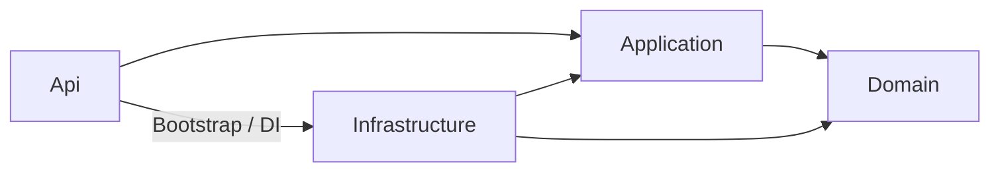

# SCDC — Tổ chức backend

Trang này mô tả cấu trúc code backend (.NET 10), quy tắc phụ thuộc giữa các phần, và các quyết định v1 về worker, Hub, repository, chia project, thư viện dùng chung và mã sinh từ gRPC.

**Trạng thái:** nghiệp vụ hiện là MVP trong một ứng dụng API. [Service mẫu S1-03](#s1-03-sample-service) bắt đầu dựng bốn project theo D40 và D43 trong [solution](../../SCDC.slnx); bốn service nghiệp vụ chưa được tách.

## Cấu trúc hiện tại (MVP)

```text
services/
├── SCDC.Api/               # Khởi động, controller, HTTP, xác thực, lỗi, OpenAPI
├── SCDC.Contracts/         # Interface và kiểu để module gọi nhau
├── SCDC.BuildingBlocks/    # Result, kiểm tra văn bản, transaction, outbox
└── Modules/
    ├── Identity/
    ├── Community/
    └── Messaging/
tests/SCDC.Api.Tests/       # Test backend
tools/SCDC.DbMigrator/      # Công cụ chạy migration
```

| Phần | Làm gì |
|---|---|
| Domain | Trạng thái, quy tắc nghiệp vụ |
| Application | Điều phối từng ca sử dụng, kiểm tra dữ liệu, interface lưu trữ |
| Infrastructure | SQL, EF Core, Npgsql, bảo mật, khóa, phân trang, tích hợp ngoài |
| API | Lấy người thực hiện từ phiên, nhận input, gọi Application, chuyển `Result` thành HTTP |
| Module bootstrap | Đăng ký DI, cấu hình, interface công khai |

Hiện mỗi module tổ chức hơi khác nhau: Identity chia theo tầng (Domain, Application, Infrastructure) ở cấp module; Community chia theo chức năng ([Community](../features/community/mechanics.md)); Messaging có API DM, ChatHub, outbox và vòng đời phòng. Chỉ tạo thư mục hay class khi gói cần dùng.

### Quy tắc phụ thuộc

- Domain không phụ thuộc HTTP, giao diện hay nhà cung cấp bên ngoài.
- Module chỉ dùng Contracts của module khác; không tham chiếu code cài đặt hay truy vấn bảng của module khác.
- Lỗi dự kiến dùng `Result` hoặc `Result<T>`; exception chỉ cho lỗi bất thường. Cách chuyển sang HTTP xem [quy ước API](api-conventions.md).
- Xác định transaction, guard, thứ tự khóa và cách gửi lại trước khi viết thao tác ghi. Transaction dùng chung chỉ đúng cho MVP, không dùng được giữa các service.
- Kiểm tra quyền ở server. Guard giữ hiệu lực tới commit khi nghiệp vụ cần.

Mỗi trang tính năng ghi luồng API → Application → Domain và lưu trữ, dữ liệu sở hữu, hợp đồng với module khác, transaction, lỗi và tình huống đồng thời. Trang này chỉ giữ quy ước chung.

Code: [Program](../../services/SCDC.Api/Program.cs), [CommunityModule](../../services/Modules/Community/CommunityModule.cs), [BuildingBlocks](../../services/SCDC.BuildingBlocks). Các bước chuẩn bị xem [quy trình](../project/workflow.md#process).

---

## Thiết kế v1: cấu trúc code

<a id="v1-repository-organization"></a>

### D39 — Giữ một repository

**Quyết định:** bốn service, WebClient, hợp đồng và tài liệu tiếp tục ở chung repository hiện tại. Mỗi service vẫn build và triển khai riêng.

**Lý do:** review thay đổi liên quan trong cùng PR, tra cứu một nơi. **Đổi lại:** phải giữ ranh giới phụ thuộc giữa service và kiểm soát thay đổi code dùng chung. Tham khảo [monorepo và nhiều repo](https://learn.microsoft.com/en-us/azure/architecture/microservices/ci-cd#monorepo-vs-multirepo).

<a id="v1-service-projects"></a>

### D40 — Mỗi service bốn project

**Quyết định:** mỗi service có bốn project: Api, Application, Domain, Infrastructure. Tổng 16 project ứng dụng.

**Lý do:** chiều tham chiếu giữa project chặn được phụ thuộc sai. **Đổi lại:** thêm project và reference phải duy trì. Phương án một project mỗi service (chia bằng thư mục) ít project hơn nhưng không tự chặn được tham chiếu sai. Tham khảo [Microsoft](https://learn.microsoft.com/en-us/dotnet/architecture/modern-web-apps-azure/common-web-application-architectures).

Test, thư viện dùng chung và mã sinh từ Protobuf không tính vào 16 project.

<a id="v1-feature-organization"></a>

### D41 — Trong project, nhóm code theo chức năng

**Quyết định:** trong mỗi project, nhóm code trước theo chức năng (ví dụ `Channels/`, `Memberships/`), không theo loại kỹ thuật (`Services/`, `Stores/`).

| | Theo chức năng (chọn) | Theo loại kỹ thuật |
|---|---|---|
| Application | `Channels/CreateChannel.cs`, `Channels/ChannelErrors.cs` | `Services/CreateChannel.cs`, `Errors/ChannelErrors.cs` |
| Infrastructure | `Channels/ChannelStore.cs`, `Memberships/MembershipStore.cs` | `Persistence/Stores/ChannelStore.cs` |

**Lý do:** dễ tìm và sửa code của một chức năng. **Đổi lại:** phải xác định ranh giới chức năng và phần thực sự dùng chung. Tham khảo [nhóm code theo chức năng](https://learn.microsoft.com/en-us/dotnet/architecture/modern-web-apps-azure/develop-asp-net-core-mvc-apps#feature-organization).

- Một chức năng có thể có phần ở cả bốn project.
- Domain nhóm quy tắc và trạng thái liên quan, không tạo model riêng cho từng thao tác.
- Phần dùng chung trong service (kết nối DB, cấu hình, transport) đặt theo trách nhiệm; bốn project không cần cây thư mục giống nhau.
- Không tạo thư mục rỗng. Tên trong bảng chỉ là ví dụ.

<a id="v1-code-layout"></a>

### D43 — Cây project và chiều tham chiếu

**Quyết định:**

```text
services/
├── Identity/
│   ├── SCDC.Identity.Api/
│   ├── SCDC.Identity.Application/
│   ├── SCDC.Identity.Domain/
│   └── SCDC.Identity.Infrastructure/
├── Community/
│   ├── SCDC.Community.Api/
│   ├── SCDC.Community.Application/
│   ├── SCDC.Community.Domain/
│   └── SCDC.Community.Infrastructure/
├── Messaging/
│   ├── SCDC.Messaging.Api/
│   ├── SCDC.Messaging.Application/
│   ├── SCDC.Messaging.Domain/
│   └── SCDC.Messaging.Infrastructure/
└── Media/
    ├── SCDC.Media.Api/
    ├── SCDC.Media.Application/
    ├── SCDC.Media.Domain/
    └── SCDC.Media.Infrastructure/
```

Mỗi thư mục chứa file `.csproj` cùng tên, ví dụ `services/Community/SCDC.Community.Api/SCDC.Community.Api.csproj`. `Media` là tên code của Media control (LiveKit là thành phần riêng). Các thư mục `clients/WebClient/`, `database/`, `tests/`, `tools/`, `docs/` giữ nguyên vai trò.

Chiều tham chiếu **trong một service**:



- **Application** khai báo interface cần dùng; **Infrastructure** cài đặt chúng; **Api** nối hai bên bằng DI lúc khởi động. Vì vậy Application không cần tham chiếu Infrastructure.
- **Domain** không phụ thuộc ba project kia, cũng không phụ thuộc SQL, HTTP, Redis, SMTP hay SDK nhà cung cấp.
- Api tham chiếu Infrastructure chỉ để đăng ký DI. Endpoint, Hub, gRPC handler gọi Application, không gọi thẳng SQL hay SDK.
- Không project nào của service này tham chiếu code cài đặt của service khác.
- **Adapter nhận vào** (HTTP, gRPC, SignalR) nằm ở Api, chuyển dữ liệu sang kiểu của Application. **Adapter gọi ra** (gRPC, SQL, Redis, SMTP, LiveKit) nằm ở Infrastructure.
- Kiểu của framework hay nhà cung cấp (`HttpContext`, message Protobuf, model EF) không được vào Domain hay hợp đồng Application.
- Adapter phát SignalR dùng [`IHubContext`](https://learn.microsoft.com/en-us/aspnet/core/signalr/hubcontext?view=aspnetcore-10.0) của Hub (thuộc Api) thì đặt ở Api, cài interface của Application; không để Infrastructure tham chiếu ngược Api.
- Worker và Hub chạy cùng tiến trình Api (D12, D13), nhưng logic nghiệp vụ vẫn ở Application.

Ví dụ với Channels:

| Project | Thư mục `Channels/` chứa |
|---|---|
| Api | Endpoint, chuyển đổi dữ liệu vào ra |
| Application | Ca sử dụng, kiểu kết quả, interface cần dùng |
| Domain | Trạng thái và quy tắc (nếu có model riêng) |
| Infrastructure | Đọc ghi dữ liệu |

Tham khảo [Clean Architecture](https://learn.microsoft.com/en-us/dotnet/architecture/modern-web-apps-azure/common-web-application-architectures#clean-architecture). Lưu ý: tham chiếu bắc cầu có thể cho dùng kiểu từ project gián tiếp ([MSBuild](https://learn.microsoft.com/en-us/dotnet/core/project-sdk/msbuild-props#disabletransitiveprojectreferences)); graph project không thay được review.

Migration: chạy như bước riêng ([D48](database.md#v1-migration-execution)) bằng một công cụ chung ([D50](database.md#v1-migration-runner)).

<a id="s1-03-sample-service"></a>

### S1-03 — Service mẫu `/health` sau gateway

Service mẫu chứng minh cách đóng gói một tiến trình .NET độc lập, chia project và định tuyến từ Nginx trước khi tách các service nghiệp vụ. `Sample` là khung thử hạ tầng cho [S1-03](../project/tasks/step-1.md), nằm ngoài bốn service nghiệp vụ của v1.

**Trạng thái:** đã triển khai và kiểm thử trên nhánh `tech/s1-03-sample-service`, kế thừa commit gateway S1-02 `d325070`; [10 ca gateway và 77 test frontend đạt](../records/verification/gateway/s1-03-2026-11-13.md), chờ review.

| Project | Trách nhiệm và tham chiếu |
|---|---|
| [SCDC.Sample.Api](../../services/Sample/SCDC.Sample.Api/SCDC.Sample.Api.csproj) | Khởi động và endpoint `/health`; gọi Application, dùng Infrastructure để đăng ký DI |
| [SCDC.Sample.Application](../../services/Sample/SCDC.Sample.Application/SCDC.Sample.Application.csproj) | `ReadServiceHealth`, response và interface `IHealthProbe`; tham chiếu Domain |
| [SCDC.Sample.Domain](../../services/Sample/SCDC.Sample.Domain/SCDC.Sample.Domain.csproj) | Snapshot sức khỏe thuần .NET; không có tham chiếu project khác |
| [SCDC.Sample.Infrastructure](../../services/Sample/SCDC.Sample.Infrastructure/SCDC.Sample.Infrastructure.csproj) | Probe liveness của tiến trình, thời gian UTC và đăng ký DI; tham chiếu Application và Domain |

Các project đặt trong `services/Sample/`, chia code theo chức năng `Health/` và bật `DisableTransitiveProjectReferences`. Service mẫu không tham chiếu module, BuildingBlocks hay Contracts của monolith. [Dockerfile](../../services/Sample/SCDC.Sample.Api/Dockerfile) chỉ lấy build context `services/Sample`, restore và publish riêng project Api.

#### HTTP và định tuyến

`GET /health` của service trả HTTP 200 và JSON, có `Cache-Control: no-store`. Ví dụ response:

```json
{
  "service": "sample-service",
  "status": "healthy",
  "checkedAt": "2026-11-13T00:00:00Z"
}
```

`checkedAt` được tạo theo giờ UTC tại lần gọi. Probe hiện kiểm tra liveness của tiến trình mẫu; nó không dùng database hay kết nối tới monolith. JWT và endpoint cần xác thực thuộc S1-06.

| Địa chỉ qua gateway | Bên trả kết quả |
|---|---|
| `/health` | Service mẫu `sample-service:8080/health` |
| `/healthz` | Nginx trả `healthy` cho chính gateway |
| `/api/v1/health` | Monolith trả trạng thái các module hiện có |

[Nginx](../../clients/WebClient/nginx.conf) định tuyến **đúng `/health`** tới service mẫu và dùng cùng cơ chế resolver của S1-02. Service mẫu chỉ mở cổng 8080 trong mạng Compose, không publish cổng riêng ra máy host. Khi service mẫu dừng, gateway trả lỗi upstream cho `/health`; giao diện và monolith có đường định tuyến riêng.

#### Chạy và kiểm chứng

[Compose phát triển](../../compose.yaml) build và chạy service mẫu cùng stack qua `podman compose up -d --build` hoặc `docker compose up -d --build`, sau khi đã chuẩn bị môi trường theo [hướng dẫn phát triển](../guides/development.md#setup). Thử `curl --fail http://localhost:3000/health` để gọi qua Nginx.

Build riêng mà không cần dựng monolith:

```bash
dotnet build services/Sample/SCDC.Sample.Api/SCDC.Sample.Api.csproj --configuration Release
```

Bộ [kiểm thử gateway](../../clients/WebClient/e2e/gateway.spec.js) thêm các ca nhận diện JSON của service mẫu, monolith dừng và service mẫu đổi IP; các ca S1-02 tiếp tục chạy trong cùng [stack thử riêng](../../compose.gateway-test.yaml). Cách chạy: `make test-gateway ENGINE=podman`, xem [hướng dẫn gateway](../guides/development.md#gateway). Việc đã có test không thay cho kết quả chạy ghi trong hồ sơ kiểm thử.

<a id="v1-shared-code"></a>

### D42 — Được phép có thư viện kỹ thuật dùng chung

**Quyết định:** cho phép thư viện kỹ thuật nhỏ dùng chung giữa các service khi có nhu cầu thật (ví dụ kiểu kết quả, cấu hình telemetry).

**Lý do:** giảm code lặp và sai khác cho nhóm ba người, bốn service cùng .NET. **Đổi lại:** sửa thư viện phải kiểm tra các service dùng nó.

- Thư viện **không** chứa nghiệp vụ, model nghiệp vụ, model lưu trữ, quy tắc quyền hay transaction của service.
- Không tạo transaction giữa service, không thay gRPC.
- Biên dịch cùng ứng dụng; không thêm service hay tiến trình.
- [BuildingBlocks](../../services/SCDC.BuildingBlocks/SCDC.BuildingBlocks.csproj) hiện chứa cả `Result`, Npgsql và transaction, outbox; không giữ nguyên cho v1. [Contracts](../../services/SCDC.Contracts) hiện phục vụ MVP; không tự thành model chung của v1. Phải phân loại từng phần khi chuyển đổi.

Không áp cho thư viện bên thứ ba, hợp đồng Protobuf, mã sinh hay tiện ích test. Tham khảo [Microsoft](https://learn.microsoft.com/en-us/dotnet/architecture/microservices/multi-container-microservice-net-applications/integration-event-based-microservice-communications#integration-events).

<a id="v1-shared-library-distribution"></a>

### D44 — Dùng ProjectReference cho thư viện chung

**Quyết định:** service tham chiếu thư viện kỹ thuật chung bằng `ProjectReference` trong cùng repository, không đóng gói NuGet.

**Lý do:** không cần bước đóng gói và phát hành package. **Đổi lại:** sửa thư viện ảnh hưởng mọi service được build lại từ commit đó. Bản đã triển khai không đổi cho tới lần cập nhật. Có thể chuyển sang NuGet nếu sau này cần quản lý phiên bản riêng. Tham khảo [ProjectReference](https://learn.microsoft.com/en-us/dotnet/core/tools/dotnet-reference-add), [NuGet](https://learn.microsoft.com/en-us/nuget/consume-packages/package-references-in-project-files).

<a id="v1-shared-library-layout"></a>

### D45 — Một thư viện chung: SCDC.Shared.Core

**Quyết định:** ban đầu chỉ có `services/Shared/SCDC.Shared.Core/SCDC.Shared.Core.csproj`, chứa kiểu kỹ thuật thuần .NET như `Result`, `Result<T>`, `Error`.

- Core không phụ thuộc database, ASP.NET hay SDK nhà cung cấp; không tham chiếu code của service.
- Mã lỗi và quy tắc nghiệp vụ vẫn ở service. Domain chỉ tham chiếu Core khi thật cần; không bắt mọi project tham chiếu Core.
- Cấu hình và adapter cần framework (ví dụ telemetry) giữ trong Api hoặc Infrastructure của từng service. Chưa có thư viện Hosting chung.
- Một số ca sử dụng Community hiện dùng thẳng code transaction, outbox ([Features](../../services/Modules/Community/Features)); phải tách khi chuyển v1, không đưa nguyên sang Core.

**Lý do:** bắt đầu với kiểu kết quả đã cần dùng chung; ít project. **Đổi lại:** có thể lặp một số cấu hình tích hợp giữa service. Phương án thêm `SCDC.Shared.Hosting` không được chọn ban đầu.

<a id="v1-grpc-code-generation"></a>

### D47 — Project hợp đồng gRPC riêng cho mỗi service cung cấp RPC

**Quyết định:** mỗi service cung cấp RPC có một project hợp đồng, sinh mã C# từ file `.proto` ([D46](api-conventions.md#v1-grpc-contract-sources)). Api và Infrastructure dùng `ProjectReference` tới project hợp đồng cần dùng. Mã sinh gồm kiểu message, client và lớp cơ sở cho server; không có nghiệp vụ.

**Lý do:** tách mã hợp đồng khỏi code cài đặt; dùng lại một bộ kiểu C#, không cấu hình sinh mã lặp lại. **Đổi lại:** thêm project và reference. Phương án sinh mã ngay trong từng project dùng (ít project hơn) phải cô lập kiểu ở nhiều nơi để tránh trùng. Tham khảo [gRPC build integration](https://github.com/grpc/grpc/blob/master/src/csharp/BUILD-INTEGRATION.md#sharing-proto-files-between-multiple-projects-in-the-same-vs-solution).

- Tối đa bốn project hợp đồng ban đầu, tạo khi có hợp đồng cần dùng; không tính vào 16 project, không thêm tiến trình.
- Api và Infrastructure chuyển kiểu Protobuf sang kiểu Application. Domain, Application và `SCDC.Shared.Core` không tham chiếu Protobuf hay project hợp đồng.
- Project hợp đồng không tham chiếu code cài đặt, domain model hay database.
- Api và Infrastructure được tham chiếu project hợp đồng của service khác để gọi RPC; vẫn không tham chiếu code cài đặt của service khác.
- `.proto` là nguồn để sửa; C# sinh ra chỉ là sản phẩm build.
- Schema dùng chung qua import phải dùng lại kiểu đã sinh, không biên dịch lại trong nhiều assembly hay tạo vòng tham chiếu.

## Thiết kế v1: worker và Hub

<a id="v1-application-workers"></a>

### D12 — Worker chạy trong tiến trình API của service

**Quyết định:** mỗi service chạy công việc nền trong chính tiến trình API của mình.

| Service | Công việc nền |
|---|---|
| Identity | [Gửi email](../features/accounts/email-links.md#delivery-mô-hình-emaildelivery-và-worker); tiếp tục tiến trình thu hồi phiên và tài khoản |
| Community | Tiếp tục [tiến trình thu hồi quyền](access-revocation.md#v1-revocation-coordinator) và [tạo phòng](../features/community/channels.md#v1-channel-creation-coordination) |
| Messaging | Phát cập nhật từ [outbox](../features/messaging/synchronization.md#contract-9) |
| Media control | Phát trạng thái qua Hub riêng; xử lý [lệnh tới LiveKit và đối chiếu](../features/media/participation-lifecycle.md#provider) sau commit |

**Lý do:** ít thành phần triển khai cho nhóm ba người. **Đổi lại:** worker chung tài nguyên và cùng khởi động lại với API. Logic tách khỏi phần khởi động API để sau này có thể chuyển sang tiến trình riêng ([hosted services](https://learn.microsoft.com/en-us/aspnet/core/fundamentals/host/hosted-services?view=aspnetcore-10.0)). Chưa đo tải.

- Tiến trình, job, outbox lưu bền trong DB của service; bộ nhớ của API không thay dữ liệu phục hồi.
- Không có worker trung tâm đọc cả bốn DB. Tách worker sau này vẫn giữ quyền sở hữu của service.
- Worker gọi gRPC bằng danh tính service qua mTLS ([D20](api-conventions.md#v1-service-authentication)).
- Bộ kiểm soát lease tại node LiveKit thuộc [Media](../features/media/participation-lifecycle.md#admission), không thuộc D12.

<a id="v1-realtime-hosting"></a>

### D13 — Hub chạy cùng API của service

**Quyết định:** Hub chat chạy cùng API Messaging; Hub Media chạy cùng API Media control ([D11](../features/media/participation-lifecycle.md#v1-media-realtime)).

**Lý do:** ít tiến trình; API, worker và Hub phối hợp trong một chỗ (gửi cập nhật qua `IHubContext`, [Microsoft](https://learn.microsoft.com/en-us/aspnet/core/signalr/background-services?view=aspnetcore-10.0)). **Đổi lại:** dùng chung tài nguyên; khởi động lại làm rớt mọi kết nối Hub của service đó.

- Kết nối SignalR sống lâu, tốn bộ nhớ; cần đo tải để biết khi nào tách ([scale](https://learn.microsoft.com/en-us/aspnet/core/signalr/scale?view=aspnetcore-10.0)).
- Tách logic Hub, nghiệp vụ và phát outbox trong code; tách tiến trình sau này phải thiết kế thêm đường phát và phối hợp quyền.
- Mỗi service một bản chạy ([D21](environments.md#v1-service-replicas)), không backplane.
- Chạy chung tiến trình không chứng minh dữ liệu bền, phục hồi hay ngắt kết nối đúng hạn.

## Còn mở

- **Cấu trúc:** số solution; cấu hình MSBuild hay công cụ kiểm tra kiến trúc; kế hoạch di chuyển code MVP; cách tách BuildingBlocks và Contracts; tiện ích test; CI/CD.
- **D47:** tên và đường dẫn project hợp đồng; công cụ và phiên bản sinh mã; namespace; schema và import; quy tắc tương thích; thứ tự triển khai khi đổi hợp đồng.
- **D12, D13:** số luồng xử lý; cách giành việc và thử lại; giới hạn tài nguyên; URL Hub Media; HA; xác thực Hub; hợp đồng tạo và xóa phòng giữa service.

---

Nguồn: [DEC-130](../records/decisions/README.md#dec-130) (D12), [DEC-131](../records/decisions/README.md#dec-131) (D13), [DEC-157](../records/decisions/README.md#dec-157) (D39), [DEC-158](../records/decisions/README.md#dec-158) (D40), [DEC-159](../records/decisions/README.md#dec-159) (D41), [DEC-160](../records/decisions/README.md#dec-160) (D42), [DEC-161](../records/decisions/README.md#dec-161) (D43), [DEC-162](../records/decisions/README.md#dec-162) (D44), [DEC-163](../records/decisions/README.md#dec-163) (D45), [DEC-165](../records/decisions/README.md#dec-165) (D47). Các phương án đã cân nhắc ghi trong hồ sơ quyết định.
