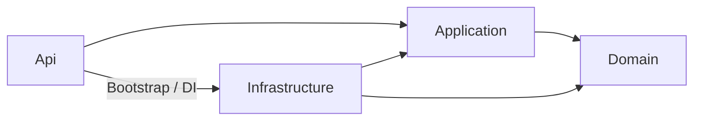

# SCDC — Tổ chức backend

## Cấu trúc

Backend dùng .NET 10 trong [SCDC.slnx](../../SCDC.slnx). MVP có một API host; ranh giới service mục tiêu tại [kiến trúc](architecture.md#target).

```text
services/
├── SCDC.Api/               # Bootstrap, controllers, HTTP/auth/error/OpenAPI
├── SCDC.Contracts/         # Interface và kiểu giao tiếp liên module
├── SCDC.BuildingBlocks/    # Result, text policy, transaction scope, outbox
└── Modules/
    ├── Identity/
    ├── Community/
    └── Messaging/
tests/SCDC.Api.Tests/       # Test backend theo thành phần và tính năng
tools/SCDC.DbMigrator/      # Nâng cấp schema explicit
```

## Trách nhiệm

| Phần | Nội dung |
|---|---|
| Domain | Trạng thái, quy tắc và bất biến nghiệp vụ |
| Application | Điều phối use case, validation và hợp đồng persistence |
| Infrastructure | SQL/EF Core/Npgsql, bảo mật, khóa, paging và tích hợp |
| API | Đọc actor từ phiên; bind input; gọi Application; ánh xạ Result ra HTTP |
| Module bootstrap | Đăng ký DI/configuration và các interface công khai |

Identity hiện tổ chức theo Domain/Application/Infrastructure ở cấp module. Community tổ chức nghiệp vụ theo feature, dùng chung infrastructure; [thiết kế Community](community.md) giữ cấu trúc chi tiết. Messaging có DM API, ChatHub/outbox và lifecycle phòng; phạm vi theo [Messaging](../features/messaging/README.md). Chỉ tạo folder/class khi gói cần sử dụng.

## Quy tắc phụ thuộc

- Domain không phụ thuộc HTTP, UI hoặc provider.
- Module chỉ sử dụng Contracts của module khác; không tham chiếu implementation hoặc truy vấn bảng do module khác sở hữu.
- Lỗi dự kiến dùng `Result`/`Result<T>`; exception dành cho lỗi bất thường. [Quy ước HTTP](api-conventions.md) giữ cách ánh xạ lỗi.
- Gói xác định transaction, guard, lock order và retry trước khi viết mutation. Shared scope thuộc nền MVP một host; không áp nguyên trạng xuyên microservice.
- Kiểm tra quyền ở server. Guard phải giữ hiệu lực theo hợp đồng tới commit khi nghiệp vụ yêu cầu.

## Thiết kế theo chủ đề

Mỗi chủ đề ghi luồng API → Application → Domain/Persistence, dữ liệu sở hữu, contract liên module, phạm vi transaction, lỗi và các tình huống đồng thời. Tài liệu này chỉ giữ quy ước chung; không chép lại thuật toán của từng chức năng.

<a id="v1-application-workers"></a>

## D12 — Cách chạy worker ứng dụng v1

Trạng thái: đã xác nhận phương án A ngày 2026-10-11 — [DEC-130](../records/decisions/README.md#dec-130). Trong cấu hình v1 ban đầu, mỗi service chạy công việc nền ứng dụng trong tiến trình API của mình. Giữ phạm vi worker MVP và phân công đã có.

| Service sở hữu | Công việc nền theo thiết kế hiện có |
|---|---|
| Identity | [Gửi email](../features/accounts/email-links.md#delivery-mô-hình-emaildelivery-và-worker) và tiếp tục tiến trình thu hồi phiên/tài khoản |
| Community | Tiếp tục [tiến trình thu hồi quyền](access-revocation.md#v1-revocation-coordinator) và [tiến trình tạo phòng](../features/community/channels.md#v1-channel-creation-coordination) |
| Messaging | Phát cập nhật từ [outbox](../features/messaging/synchronization.md#contract-9) |
| Media control | Phát trạng thái qua Hub riêng và xử lý [lệnh provider/đối soát](../features/media/participation-lifecycle.md#provider) sau commit |

Lựa chọn giảm số thành phần triển khai cho nhóm ba người; đánh đổi là công việc nền chia sẻ tài nguyên và vòng deploy/restart với API. Logic xử lý công việc tách khỏi bootstrap API để có thể chuyển sang worker host riêng khi cần. ASP.NET Core hỗ trợ hosted service trong web app và Worker Service riêng theo [tài liệu Microsoft](https://learn.microsoft.com/en-us/aspnet/core/fundamentals/host/hosted-services?view=aspnetcore-10.0). Chưa có phép đo tải để quyết định số worker hoặc tài nguyên.

Tiến trình/job/outbox được lưu bền tại DB của owner theo hợp đồng từng chủ đề; bộ nhớ của API host không thay dữ liệu phục hồi. Cách claim, chống xử lý trùng, phục hồi sau restart và giới hạn tài nguyên cần thiết kế/kiểm chứng trước triển khai. Không gom thành worker trung tâm đọc cả bốn DB. Nếu tách worker host về sau, quyền sở hữu công việc và database vẫn thuộc service tương ứng; không tự thêm service nghiệp vụ.

D12 không chọn vị trí process của Hub; phần này được chốt tại [D13](#v1-realtime-hosting). Ban đầu mỗi service có một tiến trình API hoạt động theo [D21](environments.md#v1-service-replicas); số luồng xử lý công việc và claim/retry cần thiết kế riêng. Danh tính service trong lời gọi gRPC của worker dùng mTLS theo [D20](api-conventions.md#v1-service-authentication). Schema, cấu hình mTLS, quyền RPC và mở rộng sau còn mở. Bộ kiểm soát lease/fail-close tại node SFU thuộc [Media](../features/media/participation-lifecycle.md#admission), không thuộc lựa chọn host cho worker ứng dụng này. Chưa tạo project hoặc thay runtime.

<a id="v1-realtime-hosting"></a>

## D13 — Vị trí chạy Hub SignalR v1

Trạng thái: đã xác nhận phương án A ngày 2026-10-11 — [DEC-131](../records/decisions/README.md#dec-131). Trong cấu hình v1 ban đầu, Hub chat chạy cùng API Messaging; Hub Media chạy cùng API Media control. Quyền sở hữu Hub giữ theo [D11](../features/media/participation-lifecycle.md#v1-media-realtime); công việc nền cùng API theo D12.

Lựa chọn giảm số tiến trình triển khai và đường phối hợp API/worker với Hub. Đánh đổi là API, Hub và worker của từng service dùng chung tài nguyên và vòng deploy/restart; dừng tiến trình làm gián đoạn các kết nối Hub tại đó. ASP.NET Core hỗ trợ API/Hub và công việc nền trong cùng web app, phát cập nhật qua `IHubContext` theo [Microsoft — SignalR và background services](https://learn.microsoft.com/en-us/aspnet/core/signalr/background-services?view=aspnetcore-10.0).

Kết nối SignalR tồn tại lâu, sử dụng bộ nhớ và tài nguyên kết nối; cần đo tải để đánh giá khi nào nên tách host theo [Microsoft — hosting/scaling](https://learn.microsoft.com/en-us/aspnet/core/signalr/scale?view=aspnetcore-10.0). Tách logic Hub, xử lý nghiệp vụ và phát outbox trong code; nếu tách host về sau phải thiết kế thêm đường phát cập nhật và phối hợp quyền giữa các tiến trình. D13 chưa chọn thời điểm hoặc cơ chế tách.

REST cho thao tác dữ liệu nghiệp vụ, outbox sau commit và yêu cầu thu hồi/reconnect giữ theo từng chủ đề. Chạy cùng tiến trình không thay dữ liệu bền hoặc chứng minh phục hồi/cutoff; mỗi service vẫn chỉ truy cập DB của mình.

D21 chọn một bản chạy hoạt động cho mỗi service ban đầu; chưa bổ sung backplane để phối hợp nhiều bản Hub. [D27](api-conventions.md#v1-integration-event-transport) chọn worker owner chuyển sự kiện sau commit qua gRPC từ outbox, chưa thêm broker; không gom công việc thành worker trung tâm đọc các DB. URL Hub Media, HA, mở rộng sau, xác thực Hub, topology máy chủ và đường LiveKit còn mở. Hợp đồng tạo/xóa kênh và tài nguyên Messaging/Media xuyên database tiếp tục cần thiết kế; lựa chọn host không thay shared transaction của MVP. Chưa đổi code hoặc runtime.

Nguồn triển khai: [Program](../../services/SCDC.Api/Program.cs), [CommunityModule](../../services/Modules/Community/CommunityModule.cs), [BuildingBlocks](../../services/SCDC.BuildingBlocks). Các bước chuẩn bị SQL/config/skeleton và kiểm chứng tại [workflow](../project/workflow.md#process).

<a id="v1-repository-organization"></a>

## D39 — Tổ chức repository v1

Trạng thái: đã xác nhận phương án A ngày 2026-10-12 — [DEC-157](../records/decisions/README.md#dec-157). Giữ repository hiện có cho bốn service nghiệp vụ, WebClient, hợp đồng và tài liệu.

Mỗi service là đơn vị build và triển khai riêng theo [ranh giới đã chọn](architecture.md#service-boundaries). Thay đổi trong repository chung không buộc cập nhật đồng loạt các service; cần xác định đúng phần bị ảnh hưởng khi build/test. Nguồn đối chiếu: [Microsoft — monorepo và nhiều repository](https://learn.microsoft.com/en-us/azure/architecture/microservices/ci-cd#monorepo-vs-multirepo).

Lựa chọn thuận tiện review thay đổi liên quan trong cùng PR và tra cứu mã/tài liệu tại một nơi cho nhóm ba người. Đánh đổi là cần giữ ranh giới phụ thuộc giữa các service và kiểm soát thay đổi mã dùng chung.

D39 chỉ chốt ranh giới Git; cách chia project trong mỗi service đã chọn tại [D40](#v1-service-projects), tên/đường dẫn và chiều tham chiếu tại [D43](#v1-code-layout). Số solution, cách cấp thư viện chung, version hợp đồng và pipeline CI/CD cần thiết kế riêng. Chưa di chuyển mã, tạo project hoặc đổi cấu hình.

<a id="v1-service-projects"></a>

## D40 — Chia project bên trong mỗi service

Trạng thái: đã xác nhận phương án B ngày 2026-10-12 — [DEC-158](../records/decisions/README.md#dec-158). Mỗi service nghiệp vụ có bốn project ứng dụng: API, Application, Domain và Infrastructure, theo [trách nhiệm](#trách-nhiệm) đã mô tả. Một project .NET có file `.csproj`; folder bên trong chỉ phân nhóm mã. Phạm vi quyết định không gồm test, thư viện chung hoặc mã hợp đồng sinh từ Protobuf.

| Nội dung | A — Một project ứng dụng mỗi service | B — Bốn project theo trách nhiệm mỗi service |
|---|---|---|
| Bố trí | API, nghiệp vụ và hạ tầng trong một project; phân nhóm bằng folder | Tách API, Application, Domain và Infrastructure thành bốn project |
| Lợi ích | Ít project/reference cần quản lý; thuận tiện chuyển đổi và tra cứu | Có thể chặn phụ thuộc sai giữa các project bằng chiều tham chiếu đã quy định |
| Bất lợi | Folder không tự chặn tham chiếu sai; cần review hoặc kiểm tra quy tắc phụ thuộc | Thêm project, reference và cấu hình cần duy trì |
| Tổng project ứng dụng mục tiêu cho bốn service | 4 | 16 |

Lựa chọn ưu tiên tổ chức code rõ ràng: thể hiện trách nhiệm bằng project riêng và hỗ trợ kiểm soát phụ thuộc khi cấu hình đúng chiều tham chiếu. Đánh đổi là thêm project/reference cần duy trì.

Các trách nhiệm và quy tắc phụ thuộc ở đầu tài liệu vẫn phải được giữ; Domain không gọi SQL, HTTP hoặc provider. Cách nhóm mã theo tính năng bên trong project đã chọn tại [D41](#v1-feature-organization). Các thư viện chạy cùng tiến trình API của service; mỗi service vẫn là một đơn vị triển khai. Giữ một bản API/worker/Hub của từng service theo [D12/D13](#v1-application-workers) và [D21](environments.md#v1-service-replicas).

API host chỉ chứa nghiệp vụ và hạ tầng của service mình, không tham chiếu project implementation của service khác. Giao tiếp nghiệp vụ giữa các service theo [gRPC/Protobuf](api-conventions.md#v1-internal-protocol); phạm vi thư viện kỹ thuật dùng chung đã chọn tại [D42](#v1-shared-code).

Nguồn đối chiếu về folder, project và chiều phụ thuộc: [Microsoft — tổ chức ứng dụng .NET](https://learn.microsoft.com/en-us/dotnet/architecture/modern-web-apps-azure/common-web-application-architectures). Quyết định B đã được người dùng xác nhận; source này giải thích cơ chế tổ chức và phụ thuộc.

D40 chỉ chốt cách chia project; nguyên tắc nhóm mã bên trong đã chọn tại [D41](#v1-feature-organization), phạm vi thư viện kỹ thuật chung tại [D42](#v1-shared-code), tên/đường dẫn và chiều tham chiếu tại [D43](#v1-code-layout). Cây file bên trong từng tính năng, số solution, cách đóng gói thư viện và công cụ kiểm tra phụ thuộc cần thiết kế riêng. Cấu trúc MVP hiện tại giữ nguyên; chưa di chuyển code hoặc tạo project.

<a id="v1-feature-organization"></a>

## D41 — Nhóm mã bên trong project

Trạng thái: đã xác nhận phương án A ngày 2026-10-12 — [DEC-159](../records/decisions/README.md#dec-159). Giữ bốn project theo D40; bên trong từng project, nhóm mã nghiệp vụ trước theo chủ đề/tính năng.

| Nội dung | A — Nhóm trước theo chủ đề/tính năng | B — Nhóm trước theo loại kỹ thuật |
|---|---|---|
| Ví dụ trong Application | `Channels/CreateChannel.cs`, `Channels/ChannelErrors.cs` | `Services/CreateChannel.cs`, `Errors/ChannelErrors.cs` |
| Ví dụ trong Infrastructure | `Channels/ChannelStore.cs`, `Memberships/MembershipStore.cs` | `Persistence/Stores/ChannelStore.cs`, `Persistence/Stores/MembershipStore.cs` |
| Lợi ích | Dễ tìm các file cùng chủ đề trong từng project | Dễ tìm toàn bộ thành phần cùng loại kỹ thuật |
| Bất lợi | Cần xác định ranh giới chủ đề và phần thực sự dùng chung | File cùng chủ đề nằm ở nhiều nhóm; folder theo loại có thể lớn dần |

Lựa chọn ưu tiên tra cứu và sửa mã theo nghiệp vụ. Mỗi project chỉ chứa phần đúng trách nhiệm của mình; một chủ đề vẫn có thể có phần ở cả bốn project. Domain nhóm quy tắc và trạng thái liên quan, không nhân bản model theo từng thao tác của Application. Thành phần dùng chung trong service như kết nối database, cấu hình hoặc transport đặt theo trách nhiệm; không buộc bốn project có cây folder giống nhau.

Nguồn đối chiếu: [Microsoft — nhóm mã theo tính năng](https://learn.microsoft.com/en-us/dotnet/architecture/modern-web-apps-azure/develop-asp-net-core-mvc-apps#feature-organization) nêu việc tra cứu một tính năng có thể phải đi qua nhiều folder nếu nhóm theo loại file. Người dùng đã xác nhận cách áp dụng A cho SCDC.

Đường dẫn và tên lớp trong bảng chỉ minh họa hai cách nhóm, chưa là cây file theo tính năng đã chốt. D41 không chọn thư viện, cách điều phối handler, mô hình truy cập dữ liệu hoặc yêu cầu interface cho mỗi class. Không tạo folder rỗng; chỉ tạo cấu trúc khi có mã sử dụng. Phạm vi thư viện kỹ thuật chung đã chọn tại [D42](#v1-shared-code), chiều tham chiếu giữa bốn project trong service tại [D43](#v1-code-layout), cách cấp và bố trí thư viện chung tại [D44](#v1-shared-library-distribution)/[D45](#v1-shared-library-layout). Solution cần thiết kế riêng. Chưa sửa code.

<a id="v1-shared-code"></a>

## D42 — Mã kỹ thuật dùng chung giữa service

Trạng thái: đã xác nhận phương án A ngày 2026-10-12 — [DEC-160](../records/decisions/README.md#dec-160). Cho phép thư viện kỹ thuật nhỏ dùng chung giữa service khi có nhu cầu thực tế. Phạm vi là mã C# tự viết được dùng trong runtime của nhiều service. Thư viện .NET/bên thứ ba, hợp đồng Protobuf/mã sinh và tiện ích test không thuộc quyết định này.

| Nội dung | A — Cho phép thư viện kỹ thuật nhỏ dùng chung | B — Giữ mã kỹ thuật tự viết riêng trong từng service |
|---|---|---|
| Bố trí | Tách phần có nhu cầu dùng chung, ví dụ kiểu kết quả xử lý hoặc cấu hình telemetry | Helper cần thiết nằm trong từng service; chấp nhận một số mã trùng |
| Lợi ích | Giảm triển khai lặp và sai khác giữa các bản helper | Có thể thay helper của một service mà không ảnh hưởng code của service khác |
| Bất lợi | Sửa thư viện phải đánh giá và kiểm tra các service sử dụng | Cần duy trì bản sửa tại nhiều nơi nếu helper trùng nhau |

Lựa chọn giảm triển khai lặp cho nhóm ba người và bốn service dùng .NET. Chỉ tách phần kỹ thuật có nhu cầu thực tế; thư viện không sở hữu nghiệp vụ hoặc truy cập dữ liệu của service khác. Model nghiệp vụ, model persistence, quy tắc quyền và tiến trình/transaction của owner vẫn thuộc service tương ứng. Mã dùng chung không tạo transaction xuyên service hoặc thay giao tiếp gRPC đã chọn.

Thư viện được biên dịch/đóng gói cùng ứng dụng sử dụng; không thêm service hoặc tiến trình. Thay đổi thư viện cần đánh giá tương thích nhưng không buộc triển khai đồng loạt. Ban đầu có một thư viện Core theo [D45](#v1-shared-library-layout), không tính vào 16 project ứng dụng theo D40.

[BuildingBlocks hiện tại](../../services/SCDC.BuildingBlocks/SCDC.BuildingBlocks.csproj) chứa cả Result, Npgsql và mã transaction/outbox; không mặc định giữ nguyên project này hoặc để Domain phụ thuộc nó. [Contracts hiện tại](../../services/SCDC.Contracts) phục vụ gọi trong MVP một host; không tự trở thành model nghiệp vụ chung cho v1. Cần phân loại từng phần trước chuyển đổi.

Nguồn đối chiếu: [Microsoft — phạm vi thư viện dùng chung giữa microservice](https://learn.microsoft.com/en-us/dotnet/architecture/microservices/multi-container-microservice-net-applications/integration-event-based-microservice-communications#integration-events) phân biệt công cụ kỹ thuật có thể dùng chung với domain model dùng chung gây phụ thuộc. Người dùng đã xác nhận A cho SCDC.

D42 chỉ chốt phạm vi thư viện kỹ thuật chung; cách cấp bằng project reference đã chọn tại [D44](#v1-shared-library-distribution), tên/vị trí và phạm vi ban đầu tại [D45](#v1-shared-library-layout). Cây project ứng dụng và chiều tham chiếu trong service đã chọn tại [D43](#v1-code-layout). Cách cấp hợp đồng đã chọn riêng tại [D47](#v1-grpc-code-generation); CI/CD cần thiết kế tiếp. Chưa tạo thư viện hoặc sửa code.

<a id="v1-code-layout"></a>

## D43 — Cây project và chiều phụ thuộc

Trạng thái: đã được người dùng duyệt ngày 2026-10-12 — [DEC-161](../records/decisions/README.md#dec-161). Phạm vi là tên/đường dẫn của 16 project ứng dụng và chiều tham chiếu trực tiếp giữa bốn project trong mỗi service. Cấu trúc mục tiêu áp dụng các lựa chọn D39–D42; source MVP chưa chuyển đổi.

```text
services/
├── Identity/
│   ├── SCDC.Identity.Api/
│   ├── SCDC.Identity.Application/
│   ├── SCDC.Identity.Domain/
│   └── SCDC.Identity.Infrastructure/
├── Community/
│   ├── SCDC.Community.Api/
│   ├── SCDC.Community.Application/
│   ├── SCDC.Community.Domain/
│   └── SCDC.Community.Infrastructure/
├── Messaging/
│   ├── SCDC.Messaging.Api/
│   ├── SCDC.Messaging.Application/
│   ├── SCDC.Messaging.Domain/
│   └── SCDC.Messaging.Infrastructure/
└── Media/
    ├── SCDC.Media.Api/
    ├── SCDC.Media.Application/
    ├── SCDC.Media.Domain/
    └── SCDC.Media.Infrastructure/
```

Mỗi folder project mục tiêu chứa file `.csproj` cùng tên; ví dụ `services/Community/SCDC.Community.Api/SCDC.Community.Api.csproj`. `Media` là tên code đã chọn cho Media control; LiveKit giữ vai trò SFU riêng. Các đầu mục hiện có `clients/WebClient/`, `database/`, `tests/`, `tools/` và `docs/` giữ vai trò của mình; cây này chưa thiết kế lại cấu trúc con của các đầu mục đó. `SCDC.slnx` hiện có vẫn là nguồn mô tả MVP; số solution mục tiêu chưa chọn.

Mũi tên dưới đây là chiều tham chiếu project trực tiếp đã chọn trong **cùng một service**:



Application định nghĩa các interface cần để thực hiện use case; Infrastructure triển khai phần lưu dữ liệu và tích hợp tương ứng. Api nối implementation với interface tại bootstrap bằng DI. Vì vậy Application không cần tham chiếu Infrastructure để sử dụng implementation lúc chạy. Domain giữ nghiệp vụ, không phụ thuộc ba project còn lại hoặc SQL, HTTP, Redis, SMTP và SDK provider. Nguyên tắc đảo chiều phụ thuộc và vai trò bootstrap được mô tả tại [Microsoft — Clean Architecture](https://learn.microsoft.com/en-us/dotnet/architecture/modern-web-apps-azure/common-web-application-architectures#clean-architecture).

Tham chiếu Api → Infrastructure chỉ phục vụ bootstrap/đăng ký triển khai; endpoint/Hub/gRPC handler gọi Application, không gọi trực tiếp lớp SQL hoặc SDK provider. Không project implementation nào của một service tham chiếu implementation của service khác. Thư viện kỹ thuật chung giữ phạm vi D42, cấp bằng project reference theo [D44](#v1-shared-library-distribution), ban đầu là Core theo [D45](#v1-shared-library-layout); không nằm trong graph bốn lớp này.

Adapter nhận HTTP/gRPC/SignalR nằm tại Api và ánh xạ dữ liệu truyền vào kiểu của Application. Adapter gọi gRPC ra ngoài, SQL, Redis, SMTP hoặc SFU nằm tại Infrastructure và triển khai interface do Application cần dùng. Kiểu của framework/provider như `HttpContext`, Protobuf message hoặc model EF không đi vào Domain hay hợp đồng Application.

Adapter phát SignalR dùng [IHubContext của Hub](https://learn.microsoft.com/en-us/aspnet/core/signalr/hubcontext?view=aspnetcore-10.0) thuộc Api thì đặt tại Api, triển khai interface của Application và đăng ký tại bootstrap; không để Infrastructure tham chiếu ngược Api. Chi tiết endpoint, interface và tên lớp cần thiết kế theo tính năng.

Ví dụ nhóm mã Community theo D41; tên folder/file dưới đây chỉ minh họa, chưa là danh sách lớp bắt buộc:

| Project | Ví dụ phần liên quan đến Channels |
|---|---|
| Api | `Channels/` chứa endpoint và ánh xạ dữ liệu vào/ra |
| Application | `Channels/` chứa use case, kiểu kết quả và interface cần dùng |
| Domain | `Channels/` chứa trạng thái/quy tắc nếu chủ đề có domain model riêng |
| Infrastructure | `Channels/` chứa triển khai lưu/đọc dữ liệu của owner |

Worker và Hub vẫn chạy cùng Api theo D12/D13; nơi chạy không đồng nghĩa toàn bộ logic nằm trong project Api. Bootstrap/host nằm tại Api, điều phối nghiệp vụ tại Application, triển khai dữ liệu/provider tại Infrastructure. Model Domain dùng riêng theo service; vị trí nguồn `.proto` đã chọn tại [D46](api-conventions.md#v1-grpc-contract-sources), project hợp đồng và cách cấp mã C# tại [D47](#v1-grpc-code-generation). Cấu hình sinh mã, adapter gRPC và hợp đồng xác thực chi tiết cần thiết kế riêng.

Graph project hỗ trợ kiểm soát phụ thuộc nhưng không thay review quy tắc sử dụng lớp. Cấu hình tham chiếu bắc cầu có thể cho phép dùng kiểu từ project gián tiếp theo [Microsoft — tham chiếu project ngầm định](https://learn.microsoft.com/en-us/dotnet/core/project-sdk/msbuild-props#disabletransitiveprojectreferences). D43 chưa chọn cấu hình MSBuild hoặc công cụ kiểm tra kiến trúc.

Migration vẫn thuộc DB owner; [D48](database.md#v1-migration-execution) chọn bước migration riêng trong đợt triển khai, kiểm tra đạt rồi bản API mới phục vụ. [D50](database.md#v1-migration-runner) chọn một runner chung, mỗi lần chạy chỉ một DB owner; cách phân chia SQL và việc chuyển đổi [DbMigrator MVP](../../tools/SCDC.DbMigrator) cần thiết kế riêng. D43 chỉ xác nhận cấu trúc project ứng dụng; số solution, CI/CD và kế hoạch di chuyển MVP còn mở. Cách cấp thư viện kỹ thuật chung đã chọn tại [D44](#v1-shared-library-distribution), tên/vị trí ban đầu tại [D45](#v1-shared-library-layout). Việc chuyển code cần gói triển khai riêng. Chưa tạo project, di chuyển mã hoặc đổi runtime.

<a id="v1-shared-library-distribution"></a>

## D44 — Cách cấp thư viện kỹ thuật chung

Trạng thái: đã xác nhận phương án A ngày 2026-10-12 — [DEC-162](../records/decisions/README.md#dec-162). Các service dùng `ProjectReference` tới project thư viện kỹ thuật trong cùng repository. Phạm vi là mã dùng chung tự viết theo D42; giữ chiều tham chiếu giữa bốn project trong service đã chọn tại D43. Không áp quyết định này cho thư viện bên thứ ba, hợp đồng Protobuf/mã sinh hoặc tiện ích test.

| Nội dung | A — Tham chiếu project trong repository | B — Sử dụng gói NuGet có phiên bản |
|---|---|---|
| Cách dùng | `ProjectReference` tới project thư viện; mỗi build dùng mã thư viện tại commit đang build | Đóng gói/phát hành thư viện; service khai báo package và phiên bản cần dùng qua `PackageReference` |
| Lợi ích | Thay đổi và review trong cùng repository, không cần bước phát hành package riêng | Mỗi service quản lý phiên bản thư viện và lịch nâng cấp riêng |
| Bất lợi | Thay đổi thư viện có thể ảnh hưởng mọi service sử dụng được build lại từ commit đó | Thêm bước đóng gói, phát hành, quản lý phiên bản và nơi lưu package |

Lựa chọn giảm bước đóng gói/phát hành thư viện cho nhóm ba người và repository chung đã chọn. Mỗi build dùng mã thư viện tại commit đang build; khi sửa thư viện, cần đánh giá và kiểm tra các service sử dụng nó. Bản ứng dụng đã triển khai giữ nguyên cho tới lần cập nhật; vẫn build/triển khai từng service riêng. Nếu về sau cần quản lý phiên bản thư viện độc lập, có thể xem xét chuyển sang B.

Giữ phạm vi thư viện kỹ thuật D42 và ranh giới owner; không đưa implementation hoặc domain model của service khác vào thư viện chung. Cách dùng thư viện không tạo thêm service/tiến trình và không tính vào 16 project ứng dụng theo D40.

Nguồn đối chiếu: [Microsoft — tham chiếu project](https://learn.microsoft.com/en-us/dotnet/core/tools/dotnet-reference-add) và [NuGet — tham chiếu package/phiên bản](https://learn.microsoft.com/en-us/nuget/consume-packages/package-references-in-project-files). Người dùng đã xác nhận A cho SCDC.

D44 chỉ chốt cách cấp thư viện bằng project reference; tên/vị trí và phạm vi ban đầu đã chọn tại [D45](#v1-shared-library-layout). Hợp đồng/mã sinh được quyết định riêng tại [D47](#v1-grpc-code-generation); khóa dependency và CI/CD cần thiết kế riêng. Chưa thêm reference, tạo package hoặc sửa cấu hình.

<a id="v1-shared-library-layout"></a>

## D45 — Bố trí thư viện kỹ thuật chung ban đầu

Trạng thái: đã xác nhận phương án A ngày 2026-10-12 — [DEC-163](../records/decisions/README.md#dec-163). Ban đầu dùng một project thư viện `services/Shared/SCDC.Shared.Core/SCDC.Shared.Core.csproj`. Phạm vi là kiểu kỹ thuật thuần .NET như `Result`, `Result<T>`, `Error` và kiểu hỗ trợ cần dùng; cấu hình/adapter cần framework giữ trong từng service. Giữ D42 và cách cấp bằng project reference theo D44; không bắt buộc mọi project của service tham chiếu Core.

| Nội dung | A — Một thư viện thuần .NET | B — Thư viện thuần .NET và thư viện Hosting riêng |
|---|---|---|
| Project mục tiêu | `services/Shared/SCDC.Shared.Core/` | Core như A; thêm `services/Shared/SCDC.Shared.Hosting/` |
| Core | Kiểu `Result`, `Result<T>`, `Error` và kiểu hỗ trợ cần dùng; không phụ thuộc database, ASP.NET hoặc SDK provider | Giữ cùng phạm vi Core như A |
| Phần cần framework | Cấu hình/adapter giữ tại Api hoặc Infrastructure của từng service theo D43 | Chia sẻ helper cấu hình host có nhu cầu thực tế, ví dụ telemetry, trong Hosting; chỉ Api/Infrastructure sử dụng |
| Lợi ích | Ít project chung cần quản lý, giữ phụ thuộc rõ | Giảm mã cấu hình host lặp giữa các service |
| Bất lợi | Có thể lặp một số cấu hình tích hợp | Thêm project/phụ thuộc chung và phạm vi thay đổi cần kiểm tra |

Lựa chọn bắt đầu với các kiểu kết quả đã có nhu cầu dùng chung và giảm số project cần quản lý. Đánh đổi là có thể lặp một số cấu hình tích hợp giữa các service. D42 vẫn cho phép xem xét thư viện kỹ thuật khác khi có nhu cầu; v1 ban đầu chưa có thư viện Hosting chung.

Core chỉ chứa kiểu kỹ thuật dùng chung; mã lỗi và quy tắc nghiệp vụ của từng tính năng giữ trong service owner. Core không tham chiếu implementation service, database, ASP.NET hoặc SDK provider. Domain chỉ tham chiếu Core nếu có nhu cầu thực tế. Thư viện Core không tính vào 16 project ứng dụng theo D40; chỉ tạo cấu trúc khi có mã sử dụng.

[BuildingBlocks hiện tại](../../services/SCDC.BuildingBlocks/SCDC.BuildingBlocks.csproj) chứa Npgsql cùng các kiểu [Result](../../services/SCDC.BuildingBlocks/Application/Results). Một số use case [Community hiện tại](../../services/Modules/Community/Features) còn trực tiếp dùng mã transaction/outbox. Cần phân loại/tách phụ thuộc khi chuyển v1; quyết định này không chuyển nguyên project hoặc implementation SQL đó vào Core/Application.

Nguồn đối chiếu về giữ phần nghiệp vụ độc lập hạ tầng: [Microsoft — Clean Architecture](https://learn.microsoft.com/en-us/dotnet/architecture/modern-web-apps-azure/common-web-application-architectures#clean-architecture). Người dùng đã xác nhận A cùng tên/vị trí Core cho SCDC.

D45 không chọn framework/SDK, danh sách đầy đủ helper hoặc cách kiểm tra phụ thuộc. Vị trí nguồn Protobuf đã chọn tại [D46](api-conventions.md#v1-grpc-contract-sources), project hợp đồng và cách cấp mã sinh tại [D47](#v1-grpc-code-generation). Tiện ích test, solution và migration tiếp tục thiết kế riêng. Chưa tạo thư mục/project hoặc sửa mã/cấu hình.

<a id="v1-grpc-code-generation"></a>

## D47 — Tổ chức mã C# sinh từ hợp đồng gRPC

Trạng thái: đã xác nhận phương án A ngày 2026-10-12 — [DEC-165](../records/decisions/README.md#dec-165). Mỗi service cung cấp RPC có project hợp đồng riêng, sinh mã C# từ nguồn `.proto` đã chọn tại [D46](api-conventions.md#v1-grpc-contract-sources). Api/Infrastructure dùng `ProjectReference` tới project hợp đồng cần dùng. Mã sinh gồm kiểu thông điệp, client và lớp cơ sở để triển khai server; không chứa xử lý nghiệp vụ.

| Nội dung | A — Project hợp đồng riêng theo service cung cấp RPC | B — Sinh trực tiếp trong project sử dụng |
|---|---|---|
| Bố trí | Project thư viện theo RPC owner sinh mã hợp đồng; Api/Infrastructure tham chiếu project hợp đồng cần dùng bằng `ProjectReference` | Api sinh phần server, Infrastructure sinh client cần dùng từ nguồn `.proto` chuẩn; mã sinh được cô lập trong từng adapter |
| Lợi ích | Tách mã hợp đồng khỏi implementation, dùng lại bộ kiểu C# và giảm cấu hình sinh mã lặp | Ít project thêm; mã sinh nằm gần adapter sử dụng |
| Bất lợi | Thêm project và tham chiếu cần quản lý | Cần quản lý cấu hình sinh mã và cô lập kiểu tại nhiều project để tránh trùng kiểu trong cùng ứng dụng |

Lựa chọn tách mã hợp đồng khỏi implementation và giảm cấu hình sinh mã lặp trong graph Api → Infrastructure đã chọn tại D43. Đánh đổi là thêm project và tham chiếu cần quản lý. Tạo một project hợp đồng theo owner khi có hợp đồng cần dùng, tối đa bốn project owner ban đầu; chúng không tính vào 16 project ứng dụng D40 và không thêm service/tiến trình. D47 xác nhận riêng `ProjectReference` cho hợp đồng; D44 vẫn chỉ áp cho thư viện kỹ thuật tự viết.

Api/Infrastructure ánh xạ kiểu Protobuf sang kiểu Application; Domain, Application và `SCDC.Shared.Core` không tham chiếu Protobuf hoặc project hợp đồng sinh mã. Project hợp đồng chỉ chứa mã giao tiếp, không tham chiếu implementation, domain model hoặc database của owner. Api/Infrastructure được tham chiếu project hợp đồng của service khác để gọi RPC theo D04; quy tắc không tham chiếu implementation xuyên service tại D43 giữ nguyên.

`.proto` vẫn là nguồn chỉnh sửa; C# sinh ra là artefact build, không duy trì như source chỉnh sửa riêng. Thay thư viện không tự cập nhật binary đang triển khai; tương thích trên mạng và thứ tự triển khai cần thiết kế riêng. Không buộc các service triển khai đồng loạt.

Cần tái dùng kiểu đã sinh nếu có schema import dùng chung, tránh biên dịch lại cùng kiểu trong nhiều assembly hợp đồng hoặc tạo vòng tham chiếu giữa project hợp đồng. Chỉ chọn sinh client/server riêng chưa đủ để tránh trùng message class. Phương án B đã so sánh cần cô lập kiểu sinh trong từng assembly; không được chọn cho cấu trúc ban đầu. Cấu hình cụ thể và proof build cần thực hiện trong gói triển khai.

Nguồn: [gRPC — chia sẻ nguồn `.proto` và sinh mã trong thư viện](https://github.com/grpc/grpc/blob/master/src/csharp/BUILD-INTEGRATION.md#sharing-proto-files-between-multiple-projects-in-the-same-vs-solution) mô tả cả hai cách và lợi ích thư viện trong việc tránh nhiều định nghĩa cùng kiểu. Người dùng đã xác nhận A cho SCDC; chưa có kết quả build cấu trúc này.

D47 chưa chọn tên/đường dẫn project, công cụ/phiên bản sinh mã, namespace, schema/import, quy tắc tương thích hoặc CI. Chưa tạo project, mã sinh, reference hoặc đổi cấu hình.
