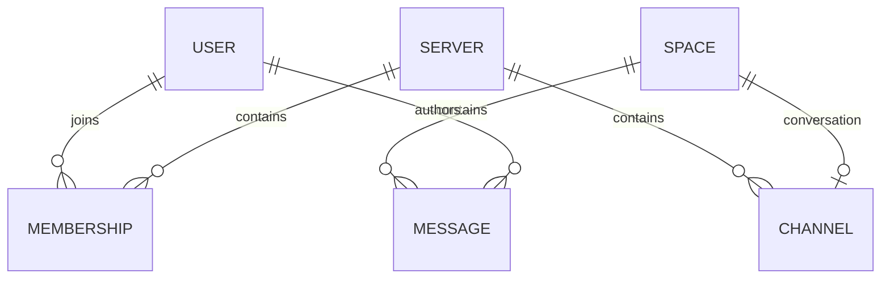

# SCDC — Thiết kế database

## Phạm vi và nguồn

MVP dùng PostgreSQL 18, một database chia schema theo module. [schema.sql](../../database/postgres/schema.sql) là nguồn DDL bootstrap; [migrations](../../database/postgres/migrations) và [DbMigrator](../../tools/SCDC.DbMigrator) giữ thay đổi explicit. Có bảng SQL không chứng minh tính năng tương ứng đã triển khai.

| Schema | Chủ sở hữu / mục đích |
|---|---|
| `identity` | Identity: user, profile, credential, phiên và token |
| `community` | Community: server, membership, channel, role/ACL và invitation |
| `messaging` | Messaging: space, participant, message và operation |
| `integration` | Outbox/inbox theo module phát sinh sự kiện |
| `audit` | Sự kiện bảo mật và quản lý |
| `moderation` | Bảng nền trong SQL; nghiệp vụ chưa tự thuộc scope v1 |
| `common` | Hàm/trigger SQL dùng chung |

## Quan hệ nghiệp vụ

Sơ đồ biểu diễn quan hệ nghiệp vụ, không thay DDL/FK hoặc áp dụng cho mọi loại space. DM có participant riêng. Quyền sở hữu và lời gọi liên module tại [architecture](architecture.md#boundaries); sơ đồ không cấp quyền đọc trực tiếp schema khác.

## Quy ước

- ID, timestamp UTC, version/CAS và khóa chống trùng phải thống nhất với [API](api-conventions.md) và hợp đồng máy đọc.
- Tài liệu chủ đề giữ model, bất biến, quan hệ, constraint/index cần thiết và ý nghĩa migration. SQL giữ kiểu dữ liệu và DDL thực thi; không duy trì bản DDL thứ hai trong Markdown.
- Mutation nhiều bảng xác định transaction và thứ tự khóa trước triển khai. Sự kiện outbox và dữ liệu nghiệp vụ phải giữ tính nguyên tử theo chủ đề.
- Bootstrap, migration và seed là các mục đích riêng. `schema.sql` có DROP SCHEMA; chỉ dùng khi tạo môi trường không cần giữ dữ liệu.
- Mapping Unicode/key chuẩn và nâng cấp dữ liệu legacy thuộc thiết kế của chủ đề; không suy tương đương giữa chuẩn hóa .NET và SQL khi chưa có bằng chứng.

## Migration và dữ liệu mẫu

DB mới dùng schema/seed theo Compose. DB cũ áp migration explicit; thay SQL bootstrap không tự cập nhật volume có sẵn. Runner Community giữ ledger/checksum và mapping legacy theo [hướng dẫn Community](../guides/community-development.md#migration).

`seed.sql` dùng dữ liệu minh họa; password/token mẫu không dùng đăng nhập. Test tích hợp dùng DB riêng và fixture theo bộ chạy. Hướng dẫn kết nối/quan sát tại [PostgreSQL README](../../database/postgres/README.md).

## Vòng đời và mục tiêu v1

Retention, xóa nội dung online và DATA-GAP tại [vòng đời dữ liệu](data-lifecycle.md). Triển khai backup và khôi phục DB từ backup được chuyển sang sau v1 theo [phạm vi backup](../project/overview.md#backup-scope), DEC-156; migration, retention online và rollback ứng dụng vẫn thuộc v1. v1 đã chọn bốn service theo [DEC-119](../records/decisions/README.md#dec-119), mỗi service sở hữu database và tài khoản truy cập riêng theo [DEC-120](../records/decisions/README.md#dec-120). Khi chuyển service phải rà soát FK/JOIN xuyên schema, dữ liệu tham chiếu và cơ chế nhất quán. Source vẫn dùng database MVP; xem [kiến trúc mục tiêu](architecture.md#target).

## D02 — Bố trí database v1

Trạng thái: đã xác nhận phương án A ngày 2026-10-11 — [DEC-120](../records/decisions/README.md#dec-120). Mỗi service sở hữu một database và tài khoản truy cập riêng; tổng cộng bốn database nghiệp vụ.

| Service | Database sở hữu |
|---|---|
| Identity | Database Identity |
| Community | Database Community |
| Messaging | Database Messaging |
| Media control | Database Media |

Các tên trong bảng mô tả vai trò, chưa là tên cấu hình. Lợi ích là tách ranh giới kết nối và đối tượng SQL, tổ chức migration theo service và thuận tiện chuyển database sang instance khác. Đánh đổi là phải tách bootstrap/migration và chuyển các tham chiếu xuyên service hiện có sang hợp đồng nghiệp vụ.

Service không đọc/ghi trực tiếp bảng của service khác. Shared transaction/guard giữa các module trong MVP không áp dụng xuyên service. Các FK xuyên Identity–Community–Messaging và quan hệ kênh–chat space phải được thay bằng hợp đồng nhất quán phù hợp; D02 chưa xác nhận cơ chế thay thế và không hạ các yêu cầu quyền/thu hồi đã chốt.

[D30](access-revocation.md#v1-session-validation)/[DEC-148](../records/decisions/README.md#dec-148) bổ sung ngoại lệ đọc có giới hạn: Identity công bố view xác thực tối thiểu trong Redis, các service khác chỉ đọc view này theo hợp đồng và quyền riêng. Identity giữ quyền cập nhật; PostgreSQL Identity và ba database nghiệp vụ còn lại vẫn riêng. Phạm vi này không cho phép kho nghiệp vụ dùng chung hoặc đọc DB owner khác nói chung. Schema, quyền và giao thức nhất quán/phục hồi tại nguồn D30 còn cần thiết kế.

Bố trí hai instance đã xác nhận tại [D03 — môi trường v1](environments.md#v1-postgres-instances); nơi chạy ban đầu theo [D25](environments.md#v1-postgres-placement), container riêng và Compose theo [D26](environments.md#v1-infrastructure-deployment). Tên database/schema, phân quyền chi tiết, vị trí outbox/inbox/audit, cơ chế đồng bộ và thứ tự migration tiếp tục rà soát riêng cho v1. Công cụ backup và sổ bảo vệ độc lập phục vụ khôi phục DB thuộc phần sau v1 theo DEC-156.

## D48 — Thực thi migration khi triển khai

Trạng thái: đã xác nhận phương án A ngày 2026-10-12 — [DEC-166](../records/decisions/README.md#dec-166). Migration là bước riêng trong đợt triển khai từng service v1; bản API mới chỉ phục vụ sau khi bước migration/kiểm tra đạt. Mỗi migration chỉ áp dụng database của owner theo D02; không yêu cầu nâng cấp cả bốn database trong mọi đợt triển khai.

Migration là thay đổi có phiên bản để đưa database hiện có sang cấu trúc/dữ liệu mà bản ứng dụng cần; khác với bootstrap tạo database mới. API không tự áp migration khi khởi động hoặc restart. Hai phương án đã so sánh:

| Nội dung | A — Bước migration riêng trong đợt triển khai | B — API chạy migration khi khởi động |
|---|---|---|
| Thực thi | Chạy/kiểm tra migration cần thiết của owner; bản API mới chỉ phục vụ sau khi bước này đạt | API kiểm tra/áp migration còn thiếu khi khởi động, chỉ phục vụ sau khi hoàn tất |
| Lợi ích | Tách thay đổi database khỏi restart API, thuận tiện kiểm tra và tách quyền migration | Ít bước triển khai riêng, thuận tiện cho phát triển/demo |
| Bất lợi | Thêm bước điều phối trong quy trình triển khai; có thể tự động hóa | Khởi động API phụ thuộc migration; bước khởi động cần được cấp quyền thay đổi schema |

Lựa chọn tách thay đổi database khỏi restart API và cho phép tách quyền migration khỏi quyền đọc/ghi runtime. Đánh đổi là thêm bước điều phối; bước này có thể tự động hóa, không bắt buộc thao tác bằng tay. Nếu migration hoặc kiểm tra thất bại hay chưa rõ kết quả, chưa cho bản API mới phục vụ; đối chiếu ledger/schema trước khi thử lại hoặc xử lý tiếp.

Source MVP đã có [DbMigrator CLI](../../tools/SCDC.DbMigrator/Program.cs) riêng cho Community 001–004; [hướng dẫn Community](../guides/community-development.md#migration) yêu cầu migration/ledger hợp lệ trước khi triển khai writer mới. Runner hiện tại chưa là bộ chạy v1 cho bốn database owner.

Nguồn tham khảo về vòng đời triển khai và quyền schema: [Microsoft — áp migration và deployment job](https://learn.microsoft.com/en-us/ef/core/managing-schemas/migrations/applying#containers-and-deployment-jobs). Người dùng đã xác nhận A cho SCDC. Tài liệu tham khảo mô tả EF Core; D48 chỉ dùng nguyên tắc thực thi, không chọn EF Core, migration bundle hoặc thay SQL/runner hiện có.

Cần preflight, kiểm tra ledger/checksum và kiểm soát chạy đồng thời. Cách drain writer cũ, tương thích app–schema và chuyển qua bản mới xác định theo migration; lựa chọn A không tự bảo đảm downtime bằng không hoặc rollback toàn bộ thay đổi SQL khi lỗi. [Rollback ứng dụng](../guides/operations.md#rollback) chỉ dùng bản còn tương thích schema, không tự đảo migration khi deploy lỗi.

Backup/restore giữ ở [giai đoạn sau v1](../project/overview.md#backup-scope) theo DEC-156. [D49](#v1-migration-source) đã chọn SQL có phiên bản làm nguồn thay đổi schema, [D50](#v1-migration-runner) chọn một runner chung cho bốn owner. Engine, project/container, đường dẫn migration, tài khoản/quyền cụ thể, CI/CD và kế hoạch tách database MVP cần thiết kế tiếp. Chưa chạy migration, đổi SQL, API, Compose hoặc cấu hình.

## D49 — Nguồn thay đổi schema

Trạng thái: đã xác nhận phương án A ngày 2026-10-12 — [DEC-167](../records/decisions/README.md#dec-167). Mỗi DB owner dùng SQL có phiên bản được viết và review trực tiếp để quản lý thay đổi schema/dữ liệu. Migration chạy thành bước triển khai riêng theo D48 bằng runner chung đã chọn tại [D50](#v1-migration-runner).

| Nội dung | A — SQL có phiên bản viết trực tiếp | B — Migration sinh từ model EF Core |
|---|---|---|
| Nguồn thay đổi | Viết và review file `.sql` có phiên bản cho từng owner | Khai báo model/mapping EF, sinh và review migration C# cùng model snapshot; SQL sinh ra là artefact dẫn xuất, cần review trước khi áp |
| Lợi ích | Kiểm soát trực tiếp DDL PostgreSQL, phù hợp quy trình thiết kế database trước code hiện tại | Tự sinh nhiều thay đổi bảng/cột/index từ khác biệt model, giảm phần SQL phải viết cho thay đổi thông thường |
| Bất lợi | Tự viết thay đổi SQL và giữ mapping truy cập dữ liệu khớp schema | Duy trì model/snapshot và tooling sinh migration; phần đặc thù hoặc chuyển dữ liệu vẫn có thể cần SQL bổ sung |

Lựa chọn phù hợp quy trình thiết kế database trước code và kế thừa [migration SQL](../../database/postgres/migrations)/[runner explicit](../../tools/SCDC.DbMigrator) hiện có. Đánh đổi là tự viết SQL và giữ mapping truy cập dữ liệu khớp schema. Mã preflight/mapping/chuyển dữ liệu bằng .NET vẫn có thể nằm trong gói migration owner, như [CommunityRoleMigration](../../tools/SCDC.DbMigrator/CommunityRoleMigration.cs); không yêu cầu mọi bước xử lý phải viết bằng SQL.

[Community hiện tại](../../services/Modules/Community/SCDC.Community.csproj) đã dùng EF Core cho truy cập dữ liệu. D49 vẫn cho phép dùng EF để đọc/ghi; model/mapping C# phải khớp schema SQL, không tự sinh hoặc áp migration EF song song. Không duy trì hai lịch sử migration độc lập cùng quản lý một schema.

Nguồn mô tả phương án B đã so sánh: [Microsoft — EF Core migrations](https://learn.microsoft.com/en-us/ef/core/managing-schemas/migrations/) giải thích so sánh model với snapshot để sinh migration; [quản lý migration](https://learn.microsoft.com/en-us/ef/core/managing-schemas/migrations/managing#customize-migration-code) yêu cầu review và cho phép SQL tùy chỉnh. Người dùng đã xác nhận A cho SCDC; chưa đổi cách truy cập dữ liệu runtime.

Giữ bất biến nghiệp vụ trong tài liệu chủ đề, thay đổi thực thi trong migration owner; không chép DDL vào Markdown. SQL/checksum đã áp không sửa lại. Mã preflight/mapping/chuyển dữ liệu phải gắn với cùng gói/revision migration đã review để tái hiện; checksum SQL hiện tại chỉ xác nhận nội dung file SQL, không chứng minh mã C# hỗ trợ giữ nguyên hành vi.

`schema.sql` hiện là bootstrap MVP, chưa là thiết kế bootstrap v1. Cách tạo DB v1 mới cần tạo schema tương đương chuỗi migration SQL được chọn, không duy trì thiết kế schema độc lập; không dùng bootstrap có DROP để nâng cấp DB có dữ liệu. Giữ ledger/checksum, preflight và kiểm soát chạy đồng thời theo D48; chưa thay runner hoặc lịch sử migration hiện tại.

D49 chỉ xác nhận nguồn migration; tổ chức runner đã chọn riêng tại [D50](#v1-migration-runner). Engine, số project, thư mục, phiên bản/provider, quyền DB, cơ chế transaction/lock, cách tiếp nhận lịch sử migration cũ và kế hoạch tách dữ liệu MVP cần thiết kế tiếp. Backup/restore vẫn sau v1. Chưa viết migration mới, sinh model snapshot hoặc đổi code/SQL/cấu hình.

## D50 — Tổ chức công cụ chạy migration

Trạng thái: đã xác nhận phương án A ngày 2026-10-12 — [DEC-168](../records/decisions/README.md#dec-168). v1 dùng một runner migration chung hỗ trợ bốn DB owner; mỗi lần chạy chọn rõ một owner, một DB và bộ migration tương ứng. Giữ bước triển khai riêng D48, nguồn SQL có phiên bản D49 và quyền sở hữu migration/dữ liệu của từng service.

| Nội dung | A — Một công cụ chung | B — Công cụ riêng cho từng service |
|---|---|---|
| Thực thi | Một runner hỗ trợ bốn owner; mỗi lần chạy chọn rõ một owner, một DB và bộ migration tương ứng | Mỗi owner có runner/artefact migration riêng, phát hành trong gói triển khai của service |
| Lợi ích | Duy trì cơ chế ledger/checksum/khóa/báo lỗi tại một nơi | Rõ artefact theo owner, thuận tiện thay dependency và phiên bản runner từng service |
| Bất lợi | Sửa runner cần kiểm tra các owner sử dụng; phải xác minh đúng owner/DB/bộ migration trước ghi | Thêm chương trình và cấu hình cần quản lý; vẫn có thể dùng chung engine để giảm mã lặp |

Lựa chọn tập trung cơ chế ledger/checksum/khóa/báo lỗi để giảm phần công cụ cần duy trì cho nhóm ba người cùng dùng PostgreSQL. Đánh đổi là sửa runner cần đánh giá và kiểm tra các owner sử dụng. Migration, preflight và chuyển dữ liệu đặc thù vẫn do owner duy trì trong gói có revision rõ; runner chung không sở hữu nghiệp vụ hoặc đưa SQL/Npgsql vào `SCDC.Shared.Core`.

Mỗi lần chạy chỉ nhận credential tới DB owner được chọn và chỉ tác động DB đó; không tự nâng cấp cả bốn database trong một đợt triển khai service. Hồ sơ triển khai xác định phiên bản runner và bộ migration owner đã kiểm tra cùng nhau; không buộc bốn service cùng commit hoặc triển khai đồng loạt.

Runner thực thi bước D48 rồi kết thúc, không thêm service thường trực. API không gọi runner khi khởi động/restart. Giữ preflight, ledger/checksum, kiểm soát đồng thời và xử lý kết quả chưa rõ theo D48; hình thức dùng chung không tạo transaction xuyên database hoặc đường đọc/ghi DB xuyên owner trong runtime nghiệp vụ.

[DbMigrator hiện tại](../../tools/SCDC.DbMigrator/Program.cs) nhận một connection string và dispatch Community 001–004; chưa là runner chung cho bốn owner. Cần thiết kế xác minh target và phần migration từng owner, không mặc định giữ nguyên CLI hoặc BuildingBlocks MVP. D50 chọn runner thực thi chung, thay vì chỉ thêm wrapper gọi bốn runner riêng. Người dùng đã xác nhận A; chưa có kết quả build hoặc thực thi thiết kế này.

D50 chưa chọn engine/thư viện, tên/path/project, container/Compose job, CLI/manifest, cách đóng gói/tái sử dụng preflight, quyền SQL cụ thể, cơ chế transaction/lock hoặc CI/CD. Backup/restore vẫn sau v1. Chưa tạo công cụ, đổi runner hiện tại hoặc chạy migration.

## D51 — Bảo toàn dữ liệu MVP khi chuyển sang v1

Trạng thái: đã xác nhận ngày 2026-10-12 — [DEC-169](../records/decisions/README.md#dec-169). Giữ dữ liệu MVP khi phát triển tiếp thành v1 và tách database theo owner. MVP là bước khởi động của cùng sản phẩm để nhóm bắt đầu làm sớm; không coi database hiện có là dữ liệu thử có thể reset/reseed khi nâng cấp.

Chuyển dữ liệu phải giữ các bất biến đã có tại tài liệu chủ đề:

- Giữ ID, quan hệ và trạng thái nghiệp vụ cần tiếp tục, gồm thứ tự/version tin nhắn, khóa chống trùng và tiến độ công việc bền vững. Công việc đã hoàn tất không được phát lại chỉ vì chuyển database.
- Giữ hiệu lực các thao tác xóa, thu hồi và khóa tài khoản; token đã dùng/hết hạn vẫn không hợp lệ theo [vòng đời dữ liệu](data-lifecycle.md) và [quyền/thu hồi](access-revocation.md). Giữ dữ liệu không kéo dài retention hoặc khôi phục quyền đã mất.
- Kiểm tra khóa/cấu hình còn cần để đọc dữ liệu được mã hóa và cách ánh xạ lịch sử migration. Không sao chép ledger cũ rồi mặc định xem migration v1 đã áp dụng; bảo toàn tài khoản không tự bảo đảm phiên, JWT hoặc cursor cũ tiếp tục dùng được.

Phương thức chuyển offline đã chọn tại [D52](#v1-mvp-data-cutover); mapping schema/dữ liệu, xử lý khóa/phiên và ledger cần thiết kế trước khi chuyển. Thiết kế trước code thực hiện [theo từng gói việc](../project/planning.md#package-design), không đợi toàn bộ tài liệu v1 hoàn chỉnh.

Chuyển dữ liệu MVP thuộc v1; backup/restore vẫn thuộc [giai đoạn sau v1](../project/overview.md#backup-scope) theo DEC-156. Nguồn SQL và runner MVP giữ hiện trạng; chưa chạy migration hoặc thao tác database.

## D52 — Phương thức chuyển dữ liệu MVP sang v1

Trạng thái: đã xác nhận phương án A ngày 2026-10-12 — [DEC-170](../records/decisions/README.md#dec-170). Chuyển dữ liệu MVP sang bốn database owner trong cửa sổ offline: ngừng phục vụ và các tác vụ ghi, chuyển dữ liệu theo owner, kiểm tra rồi mở v1. Giữ dữ liệu theo D51. Người dùng xác nhận chưa có người dùng trước khi hoàn tất v1 và chọn cập nhật offline cho giai đoạn hiện tại theo [chính sách môi trường](environments.md#v1-offline-updates).

Hai phương án đã so sánh:

| Nội dung | A — Chuyển trong cửa sổ bảo trì | B — Sao chép nền và đồng bộ thay đổi |
|---|---|---|
| Cách làm | Tạm dừng nhận ghi và chờ các writer nguồn kết thúc an toàn; chuyển dữ liệu theo owner, kiểm tra rồi mở v1 | Sao chép ban đầu khi MVP vẫn hoạt động; ghi nhận và áp các thay đổi phát sinh, bắt kịp rồi chuyển sang v1 |
| Lợi ích | Ít cơ chế chuyển tiếp, dễ đối chiếu trên dữ liệu nguồn đã ngừng thay đổi | Giảm thời gian gián đoạn ở bước chuyển cuối |
| Bất lợi | Ngừng ghi trong thời gian chuyển và kiểm tra; thời gian này chưa được đo | Thêm cơ chế bắt thay đổi, thứ tự áp, chống trùng và đối soát; vẫn có thể cần dừng ghi ở bước cuối |

Lựa chọn A chấp nhận gián đoạn phục vụ để giảm cơ chế chuyển tiếp. Cần đo trên dữ liệu đại diện để lập kế hoạch, chưa có cam kết thời gian bảo trì. So sánh offline/online tham khảo [Microsoft — PostgreSQL migration](https://learn.microsoft.com/en-us/azure/postgresql/migrate/migration-service/overview-migration-service-postgresql#migrate-to-azure-database-for-postgresql-flexible-server); nguồn này không chọn Azure hoặc công cụ cho SCDC. Tách schema/dữ liệu theo owner vẫn cần mapping riêng.

Kế hoạch phải kiểm soát cả API, worker/job và transaction đang chạy ở nguồn; chặn thao tác trên UI chưa đủ để dừng ghi. Trước khi mở v1 cần đối chiếu dữ liệu, quyền và trạng thái công việc theo D51. Sau khi v1 nhận ghi mới, không tự mở lại database MVP cũ vì nguồn đã thiếu những thay đổi đó; phương án quay lại cần xử lý phần chênh lệch.

[D50](#v1-migration-runner) vẫn giới hạn mỗi lần chạy migration vào một DB owner. Cách đọc dữ liệu nguồn và cấp quyền cho bước chuyển cần thiết kế riêng; D52 không cấp runner quyền mặc định tới cả bốn DB hoặc tạo transaction xuyên DB. Chưa chọn công cụ, trình tự theo owner, mapping hay quy trình chuyển chính thức; backup/restore vẫn sau v1.
