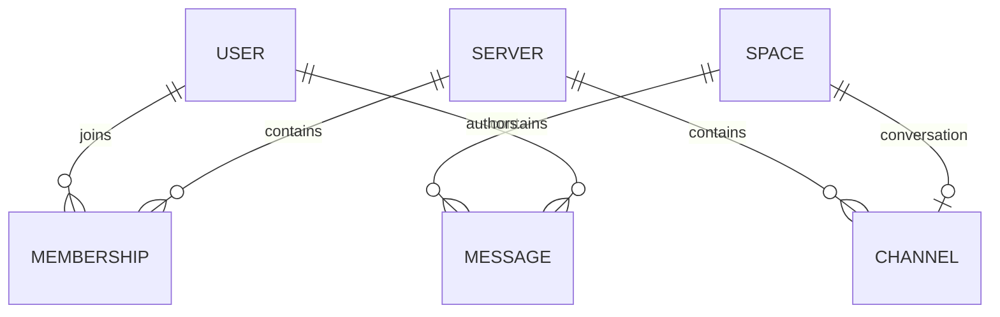

# SCDC — Thiết kế database

Trang này mô tả cách tổ chức dữ liệu trong PostgreSQL, quy ước chung, cách chạy migration, và các quyết định cho v1 (tách database theo service, công cụ migration, chuyển dữ liệu từ MVP).

**Trạng thái:** MVP dùng PostgreSQL 18, một database, chia schema theo module. Các quyết định v1 (D02, D48 đến D52) đã chốt nhưng chưa có code.

## MVP hiện tại

- [schema.sql](../../database/postgres/schema.sql): tạo database mới từ đầu.
- [migrations](../../database/postgres/migrations) và [DbMigrator](../../tools/SCDC.DbMigrator): nâng cấp database đang có.
- Có bảng trong SQL không có nghĩa tính năng tương ứng đã làm.

| Schema | Thuộc về |
|---|---|
| `identity` | Identity: người dùng, hồ sơ, mật khẩu, phiên, token |
| `community` | Community: server, thành viên, phòng, vai trò, ACL, lời mời |
| `messaging` | Messaging: không gian chat, người tham gia, tin, thao tác |
| `integration` | Outbox và inbox của module phát sinh sự kiện |
| `audit` | Sự kiện bảo mật và quản lý |
| `moderation` | Bảng nền; nghiệp vụ chưa thuộc v1 |
| `common` | Hàm và trigger dùng chung |

Sơ đồ chỉ thể hiện quan hệ nghiệp vụ, không thay cho khóa ngoại trong SQL. DM có bảng người tham gia riêng. Module chỉ đọc dữ liệu của mình; xem [ranh giới](architecture.md#boundaries).

## Quy ước

- ID, thời gian UTC, version và khóa chống trùng phải thống nhất với [quy ước API](api-conventions.md) và hợp đồng máy đọc.
- Trang tính năng mô tả mô hình, ràng buộc, index cần có và ý nghĩa migration. SQL là nơi duy nhất chứa DDL; không chép DDL vào Markdown.
- Thao tác ghi nhiều bảng phải xác định transaction và thứ tự khóa trước khi làm. Outbox và dữ liệu nghiệp vụ ghi cùng transaction.
- Khởi tạo, migration và dữ liệu mẫu là ba việc riêng. `schema.sql` có lệnh DROP SCHEMA; chỉ dùng khi không cần giữ dữ liệu.
- Chuẩn hóa Unicode ở .NET và SQL không tự động giống nhau; cần bằng chứng.

### Migration và dữ liệu mẫu

- Database mới: dùng schema và seed qua Compose.
- Database cũ: chạy migration. Sửa `schema.sql` không cập nhật volume đã có.
- Công cụ migration Community có sổ ghi (ledger) và checksum; xem [hướng dẫn Community](../guides/development.md#migration).
- `seed.sql` là dữ liệu minh họa; mật khẩu và token mẫu không dùng để đăng nhập. Test tích hợp dùng database riêng.
- Kết nối và quan sát DB: [PostgreSQL README](../../database/postgres/README.md).

Thời hạn lưu, xóa dữ liệu và DATA-GAP xem [vòng đời dữ liệu](data-lifecycle.md). Backup và khôi phục để [sau v1](../project/overview.md#backup-scope); migration, thời hạn lưu và rollback ứng dụng vẫn thuộc v1.

---

## Thiết kế v1

### D02 — Mỗi service một database

**Quyết định:** bốn database, mỗi service sở hữu một database và tài khoản truy cập riêng.

| Service | Database |
|---|---|
| Identity | Identity |
| Community | Community |
| Messaging | Messaging |
| Media control | Media |

Tên trong bảng chỉ mô tả vai trò, chưa phải tên cấu hình.

**Lý do:** ranh giới kết nối rõ, migration theo từng service, dễ chuyển một database sang máy khác. **Đổi lại:** phải tách khởi tạo và migration, và thay các tham chiếu giữa service bằng hợp đồng.

- Service không đọc hay ghi bảng của service khác.
- Transaction và guard dùng chung của MVP không dùng được giữa các service.
- Khóa ngoại giữa Identity, Community, Messaging và quan hệ phòng với không gian chat phải thay bằng hợp đồng nhất quán; chưa chọn cơ chế. Yêu cầu về quyền và thu hồi không được hạ.
- **Ngoại lệ:** Identity công bố trạng thái phiên tối thiểu trong Redis; service khác chỉ được đọc ([D30](access-revocation.md#v1-session-validation)). Điều này không cho phép đọc database của service khác.

Bố trí máy chủ: hai instance PostgreSQL ([D03](environments.md#v1-postgres-instances)), chạy trên máy hiện có ([D25](environments.md#v1-postgres-placement)), mỗi instance một container do Compose quản lý ([D26](environments.md#v1-infrastructure-deployment)).

### D48 — Migration là bước riêng khi triển khai

**Quyết định:** khi triển khai một service, chạy migration như một bước riêng. Bản API mới chỉ được phục vụ khi migration và kiểm tra đã đạt. API không tự chạy migration khi khởi động.

Mỗi migration chỉ áp vào database của service sở hữu; không cần nâng cấp cả bốn database mỗi lần.

**Lý do:** tách việc đổi database khỏi việc khởi động API; cho phép quyền đổi schema tách khỏi quyền đọc ghi lúc chạy. **Đổi lại:** thêm một bước trong quy trình triển khai (có thể tự động hóa). Phương án "API tự chạy migration khi khởi động" ít bước hơn nhưng bắt API phải có quyền đổi schema.

- Migration lỗi hoặc chưa rõ kết quả: chưa cho bản API mới phục vụ; đối chiếu ledger và schema trước khi thử lại.
- Cần: kiểm tra trước khi chạy, kiểm tra ledger và checksum, chặn chạy đồng thời.
- Cách dừng writer cũ và chuyển sang bản mới xác định theo từng migration. D48 không đảm bảo không gián đoạn, cũng không tự hoàn tác SQL khi lỗi. [Rollback ứng dụng](../guides/operations.md#rollback) chỉ quay về bản còn tương thích với schema.

Hiện tại [DbMigrator](../../tools/SCDC.DbMigrator/Program.cs) chỉ chạy migration Community 001 đến 004; chưa phải công cụ v1. Tham khảo: [Microsoft về migration trong triển khai](https://learn.microsoft.com/en-us/ef/core/managing-schemas/migrations/applying#containers-and-deployment-jobs) (chỉ dùng nguyên tắc, không chọn EF Core).

### D49 — Viết migration bằng SQL

**Quyết định:** mỗi service viết và review file `.sql` có phiên bản để thay đổi schema và dữ liệu. Không dùng migration tự sinh từ model EF Core.

**Lý do:** kiểm soát trực tiếp DDL PostgreSQL; hợp với cách làm hiện tại (thiết kế database trước code) và tận dụng [migration SQL](../../database/postgres/migrations) và [runner](../../tools/SCDC.DbMigrator) đang có. **Đổi lại:** tự viết SQL và tự giữ mapping truy cập dữ liệu khớp schema. Migration EF Core tự sinh được nhiều thay đổi thông thường, nhưng phải duy trì model snapshot và công cụ sinh.

- Code .NET vẫn được dùng cho bước kiểm tra trước, mapping hay chuyển dữ liệu, ví dụ [CommunityRoleMigration](../../tools/SCDC.DbMigrator/CommunityRoleMigration.cs).
- [Community](../../services/Modules/Community/SCDC.Community.csproj) vẫn dùng EF Core để đọc ghi; model C# phải khớp SQL. Không chạy song song migration EF; không có hai lịch sử migration cho cùng một schema.
- File SQL đã áp thì không sửa. Code .NET đi kèm phải gắn với cùng phiên bản migration đã review; checksum SQL không chứng minh code .NET không đổi.
- `schema.sql` là của MVP. Cách tạo database v1 mới phải cho ra schema giống như chạy hết chuỗi migration; không dùng file có DROP để nâng cấp database có dữ liệu.

Tham khảo phương án không chọn: [EF Core migrations](https://learn.microsoft.com/en-us/ef/core/managing-schemas/migrations/), [tùy chỉnh migration](https://learn.microsoft.com/en-us/ef/core/managing-schemas/migrations/managing#customize-migration-code).

### D50 — Một công cụ migration cho cả bốn service

**Quyết định:** dùng một công cụ chạy migration chung. Mỗi lần chạy chọn rõ một service, một database và bộ migration tương ứng.

**Lý do:** ledger, checksum, khóa và báo lỗi chỉ viết và duy trì ở một chỗ; hợp với nhóm ba người cùng dùng PostgreSQL. **Đổi lại:** sửa công cụ phải kiểm tra với cả bốn service. Phương án mỗi service một công cụ riêng thì rõ ràng hơn nhưng nhiều chương trình phải quản lý.

- Migration, kiểm tra trước và chuyển dữ liệu đặc thù vẫn do service sở hữu duy trì. Công cụ chung không chứa nghiệp vụ, và không đưa SQL hay Npgsql vào `SCDC.Shared.Core`.
- Mỗi lần chạy chỉ nhận thông tin đăng nhập của database được chọn.
- Hồ sơ triển khai ghi phiên bản công cụ và bộ migration đã kiểm tra cùng nhau; bốn service không cần cùng commit hay triển khai cùng lúc.
- Công cụ chạy xong rồi thoát, không phải service thường trực. Không tạo transaction giữa các database.

[DbMigrator hiện tại](../../tools/SCDC.DbMigrator/Program.cs) nhận một connection string và chỉ chạy Community. Cần thiết kế lại phần kiểm tra database đích và phần migration của từng service.

### D51 — Giữ dữ liệu MVP khi lên v1

**Quyết định:** giữ dữ liệu MVP khi chuyển sang v1 và tách database. MVP là bước đầu của cùng sản phẩm, không phải dữ liệu thử để xóa làm lại.

Khi chuyển dữ liệu, phải giữ:

- ID, quan hệ và trạng thái cần dùng tiếp: thứ tự và version tin nhắn, khóa chống trùng, tiến độ công việc nền. Việc đã xong không được chạy lại.
- Hiệu lực của các thao tác xóa, thu hồi, khóa tài khoản. Token đã dùng hoặc hết hạn vẫn không dùng được ([vòng đời dữ liệu](data-lifecycle.md), [thu hồi](access-revocation.md)). Giữ dữ liệu không được kéo dài thời hạn lưu hay khôi phục quyền đã mất.
- Khóa và cấu hình cần để đọc dữ liệu mã hóa. Không sao chép ledger cũ rồi coi như migration v1 đã chạy. Giữ tài khoản không đảm bảo phiên, JWT hay cursor cũ còn dùng được.

### D52 — Chuyển dữ liệu offline

**Quyết định:** chuyển dữ liệu trong một khoảng bảo trì: ngừng phục vụ và mọi thao tác ghi, chuyển dữ liệu sang bốn database, kiểm tra, rồi mở v1. Hiện chưa có người dùng thật trước v1, nên chấp nhận gián đoạn ([chính sách cập nhật offline](environments.md#v1-offline-updates)).

**Lý do:** ít cơ chế chuyển tiếp, dễ đối chiếu vì dữ liệu nguồn không còn thay đổi. **Đổi lại:** ngừng phục vụ trong lúc chuyển (chưa đo mất bao lâu). Phương án sao chép trước rồi đồng bộ thay đổi giảm thời gian gián đoạn nhưng cần thêm cơ chế bắt thay đổi, thứ tự, chống trùng và đối chiếu. Tham khảo [so sánh offline và online](https://learn.microsoft.com/en-us/azure/postgresql/migrate/migration-service/overview-migration-service-postgresql#migrate-to-azure-database-for-postgresql-flexible-server) (không chọn Azure).

- Phải dừng cả API, worker, job và transaction đang chạy; chỉ chặn ở giao diện là chưa đủ.
- Trước khi mở v1, đối chiếu dữ liệu, quyền và trạng thái công việc theo D51.
- Sau khi v1 đã nhận ghi mới, không mở lại database MVP cũ; muốn quay lại phải xử lý phần chênh lệch.
- Công cụ migration (D50) vẫn chỉ chạm một database mỗi lần; cách đọc dữ liệu nguồn và cấp quyền cho bước chuyển cần thiết kế riêng.

## Còn mở

- Tên database và schema, phân quyền chi tiết, vị trí outbox, inbox, audit, cơ chế đồng bộ giữa service, thứ tự migration (D02).
- Engine, thư viện, tên và vị trí project, container, CLI, cách đóng gói phần kiểm tra trước, quyền SQL, cơ chế transaction và khóa, CI/CD (D48 đến D50).
- Cách tiếp nhận lịch sử migration cũ; kế hoạch tách dữ liệu MVP.
- Mapping schema và dữ liệu, xử lý khóa và phiên, ledger, công cụ và trình tự chuyển (D51, D52). Thời gian bảo trì cần đo trên dữ liệu đại diện.
- Công cụ backup và sổ bảo vệ độc lập: sau v1.

Mỗi phần được thiết kế [theo gói](../project/planning.md#package-design) khi cần, không chờ toàn bộ.

---

Nguồn: [DEC-119](../records/decisions/README.md#dec-119) (bốn service), [DEC-120](../records/decisions/README.md#dec-120) (D02), [DEC-148](../records/decisions/README.md#dec-148) (Redis), DEC-156 (backup sau v1), [DEC-166](../records/decisions/README.md#dec-166) (D48), [DEC-167](../records/decisions/README.md#dec-167) (D49), [DEC-168](../records/decisions/README.md#dec-168) (D50), [DEC-169](../records/decisions/README.md#dec-169) (D51), [DEC-170](../records/decisions/README.md#dec-170) (D52).
