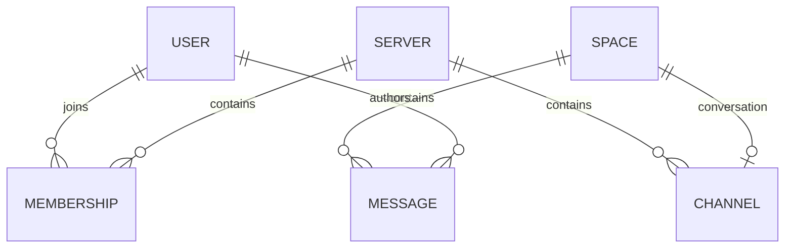

# SCDC — Thiết kế database

Trang này mô tả cách tổ chức dữ liệu trong PostgreSQL, quy ước chung, cách chạy migration, và các quyết định cho v1 (tách database theo service, công cụ migration, chuyển dữ liệu từ MVP).

**Trạng thái cập nhật 2026-11-28:** Identity có PostgreSQL instance riêng và database `scdc_identity`. Community đã chuyển sang `scdc_community`, dùng cùng instance PostgreSQL với Messaging ở database nguồn `scdc_chat`. Runtime Community mới là `scdc_community_service`; login nguồn Identity/Community giữ `NOLOGIN`. Công cụ chuyển offline đối chiếu dữ liệu, DDL và lineage trước khi mở writer: [Identity](../../database/postgres/identity/README.md), [Community](../../database/postgres/community/README.md). Database Messaging riêng còn thuộc S3-08.

## Baseline nguồn MVP và migration

- [schema.sql](../../database/postgres/schema.sql): tạo database mới từ đầu.
- [migrations](../../database/postgres/migrations) và [DbMigrator](../../tools/SCDC.DbMigrator): nâng cấp database đang có.
- Có bảng trong SQL không có nghĩa tính năng tương ứng đã làm.

| Schema | Thuộc về |
|---|---|
| `identity` | Identity: người dùng, hồ sơ, mật khẩu, phiên, token, security audit, outbox/inbox và ledger |
| `community` | Community: server, thành viên, phòng, vai trò, ACL, lời mời, outbox/inbox, ledger và fence |
| `messaging` | Messaging: không gian chat, người tham gia, tin, thao tác, outbox/inbox, ledger và fence |

Sơ đồ chỉ thể hiện quan hệ nghiệp vụ, không thay cho khóa ngoại trong SQL. DM có bảng người tham gia riêng. Sau role script S2-11, mỗi module chỉ có quyền trên schema của mình. Xem [ranh giới](architecture.md#boundaries).

## Quy ước

- ID, thời gian UTC, version và khóa chống trùng phải thống nhất với [quy ước API](api-conventions.md) và hợp đồng máy đọc.
- Trang tính năng mô tả mô hình, ràng buộc, index cần có và ý nghĩa migration. SQL là nơi duy nhất chứa DDL; không chép DDL vào Markdown.
- Thao tác ghi nhiều bảng phải xác định transaction và thứ tự khóa trước khi làm. Outbox và dữ liệu nghiệp vụ ghi cùng transaction.
- Khởi tạo, migration và dữ liệu mẫu là ba việc riêng. `schema.sql` có lệnh DROP SCHEMA; chỉ dùng khi không cần giữ dữ liệu.
- Chuẩn hóa Unicode ở .NET và SQL không tự động giống nhau; cần bằng chứng.

### Migration và dữ liệu mẫu

- Database mới: dùng schema và seed qua Compose.
- Database cũ: chạy migration. Sửa `schema.sql` không cập nhật volume đã có.
- Công cụ migration Community có sổ ghi (ledger) và checksum; xem [hướng dẫn Community](../guides/development.md#migration).
- `seed.sql` là dữ liệu minh họa; mật khẩu và token mẫu không dùng để đăng nhập. Test tích hợp dùng database riêng.
- Kết nối và quan sát DB: [PostgreSQL README](../../database/postgres/README.md).

Thời hạn lưu, xóa dữ liệu và DATA-GAP xem [vòng đời dữ liệu](data-lifecycle.md). Backup và khôi phục để [sau v1](../project/overview.md#backup-scope); migration, thời hạn lưu và rollback ứng dụng vẫn thuộc v1.

---

## Thiết kế v1

### D02 — Mỗi service một database

**Quyết định:** bốn database, mỗi service sở hữu một database và tài khoản truy cập riêng.

| Service | Database |
|---|---|
| Identity | Identity |
| Community | Community |
| Messaging | Messaging |
| Media control | Media |

Tên trong bảng chỉ mô tả vai trò, chưa phải tên cấu hình.

**Lý do:** ranh giới kết nối rõ, migration theo từng service, dễ chuyển một database sang máy khác. **Đổi lại:** phải tách khởi tạo và migration, và thay các tham chiếu giữa service bằng hợp đồng.

- Service không đọc hay ghi bảng của service khác.
- Transaction và guard dùng chung của MVP không dùng được giữa các service.
- Khóa ngoại giữa Identity, Community, Messaging và quan hệ phòng với không gian chat phải thay bằng hợp đồng nhất quán theo [S2-02](access-revocation.md#s2-02-protocol). Yêu cầu về quyền và thu hồi không được hạ.
- **Ngoại lệ:** Identity công bố trạng thái phiên tối thiểu trong Redis; service khác chỉ được đọc ([D30](access-revocation.md#v1-session-validation)). Điều này không cho phép đọc database của service khác.

Bố trí máy chủ: hai instance PostgreSQL ([D03](environments.md#v1-postgres-instances)), chạy trên máy hiện có ([D25](environments.md#v1-postgres-placement)), mỗi instance một container do Compose quản lý ([D26](environments.md#v1-infrastructure-deployment)).

### D48 — Migration là bước riêng khi triển khai

**Quyết định:** khi triển khai một service, chạy migration như một bước riêng. Bản API mới chỉ được phục vụ khi migration và kiểm tra đã đạt. API không tự chạy migration khi khởi động.

Mỗi migration chỉ áp vào database của service sở hữu; không cần nâng cấp cả bốn database mỗi lần.

**Lý do:** tách việc đổi database khỏi việc khởi động API; cho phép quyền đổi schema tách khỏi quyền đọc ghi lúc chạy. **Đổi lại:** thêm một bước trong quy trình triển khai (có thể tự động hóa). Phương án "API tự chạy migration khi khởi động" ít bước hơn nhưng bắt API phải có quyền đổi schema.

- Migration lỗi hoặc chưa rõ kết quả: chưa cho bản API mới phục vụ; đối chiếu ledger và schema trước khi thử lại.
- Cần: kiểm tra trước khi chạy, kiểm tra ledger và checksum, chặn chạy đồng thời.
- Cách dừng writer cũ và chuyển sang bản mới xác định theo từng migration. D48 không đảm bảo không gián đoạn, cũng không tự hoàn tác SQL khi lỗi. [Rollback ứng dụng](../guides/operations.md#rollback) chỉ quay về bản còn tương thích với schema.

Hiện tại [DbMigrator](../../tools/SCDC.DbMigrator/Program.cs) chỉ chạy migration Community 001 đến 004; chưa phải công cụ v1. Tham khảo: [Microsoft về migration trong triển khai](https://learn.microsoft.com/en-us/ef/core/managing-schemas/migrations/applying#containers-and-deployment-jobs) (chỉ dùng nguyên tắc, không chọn EF Core).

### D49 — Viết migration bằng SQL

**Quyết định:** mỗi service viết và review file `.sql` có phiên bản để thay đổi schema và dữ liệu. Không dùng migration tự sinh từ model EF Core.

**Lý do:** kiểm soát trực tiếp DDL PostgreSQL; hợp với cách làm hiện tại (thiết kế database trước code) và tận dụng [migration SQL](../../database/postgres/migrations) và [runner](../../tools/SCDC.DbMigrator) đang có. **Đổi lại:** tự viết SQL và tự giữ mapping truy cập dữ liệu khớp schema. Migration EF Core tự sinh được nhiều thay đổi thông thường, nhưng phải duy trì model snapshot và công cụ sinh.

- Code .NET vẫn được dùng cho bước kiểm tra trước, mapping hay chuyển dữ liệu, ví dụ [CommunityRoleMigration](../../tools/SCDC.DbMigrator/CommunityRoleMigration.cs).
- [Community](../../services/Community/SCDC.Community.Infrastructure/SCDC.Community.Infrastructure.csproj) vẫn dùng EF Core để đọc ghi; model C# phải khớp SQL. Không chạy song song migration EF; không có hai lịch sử migration cho cùng một schema.
- File SQL đã áp thì không sửa. Code .NET đi kèm phải gắn với cùng phiên bản migration đã review; checksum SQL không chứng minh code .NET không đổi.
- `schema.sql` là của MVP. Cách tạo database v1 mới phải cho ra schema giống như chạy hết chuỗi migration; không dùng file có DROP để nâng cấp database có dữ liệu.

Tham khảo phương án không chọn: [EF Core migrations](https://learn.microsoft.com/en-us/ef/core/managing-schemas/migrations/), [tùy chỉnh migration](https://learn.microsoft.com/en-us/ef/core/managing-schemas/migrations/managing#customize-migration-code).

### D50 — Một công cụ migration cho cả bốn service

**Quyết định:** dùng một công cụ chạy migration chung. Mỗi lần chạy chọn rõ một service, một database và bộ migration tương ứng.

**Lý do:** ledger, checksum, khóa và báo lỗi chỉ viết và duy trì ở một chỗ; hợp với nhóm ba người cùng dùng PostgreSQL. **Đổi lại:** sửa công cụ phải kiểm tra với cả bốn service. Phương án mỗi service một công cụ riêng thì rõ ràng hơn nhưng nhiều chương trình phải quản lý.

- Migration, kiểm tra trước và chuyển dữ liệu đặc thù vẫn do service sở hữu duy trì. Công cụ chung không chứa nghiệp vụ, và không đưa SQL hay Npgsql vào `SCDC.Shared.Core`.
- Mỗi lần chạy chỉ nhận thông tin đăng nhập của database được chọn.
- Hồ sơ triển khai ghi phiên bản công cụ và bộ migration đã kiểm tra cùng nhau; bốn service không cần cùng commit hay triển khai cùng lúc.
- Công cụ chạy xong rồi thoát, không phải service thường trực. Không tạo transaction giữa các database.

[DbMigrator hiện tại](../../tools/SCDC.DbMigrator/Program.cs) nhận một connection string và chỉ chạy Community. Cần thiết kế lại phần kiểm tra database đích và phần migration của từng service.

### D51 — Giữ dữ liệu MVP khi lên v1

**Quyết định:** giữ dữ liệu MVP khi chuyển sang v1 và tách database. MVP là bước đầu của cùng sản phẩm, không phải dữ liệu thử để xóa làm lại.

Khi chuyển dữ liệu, phải giữ:

- ID, quan hệ và trạng thái cần dùng tiếp: thứ tự và version tin nhắn, khóa chống trùng, tiến độ công việc nền. Việc đã xong không được chạy lại.
- Hiệu lực của các thao tác xóa, thu hồi, khóa tài khoản. Token đã dùng hoặc hết hạn vẫn không dùng được ([vòng đời dữ liệu](data-lifecycle.md), [thu hồi](access-revocation.md)). Giữ dữ liệu không được kéo dài thời hạn lưu hay khôi phục quyền đã mất.
- Khóa và cấu hình cần để đọc dữ liệu mã hóa. Không sao chép ledger cũ rồi coi như migration v1 đã chạy. Giữ tài khoản không đảm bảo phiên, JWT hay cursor cũ còn dùng được.

### D52 — Chuyển dữ liệu offline

**Quyết định:** chuyển dữ liệu trong một khoảng bảo trì: ngừng phục vụ và mọi thao tác ghi, chuyển dữ liệu sang bốn database, kiểm tra, rồi mở v1. Hiện chưa có người dùng thật trước v1, nên chấp nhận gián đoạn ([chính sách cập nhật offline](environments.md#v1-offline-updates)).

**Lý do:** ít cơ chế chuyển tiếp, dễ đối chiếu vì dữ liệu nguồn không còn thay đổi. **Đổi lại:** ngừng phục vụ trong lúc chuyển (chưa đo mất bao lâu). Phương án sao chép trước rồi đồng bộ thay đổi giảm thời gian gián đoạn nhưng cần thêm cơ chế bắt thay đổi, thứ tự, chống trùng và đối chiếu. Tham khảo [so sánh offline và online](https://learn.microsoft.com/en-us/azure/postgresql/migrate/migration-service/overview-migration-service-postgresql#migrate-to-azure-database-for-postgresql-flexible-server) (không chọn Azure).

- Phải dừng cả API, worker, job và transaction đang chạy; chỉ chặn ở giao diện là chưa đủ.
- Trước khi mở v1, đối chiếu dữ liệu, quyền và trạng thái công việc theo D51.
- Sau khi v1 đã nhận ghi mới, không mở lại database MVP cũ; muốn quay lại phải xử lý phần chênh lệch.
- Công cụ migration (D50) vẫn chỉ chạm một database mỗi lần; cách đọc dữ liệu nguồn và cấp quyền cho bước chuyển cần thiết kế riêng.

## S2-01 — Xử lý các phụ thuộc giữa module

Bảng này là đầu vào triển khai STEP-2, đối chiếu code tại `59748f8` và schema PostgreSQL ngày 2026-11-15. Số lượng dữ liệu được ghi theo snapshot thực tế ngày 2026-11-14. **S2-01 hoàn tất theo [xác nhận tiến độ ngày 2026-11-17](../records/planning/progress-2026-11-17.md).** Chưa chạy migration hoặc thay hợp đồng runtime trong S2-01. [Hồ sơ đối chiếu](../records/verification/architecture/s2-01-2026-11-15.md) ghi nguồn, số lượng và kiểm tra độ phủ.

Phân công theo [các thẻ STEP-2](../project/tasks/step-2.md): Vg làm S2-02, 03, 04, 06, 07, 09, 10; Sáng làm S2-05, 08, 11. Mỗi dòng dưới gắn với thẻ thực hiện, từ đó xác định người làm. Trạng thái hiện tại nằm ở thẻ; hồ sơ kiểm chứng giữ nguyên phạm vi lịch sử.

### Nguyên tắc giữ dữ liệu và quyền

- Bỏ ràng buộc SQL xuyên module, giữ nguyên cột, UUID, giá trị NULL, version và thời điểm hiện có. Không tạo FK mới sang bản sao người dùng hoặc dùng cascade để xóa dữ liệu module khác.
- ID người dùng ngoài module là tham chiếu nghiệp vụ. Identity trả thông tin công khai qua hợp đồng; user không tồn tại hoặc không khả dụng nhận placeholder theo từng API, không làm mất lịch sử và không cấp quyền mới.
- Kiểm tra trước khi ghi phải theo hàng rào và giấy phép có epoch của D05–D07. Gọi `FindUser` một lần, JWT hợp lệ hay cache hồ sơ không bảo vệ quyền tới commit. Redis dùng để kiểm tra phiên, không thay hàng rào ghi.
- Tất cả thao tác, dấu chống trùng, outbox/inbox và tombstone hiện có được giữ theo D51. Phân loại không rõ phải dừng để review; không đoán owner, tự đánh dấu đã phát hay phát lại sự kiện cũ.
- STEP-2 vẫn chạy một tiến trình. Adapter nội bộ phải giữ hình dạng hợp đồng có deadline, lỗi không rõ kết quả, epoch và ID chống trùng như lời gọi qua mạng. Giao thức gRPC/mTLS đang chốt vẫn giữ nguyên; đề xuất hoãn chưa được xác nhận.

### Khóa ngoại của Community: 9 ràng buộc

Các FK tới người dùng dưới đây cùng trỏ `identity.users(id)`. Bỏ FK trong S2-04; xử lý quyền ghi và tra cứu người dùng hoàn thiện ở S2-07. Ràng buộc nội bộ Community, đặc biệt owner/member, membership epoch và unique role/channel, vẫn giữ.

| FK | Cột nguồn | Xử lý thay thế | Thẻ |
|---|---|---|---|
| `fk_server_bans_banned_by` | `community.bans.banned_by_user_id` | Giữ ID người cấm để tra cứu lịch sử; không phụ thuộc tài khoản còn hoạt động | S2-04, S2-07 |
| `fk_server_bans_revoked_by` | `community.bans.revoked_by_user_id` | Giữ ID hoặc NULL đã lưu; không tự SET NULL khi Identity đổi trạng thái | S2-04, S2-07 |
| `fk_server_bans_user` | `community.bans.user_id` | Giữ ID bị cấm; không làm mất lệnh cấm khi không lấy được hồ sơ | S2-04, S2-07 |
| `fk_server_channels_space` | `community.channels(space_id, space_type)` → `messaging.spaces(id, space_type)` | Giữ cùng channel/space ID và loại phòng; thay tính nguyên tử bằng chuẩn bị, xác nhận, hủy có chống trùng và trạng thái bền | S2-04, S2-09 |
| `fk_server_member_roles_assigner` | `community.member_roles.assigned_by_user_id` | Giữ người gán; quyền gán dựa vào Community và giấy phép tài khoản tới commit | S2-04, S2-07 |
| `operations_actor_user_id_fkey` | `community.operations.actor_user_id` | Giữ actor trong dấu chống trùng; không xóa operation khi mất hồ sơ hoặc thu hồi tài khoản | S2-04, S2-07 |
| `fk_server_members_inviter` | `community.server_members.invited_by_user_id` | Giữ ID người mời hoặc NULL; kiểm tra tư cách người mời bằng hợp đồng khi thao tác mới | S2-04, S2-07 |
| `fk_server_members_user` | `community.server_members.user_id` | Community sở hữu membership và epoch; xác minh tài khoản qua Identity, không JOIN hay đặt FK sang bản sao | S2-04, S2-07 |
| `fk_servers_owner` | `community.servers.owner_user_id` | Giữ owner ID và bất biến owner là member; kiểm tra tài khoản qua giấy phép, không dùng FK Identity | S2-04, S2-07 |

### Khóa ngoại của Messaging: 16 ràng buộc

Tất cả cùng trỏ `identity.users(id)`. S2-05 bỏ FK; S2-08 thay guard và đọc hồ sơ dùng chung connection. Các ràng buộc giữa message, conversation, space và operation trong Messaging vẫn giữ.

| FK | Cột nguồn | Xử lý thay thế | Thẻ |
|---|---|---|---|
| `fk_direct_conversations_user_high` | `messaging.direct_conversations.user_high_id` | Giữ cặp ID và thứ tự UUID; xác minh peer qua hợp đồng khi mở/gửi, giữ hội thoại cũ | S2-05, S2-08 |
| `fk_direct_conversations_user_low` | `messaging.direct_conversations.user_low_id` | Như trên; giữ unique cặp DM và tính lặp an toàn | S2-05, S2-08 |
| `fk_group_conversations_owner` | `messaging.group_conversations.owner_user_id` | Giữ owner ID; đây là bảng nền, không tự mở rộng tính năng group chat | S2-05 |
| `fk_message_mentions_user` | `messaging.mentions.mentioned_user_id` | Giữ ID đích; hồ sơ hiển thị qua hợp đồng khi có luồng dùng, không JOIN | S2-05 |
| `fk_message_edits_editor` | `messaging.message_edits.edited_by_user_id` | Giữ người sửa; quyền sửa do Messaging và giấy phép tài khoản bảo vệ | S2-05, S2-08 |
| `fk_messages_author` | `messaging.messages.author_user_id` | Giữ tác giả; thông tin công khai lấy theo batch từ Identity, giữ lịch sử khi tác giả không khả dụng | S2-05, S2-08 |
| `fk_messages_deleted_by` | `messaging.messages.deleted_by_user_id` | Giữ ID hoặc NULL; tombstone và quyền xóa vẫn thuộc Messaging | S2-05, S2-08 |
| `fk_pinned_messages_user` | `messaging.pinned_messages.pinned_by_user_id` | Giữ ID người ghim; bảng nền không tạo thêm tính năng trong STEP-2 | S2-05 |
| `fk_message_reactions_user` | `messaging.reactions.user_id` | Giữ ID và unique hiện có; không cấp quyền từ việc tham chiếu có tồn tại | S2-05 |
| `fk_message_receipts_user` | `messaging.receipts.user_id` | Giữ ID người nhận và tiến độ; không xóa theo cascade Identity | S2-05 |
| `fk_chat_space_members_remover` | `messaging.space_members.removed_by_user_id` | Giữ ID hoặc NULL của người loại; không đặt lại lịch sử/epoch | S2-05, S2-08 |
| `fk_chat_space_members_user` | `messaging.space_members.user_id` | Messaging sở hữu tư cách trong space; phiên và tài khoản kiểm tra qua hợp đồng | S2-05, S2-08 |
| `fk_chat_space_user_states_user` | `messaging.space_user_states.user_id` | Giữ ID và trạng thái người dùng trong hội thoại; không đọc bảng Identity | S2-05, S2-08 |
| `fk_chat_spaces_creator` | `messaging.spaces.created_by_user_id` | Giữ ID người tạo hoặc NULL; tạo space từ giấy phép hoặc hợp đồng provision phòng | S2-05, S2-08, S2-09 |
| `fk_user_blocks_blocked` | `messaging.user_blocks.blocked_user_id` | Giữ ID bị chặn; bỏ cascade xuyên module, xử lý vòng đời tại owner | S2-05 |
| `fk_user_blocks_blocker` | `messaging.user_blocks.blocker_user_id` | Giữ ID người chặn và cặp chống trùng; không làm sống lại quyền do mất hồ sơ | S2-05 |

### Moderation: 7 ràng buộc, chưa có code dùng

Hai bảng `moderation.message_reports` và `moderation.actions` không thuộc tính năng v1 đã chọn, không tạo service Moderation. Snapshot 2026-11-14 ghi nhận 0 dòng ở cả hai bảng. S2-05 bỏ bảy FK sau và loại hai bảng rỗng bằng migration có preflight, đồng thời cập nhật bootstrap tương ứng. Kiểm tra rỗng và loại bảng phải nằm trong cùng transaction có khóa chặn ghi. Nếu lúc chạy có dữ liệu, migration phải dừng để duyệt cách lưu và chuyển dữ liệu theo D51; không tự DROP hay bỏ nội dung snapshot.

| FK | Tham chiếu | Xử lý | Thẻ |
|---|---|---|---|
| `fk_moderation_actions_moderator` | `actions.moderator_user_id` → `identity.users` | Bỏ FK; preflight và loại bảng rỗng theo chính sách trên | S2-05 |
| `fk_moderation_actions_server` | `actions.server_id` → `community.servers` | Như trên; không chuyển quan hệ này sang FK khác | S2-05 |
| `fk_moderation_actions_target_message` | `actions.target_message_id` → `messaging.messages` | Như trên; dữ liệu có sẵn phải được giữ nếu preflight thấy khác rỗng | S2-05 |
| `fk_moderation_actions_target_user` | `actions.target_user_id` → `identity.users` | Như trên | S2-05 |
| `fk_message_reports_message` | `message_reports.message_id` → `messaging.messages` | Bỏ FK; không phát sinh quyền xem nội dung snapshot qua API | S2-05 |
| `fk_message_reports_reporter` | `message_reports.reporter_user_id` → `identity.users` | Bỏ FK; preflight và loại bảng rỗng | S2-05 |
| `fk_message_reports_reviewer` | `message_reports.reviewed_by_user_id` → `identity.users` | Bỏ FK; giữ NULL/ID nếu có dữ liệu cần chuyển trước khi loại bảng | S2-05 |

### View đọc chéo schema

| View | Phụ thuộc ngoài module | Xử lý | Thẻ |
|---|---|---|---|
| `messaging.v_space_overview` | `identity.user_profiles`, `community.channels`, `community.servers` | Bỏ view; code hiện không dùng. Nếu cần màn hình tương đương, ghép response từ các owner qua hợp đồng, không dựng lại view hay bản sao toàn bảng | S2-05 |
| `messaging.v_message_timeline` | `identity.users`, `identity.user_profiles` | Bỏ view; API lịch sử tiếp tục đọc Messaging và lấy summary công khai theo hợp đồng | S2-05, S2-08 |

Hai view nội bộ Identity (`identity.v_user_accounts`, `identity.v_active_sessions`) giữ tại Identity; không cho role module khác đọc.

### Hợp đồng và transaction

Các tên dưới là hợp đồng hiện tại để đối chiếu. DTO và phương thức thay thế chi tiết đã có ở [S2-02](access-revocation.md#s2-02-protocol); chưa đổi chữ ký runtime trong S2-01/S2-02.

| Hợp đồng trước STEP-2 | Bên dùng và chỗ dính | Hướng xử lý | Thẻ |
|---|---|---|---|
| `IAccountAccessGuard` | `MembershipService`, `ServerService`, `CommunityManagementGuard` truyền transaction Community cho Identity | Thay bằng cấp giấy phép tài khoản có epoch và hàng rào cục bộ; Community giữ transaction của mình, kiểm tra trước commit | S2-02, S2-07 |
| `IAccountPairAccessGuard` | Sáu file Messaging; `AccountPairAccessGuard` gắn DbContext Identity vào transaction shared | Thay bằng hợp đồng actor/peer và giấy phép đúng phạm vi; không mang DbConnection/DbTransaction qua ranh giới; peer không khả dụng không làm mất lịch sử | S2-02, S2-08 |
| `ISharedDatabaseSession` và `ISharedDatabaseTransaction` | Connection chung cho Identity, Messaging, guard và OutboxStore | Loại khỏi hợp đồng giữa module; unit of work nội bộ theo owner và connection string riêng | S2-03, S2-08, S2-10 |
| `IChatSpaceLifecycle` | `ChannelService` gọi Messaging tạo space trong transaction Community | Thay bằng prepare/confirm/cancel có operation ID, version và trạng thái bền theo D14–D19; timeout không được coi là rollback | S2-02, S2-09 |
| `IChannelAccessGuard` | Wrapper đã đăng ký DI; chưa có caller dùng interface, lớp `CommunityChannelGuard` có đường gọi nội bộ | Giữ luật ACL nội bộ; bỏ wrapper nhận transaction ở S2-10, hợp đồng quyền mới dùng giấy phép/epoch theo S2-02. Không xóa cả lớp guard | S2-02, S2-10 |
| `IUserDirectory` | `RoleService` đọc summary qua IdentityDbContext | Giữ ý nghĩa lookup công khai, thay adapter bằng lời gọi batch có deadline; thiếu user trả placeholder/không khả dụng. Không dùng kết quả làm giấy phép ghi | S2-07 |
| `IHistoricalUserSummaryReader` | `ConversationInbox`, `MessageHistory`, `ConversationAccess`; hiện đọc qua DbContext đã gắn transaction chung | Tách lookup khỏi transaction, gọi batch tới Identity; chỉ projection công khai, không sao chép email, security stamp hay credential vào Messaging | S2-08 |
| `IAuthenticatedSessionReader` | `ChatHub`, `OutboxDispatcher`, `SubscriptionReconciler` đọc Identity DB | Thay adapter bằng đọc phiên tối thiểu ở Redis do Identity công bố; mất/hỏng Redis phải dừng cấp quyền mới và giữ quy tắc 5 giây | S2-06, S2-11 |
| `IUserSearchDirectory` | Chỉ `UsersController` của API dùng; truy vấn thuộc Identity | Giữ trong ranh giới Identity và chuyển cùng Identity khi tách; không tạo DB reader ở Messaging hay replicate chỉ mục người dùng sang đó | S2-10 |
| `IChannelAccessChecker` | Chỉ có khai báo, không implementation/DI/caller | Xóa placeholder ở S2-10; không coi check boolean cũ là quyền ghi tới commit. Hợp đồng permission mới theo S2-02 | S2-10 |
| `IRealtimeAccessRevoker` | Chỉ có khai báo, không implementation/DI/caller | Xóa placeholder; hợp đồng thu hồi tương lai phải có phạm vi, epoch, operation ID, xác nhận sau commit và phục hồi theo D05–D07 | S2-10 |

S2-10 đã gỡ bốn hợp đồng guard/lifecycle cũ, cặp session/transaction dùng chung và hai placeholder theo bảng này; giữ các lookup công khai, reader lịch sử và reader Redis. Các hợp đồng permit, fence và provision mới không chứa kiểu persistence. Chi tiết deadline và gọi lại tại [hợp đồng giữa module](backend.md#s2-10-contracts); luật ACL trong `CommunityChannelGuard` vẫn dùng nội bộ. Role script S2-11 thu hồi grant chéo tạm đã cấp trước đây và không cấp lại khi chạy lần sau.

### Outbox, inbox, audit và hạ tầng chung

Tại baseline S2-01, `integration.outbox_events` là **một bảng dùng bởi cả Identity, Community và Messaging**. S2-03 đã đổi các mapping trong [IdentityDbContext](../../services/Identity/SCDC.Identity.Infrastructure/Accounts/IdentityDbContext.cs), [MessagingDbContext](../../services/Modules/Messaging/Infrastructure/Persistence/MessagingDbContext.cs) và writer [TransactionalOutbox](../../services/SCDC.BuildingBlocks/Infrastructure/Outbox/TransactionalOutbox.cs) của Community. [OutboxStore](../../services/Modules/Messaging/Realtime/OutboxStore.cs) chỉ nhận `Messaging.MessageChanged`; nó không phát sự kiện Identity hoặc Community.

| Đối tượng | Owner và cách tách | Thẻ |
|---|---|---|
| `integration.outbox_events`: `Identity.*` | Identity → `identity.outbox_events` trong STEP-2; mọi writer Identity đổi mapping cùng migration | S2-03 |
| `integration.outbox_events`: `Community.*` | Community → `community.outbox_events`; `TransactionalOutbox` gắn owner cụ thể, không chọn bảng từ input HTTP | S2-03 |
| `integration.outbox_events`: `Messaging.*` và legacy `MessageCreated` | Messaging → `messaging.outbox_events`; giữ nguyên event ID, type, payload, timestamp, version, published state, attempt và lease. Không đổi legacy type để phát lại | S2-03 |
| Event type chưa phân loại | Dừng cutover để bổ sung owner được review; không bỏ dòng hay coi bảng cũ đã chuyển hết | S2-03 |
| `integration.inbox_events` | Inbox thuộc **consumer**. Đích STEP-2 là `<consumer>.inbox_events` khi có consumer; giữ consumer name, event ID và dấu chống trùng. Không có caller; snapshot 2026-11-14 có 0 dòng | S2-03, S2-10 |
| `audit.security_events` | **Đang có code Identity dùng; snapshot 2026-11-14 có 37 dòng**. Chuyển nguyên dữ liệu sang `identity.security_events`; giữ ID, timestamp, append-only, không FK user và chính sách audit 90 ngày, IP/user-agent 7 ngày. Worker dọn dữ liệu chưa được triển khai trong S2-01 | S2-03 |
| Schema `audit` và `integration` cũ | Chỉ loại sau đối chiếu đủ từng dòng và chuyển toàn bộ writer/reader; migration role giữ quyền DDL, app role không giữ quyền chéo tạm sau S2-11 | S2-03, S2-10, S2-11 |
| Một `ConnectionStrings:Database` | Thay bằng ba cấu hình Identity/Community/Messaging; role của owner chỉ dùng schema của mình khi STEP-2 kết thúc. Mọi quyền chéo tạm phải có danh sách và ngày gỡ | S2-03, S2-11 |
| Hàm `common.*` | Hàm kỹ thuật như cập nhật timestamp và đếm UTF-16 được chuyển/copy vào schema owner, cập nhật trigger/check và kiểm thử Unicode; không chia sẻ connection hay dữ liệu nghiệp vụ | S2-03 |
| `common.schema_migrations` | Ledger Community hiện tại được giữ nguyên checksum và lịch sử; migration tool nhận owner rõ ràng, ledger theo owner khi nâng cấp. Role API không cần đọc hay sửa ledger | S2-03, S2-10 |

Khi lên STEP-3, các bảng owner-local đi cùng database owner; có thể dùng lại tên schema kỹ thuật bên trong từng database riêng. Không có database Integration hay Audit dùng chung. S2-03 phải đối chiếu số dòng và event ID trước/sau, giữ trạng thái công việc; S2-11 xác nhận ba role không đọc được bảng của nhau và các đường cũ vẫn chạy.

### S2-03 — Kết nối và dữ liệu theo owner

Ba khóa cấu hình bắt buộc là `ConnectionStrings:Identity`, `ConnectionStrings:Community`, `ConnectionStrings:Messaging`, tương ứng `scdc_identity`, `scdc_community`, `scdc_messaging`. User runtime có DML trong schema mình, không DDL/ledger; audit Identity chỉ đọc/thêm. Community và Messaging có `access_fences` với khóa scope không NULL và epoch dương không lùi, cùng `fence_receipts` chỉ đọc/thêm. Identity là authority, các bảng tiến trình của Identity làm ở S2-06.

[Migration S2-03](../../database/postgres/migrations/20261120_s2-03_module_databases.sql) chuyển dữ liệu theo bảng xử lý trên, kiểm tra đầy đủ outbox/inbox, chuyển nguyên relation audit/ledger và giữ checksum 001–004. Consumer inbox có dữ liệu phải có map owner đã review. Không dùng `CASCADE` để loại schema cũ; gặp đối tượng chưa xử lý thì rollback. Bootstrap mới bao gồm cùng migration; runner ghi/check checksum trong ledger từng owner, nhận kết nối quản trị `ConnectionStrings:Migration`.

Danh sách lịch sử quyền tạm cấp từ 2026-11-20, được role script S2-11 thu hồi sau khi S2-07/08/09 thay đường cũ:

| Bên dùng | Đối tượng ngoài schema | Quyền và lý do |
|---|---|---|
| Community, Messaging | `identity.users`, `auth_sessions`, `user_emails`, `user_security_states` | SELECT để guard tài khoản/phiên trong transaction cũ |
| Messaging | `identity.user_profiles` | SELECT để tạo summary lịch sử |
| Community, Messaging | `identity.users.id` | UPDATE cột ID để được khóa dòng FOR SHARE |
| Messaging | `identity.auth_sessions.id` | UPDATE cột ID để được khóa phiên FOR SHARE |
| Community | `messaging.spaces` | INSERT để tạo channel; SELECT hai cột `id`, `space_type` và UPDATE `id` cho khóa của deferred DM trigger |
| Community | `messaging.assert_direct_conversation_membership(uuid)` | EXECUTE do trigger kiểm tra trước khi commit channel space |

Quyền UPDATE trên cột ID cũng cho phép thay ID; đây là quyền ghi chéo tạm thật. S2-11 dùng REVOKE trên schema, bảng, sequence và hàm của owner khác, đồng thời thu hồi quyền PUBLIC trên schema nghiệp vụ. REVOKE cấp bảng cũng gỡ quyền cột theo [PostgreSQL 18](https://www.postgresql.org/docs/18/sql-revoke.html). Kiểm thử kiểm tra cả catalog ACL lẫn SELECT/UPDATE thực tế bằng ba login runtime. Permit/fence và Redis đã hoạt động trong process; transport gRPC thuộc STEP-3.

Cách dựng mới, nâng cấp volume và chạy test: [hướng dẫn phát triển](../guides/development.md#s2-03-upgrade). Bằng chứng: [hồ sơ S2-03](../records/verification/architecture/s2-03-2026-11-20.md).

### S2-04/S2-05 — Bỏ ràng buộc dữ liệu giữa module

[S2-04](../../database/postgres/migrations/20261122_s2-04_drop-community-fk.sql) bỏ đúng 9 FK Community đã liệt kê trong baseline S2-01. [S2-05](../../database/postgres/migrations/20261122_s2-05_drop-messaging-fk-views.sql) bỏ đúng 16 FK Messaging, 7 FK của Moderation, hai view đọc chéo và hai bảng Moderation rỗng. Không thay cột hoặc dữ liệu nghiệp vụ; giữ các FK nội bộ, unique cặp DM, constraint membership/epoch, trigger và lịch sử thao tác.

Hai migration có ledger riêng, chạy được theo cả hai thứ tự sau S2-03; dùng phiên bản `community/2026112204` và `messaging/2026112205`. SQL và kiểm tra rỗng chạy cùng transaction, giữ khóa tới commit. Moderation có dữ liệu, FK khác danh sách, đối tượng lạ hoặc phụ thuộc view chưa xử lý đều làm rollback. Không dùng `CASCADE` để loại đối tượng chưa biết.

Community giữ membership/owner ID khi không còn người dùng và trả `user=null` trong roster theo quyền hiện tại. DM giữ ID, lịch sử, cặp hội thoại và tác giả; account/profile không tìm thấy nhận placeholder `unavailable`. Placeholder không cấp quyền cho actor hoặc tương tác mới với peer. Quyền của người còn hoạt động đối với DM đã có, lịch sử, replay và sửa/xóa tin của mình giữ nguyên.

Bootstrap mới đã gồm hai migration; volume hiện hữu phải dùng [CLI nâng cấp](../guides/development.md#s2-04-s2-05-upgrade). [Hồ sơ S2-04/S2-05](../records/verification/architecture/s2-04-s2-05-2026-11-22.md) ghi dữ liệu đối chiếu và kết quả kiểm thử. Chưa nâng cấp volume dev trong lần triển khai này.

### Điều kiện chuyển sang triển khai

1. Dùng danh sách phụ thuộc đã chốt ở S2-01 và trạng thái hiện tại trong [STEP-2](../project/tasks/step-2.md).
2. Triển khai giấy phép, hàng rào, phục hồi và ba luồng theo [S2-02](access-revocation.md#s2-02-protocol); không chỉ bỏ tham số transaction.
3. Các migration S2-03/04/05 được thử trên bản sao có dữ liệu MVP, giữ migration cũ bất biến; không dùng `schema.sql` để nâng cấp volume hiện tại.
4. Sau S2-10, S2-11 phải thử quyền database thực tế, lỗi Redis/lời gọi, sự kiện trùng/sai thứ tự và thời gian thu hồi. JWT RS256 của S1-06 không thay các điều kiện này.

## Còn mở

- Bảng xử lý STEP-2 và hợp đồng S2-02 đã có; DDL, quyền chi tiết và thứ tự migration được triển khai tại S2-03 đến S2-11. Tên database triển khai STEP-3 và cơ chế chuyển dữ liệu cụ thể tiếp tục được thiết kế theo gói (D02).
- Engine, thư viện, tên và vị trí project, container, CLI, cách đóng gói phần kiểm tra trước, quyền SQL, cơ chế transaction và khóa, CI/CD (D48 đến D50).
- Tách vật lý lịch sử migration và dữ liệu MVP ở STEP-3; S2-03 đã giữ ledger 001–004 trong Community.
- Mapping schema và dữ liệu, xử lý khóa và phiên, ledger, công cụ và trình tự chuyển (D51, D52). Thời gian bảo trì cần đo trên dữ liệu đại diện.
- Công cụ backup và sổ bảo vệ độc lập: sau v1.

Mỗi phần được thiết kế [theo gói](../project/planning.md#package-design) khi cần, không chờ toàn bộ.

---

Nguồn: [DEC-119](../records/decisions/README.md#dec-119) (bốn service), [DEC-120](../records/decisions/README.md#dec-120) (D02), [DEC-148](../records/decisions/README.md#dec-148) (Redis), DEC-156 (backup sau v1), [DEC-166](../records/decisions/README.md#dec-166) (D48), [DEC-167](../records/decisions/README.md#dec-167) (D49), [DEC-168](../records/decisions/README.md#dec-168) (D50), [DEC-169](../records/decisions/README.md#dec-169) (D51), [DEC-170](../records/decisions/README.md#dec-170) (D52).
