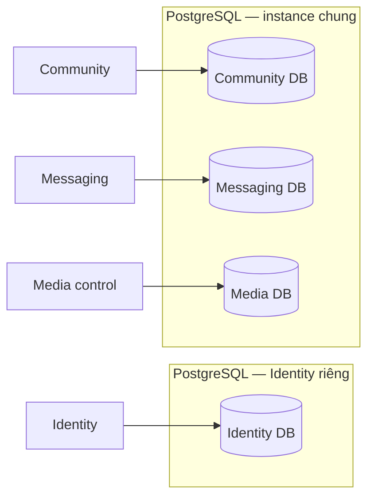

# SCDC — Thiết kế môi trường

## Phạm vi

Nguồn cho topology, thành phần và yêu cầu cấu hình. Các bước cài đặt/chạy/test nằm tại [hướng dẫn phát triển](../guides/development.md); thao tác phát hành tại [vận hành](../guides/operations.md).

## Development hiện tại

| Thành phần | Vai trò | Nguồn cấu hình |
|---|---|---|
| WebClient | React/Vite khi debug; Nginx phục vụ bản build trong container | [Vite](../../clients/WebClient/vite.config.js), [Nginx](../../clients/WebClient/nginx.conf), [Dockerfile](../../clients/WebClient/Dockerfile) |
| SCDC.Api | Host Identity, Community và Messaging | [Program](../../services/SCDC.Api/Program.cs), [appsettings](../../services/SCDC.Api/appsettings.json), [Dockerfile](../../services/SCDC.Api/Dockerfile) |
| PostgreSQL | Dữ liệu nghiệp vụ trong một database | [Compose](../../compose.yaml), [SQL bootstrap](../../database/postgres/schema.sql) |
| Volume DB | Giữ dữ liệu qua restart container | `scdc-postgres-data` trong Compose |
| Community keyring | Giữ khóa bảo vệ cursor qua restart | `scdc-community-keys` trong Compose |

WebClient proxy `/api`, `/hubs`, `/swagger` tới API. PostgreSQL được kiểm tra bằng `pg_isready` trước khi API khởi động. Thứ tự service khởi động không thay phép kiểm tra hành trình người dùng.

Danh sách địa chỉ, công cụ và giá trị local tại [Development](../guides/development.md#setup); danh sách khóa cấu hình tại [Configuration](../guides/development.md#configuration). Repo không lưu secret production trong tài liệu. Khi ghi hồ sơ chỉ ghi tên khóa, key ID và nguồn cấp quyền.

## Kiểm thử

Test tích hợp cần DB riêng có hậu tố `_test`, dữ liệu giả và quyền tạo/drop fixture DB. Bộ chạy Community tại [hướng dẫn Community](../guides/community-development.md). Không dùng dữ liệu local cần giữ làm fixture thử nghiệm.

## Staging và production

Chưa chọn cấu hình Docker host/máy ảo, domain, tài nguyên, email provider, secret store, backup tool, người trực hoặc manifest production. Hạ tầng hiện có ghi bên dưới; Compose hiện tại là Development. Các đầu vào còn mở tại [OQ-008/010/011](../project/open-questions.md#open-questions). Phát triển/demo dùng Gmail cá nhân qua SMTP và App Password theo [D37](../features/accounts/email-links.md#v1-email-delivery-model)/[DEC-155](../records/decisions/README.md#dec-155); dịch vụ email cho bản công khai chưa chọn.

### Hạ tầng hiện có

Người dùng cung cấp ngày 2026-10-12: hiện có một máy vật lý dùng Linux, kết nối qua nhiều mạng ở các địa điểm khác nhau. Máy phục vụ phát triển/demo; nơi chạy bản công khai chọn sau. Cấu hình cùng máy theo D24/D25/D32/D34 là baseline v1 ban đầu để phát triển/demo, chưa chốt host/mạng production. Development hiện tại vẫn là stack MVP ở trên; baseline v1 chưa triển khai.

Người dùng cung cấp cùng ngày: có gói Google One 5 TB. Chưa kiểm tra dung lượng trống hoặc xác nhận có cùng tài khoản Gmail của D37. Google One dùng chung dung lượng cho Drive, Gmail và Photos; không coi toàn bộ 5 TB dành riêng cho backup. Google Drive là phương án lưu backup sau v1 theo [D38](#v1-postgres-backup-storage); chưa triển khai. Nguồn: [Google One — dung lượng](https://support.google.com/googleone/answer/9004014?hl=en).

Chưa có thêm máy chủ để phân bố tải; cấu hình phần cứng và khả năng đáp ứng workload chưa được kiểm chứng. Bản phân phối/phiên bản Linux, Docker host/máy ảo và tài nguyên cần thiết kế chi tiết. Chưa chọn đầu mối truy cập Internet, relay/tunnel hoặc Cloud cho bản công khai; mục tiêu phát hành công khai tại [phạm vi dự án](../project/overview.md) giữ nguyên.

Nếu thử tải không đáp ứng, người dùng sẽ cân nhắc chuyển LiveKit sang laptop khác hoặc LiveKit Cloud. Đây là khả năng xem xét, chưa chọn thiết bị mới hoặc thay quyết định LiveKit tự host DEC-084. PostgreSQL ban đầu tự host theo [D25](#v1-postgres-placement); chuyển database Identity lên Cloud về sau vẫn là khả năng chưa chọn provider.

Thiết kế môi trường v1 phải xác định ingress/HTTPS, routing HTTP/realtime, phân quyền DB chi tiết, giám sát và LiveKit/TURN. Backup/WAL chuyển sang sau v1 theo [phạm vi đã cập nhật](../project/overview.md#backup-scope). Ranh giới bốn service đã xác nhận tại [architecture](architecture.md#service-boundaries); database và tài khoản riêng tại [database](database.md#v1-database-layout); bố trí instance tại [D03](#v1-postgres-instances). Đầu vào API chung cho WebClient đã chọn tại [D09](api-conventions.md#v1-public-routing), dùng Nginx OSS theo [D10](api-conventions.md#v1-gateway-technology). Công việc nền ứng dụng và Hub ban đầu chạy cùng API của owner theo [D12](backend.md#v1-application-workers)/[D13](backend.md#v1-realtime-hosting). gRPC giữa service dùng mTLS theo [D20](api-conventions.md#v1-service-authentication); CA, vòng đời chứng chỉ và điểm kết thúc TLS còn mở. Mỗi service nghiệp vụ có một bản chạy hoạt động trong cấu hình ban đầu theo [D21](#v1-service-replicas). Nginx phục vụ static WebClient và làm Gateway trong cùng container theo [D22](#v1-gateway-webclient-hosting); bố trí Docker host/máy ảo trên hạ tầng hiện có, mạng, TLS công khai và HA còn cần thiết kế. Docker Compose quản lý container ứng dụng theo [D23](#v1-container-deployment), PostgreSQL và LiveKit theo [D26](#v1-infrastructure-deployment); chưa thêm broker ban đầu, sự kiện theo [D27](api-conventions.md#v1-integration-event-transport).

Điều kiện môi trường trước phát hành tại [gate nghiệm thu](../releases/acceptance.md#release-gates). Runbook chỉ trở thành hướng dẫn thực thi khi có manifest/lệnh đã diễn tập trên cấu hình được chọn.

Redis đã chọn cho view xác thực do Identity quản lý theo [D30](access-revocation.md#v1-session-validation)/DEC-148. Khi chưa xác minh được phiên, tạm từ chối theo [D31](access-revocation.md#v1-session-validation-fallback). Redis tự host cùng máy trong container riêng do Compose quản lý theo [D32](#v1-auth-redis-deployment)/DEC-150. Version, TLS/quyền truy cập, persistence/eviction, tài nguyên và HA chưa chọn. Lựa chọn này không chốt SignalR backplane hoặc Redis của LiveKit.

[D33](observability.md#v1-telemetry-collection)/DEC-151 chọn OpenTelemetry và Collector chung cho service nghiệp vụ. Collector, nơi lưu/tra cứu và dashboard tự host cùng máy trong container do Compose quản lý theo [D34](observability.md#v1-observability-deployment)/DEC-152. OpenObserve OSS chạy single-node cho lưu/tra cứu/dashboard theo [D35](observability.md#v1-observability-tools)/DEC-153; Collector có container riêng. Số bản Collector, storage, bảo mật và cấu hình còn mở. Phạm vi này dành cho phát triển/demo; triển khai công khai đánh giá riêng.

## Chính sách cập nhật offline

Đã xác nhận ngày 2026-10-12 theo [D52](database.md#v1-mvp-data-cutover)/[DEC-170](../records/decisions/README.md#dec-170). Các đợt triển khai ứng dụng, thay đổi cấu hình/hạ tầng và migration trong giai đoạn hiện tại thực hiện offline, chấp nhận ngừng phục vụ trong thời gian cập nhật và kiểm tra. Cơ sở là dự án chưa có người dùng trước khi hoàn tất v1; nhu cầu duy trì phục vụ liên tục sau đó chưa xác định. Mục tiêu phát hành công khai vẫn giữ.

Trình tự: đóng đầu vào và ngừng phục vụ, dừng an toàn các API/worker/job ghi và transaction đang chạy, cập nhật/migration, kiểm tra rồi mở lại. Giữ PostgreSQL và thành phần cần cho migration/đối soát hoạt động; giữ volume, dữ liệu và khóa cần dùng. Thao tác cụ thể tại [runbook triển khai](../guides/operations.md#deploy), dữ liệu MVP theo [D51](database.md#v1-mvp-data-transition).

Không yêu cầu triển khai online, đồng bộ thay đổi liên tục hoặc HA chỉ để duy trì phục vụ trong đợt cập nhật hiện tại. Quyền/thu hồi, dữ liệu bền và kiểm tra trước mở lại vẫn áp dụng; backup/restore vẫn sau v1. Đánh giá lại cách cập nhật khi có nhu cầu phục vụ liên tục. Đây là chính sách đã chọn; lệnh/manifest và bằng chứng thực thi còn cần hoàn thiện theo gói.

## D03 — Bố trí instance PostgreSQL v1

Trạng thái: đã xác nhận phương án A điều chỉnh ngày 2026-10-11 — [DEC-121](../records/decisions/README.md#dec-121). Bốn database nghiệp vụ được bố trí trên hai instance chính (primary): Identity riêng; Community, Messaging và Media control dùng chung instance còn lại.

| Instance | Database nghiệp vụ | Cơ sở lựa chọn |
|---|---|---|
| Identity | Database của Identity | Tách riêng để có thể dùng database cloud cho Identity |
| Chung | Ba database riêng của Community, Messaging và Media control | Giữ chung đầu mối vận hành cho ba service còn lại |

Các tên trong bảng mô tả vai trò, chưa là tên cấu hình. Cấu hình ban đầu tự host hai instance theo [D25](#v1-postgres-placement); Identity có thể chuyển lên Cloud về sau, chưa chọn provider. Bốn database và tài khoản riêng vẫn giữ theo [DEC-120](../records/decisions/README.md#dec-120).

Sơ đồ thể hiện quyền sở hữu database và hai ranh giới instance của mục tiêu v1; chưa là topology đã triển khai. Hai instance ban đầu cùng tự host trên máy vật lý hiện có theo [D25](#v1-postgres-placement), mỗi instance có container riêng do Compose quản lý theo [D26](#v1-infrastructure-deployment). Cấu hình cần thiết kế chi tiết; Development hiện tại vẫn theo Compose ở trên.

Ba database trong instance chung cùng tài nguyên, WAL và phạm vi restart/sự cố instance. Identity nằm ngoài phạm vi restart này; mức cách ly lỗi máy chủ phụ thuộc nơi triển khai, và hành trình ứng dụng vẫn có thể phụ thuộc service khác. PostgreSQL PITR bằng base backup/WAL khôi phục ở cấp cluster; khôi phục riêng một database từ kết quả PITR cần quy trình bổ sung. Nguồn: [quản lý database](https://www.postgresql.org/docs/18/manage-ag-overview.html), [PITR](https://www.postgresql.org/docs/18/continuous-archiving.html).

Phục hồi hai instance cần cơ chế đối chiếu/nhất quán xuyên service. Triển khai backup/restore chuyển sang sau v1 theo [DEC-156](../records/decisions/README.md#dec-156); mục tiêu RPO/RTO, tuổi backup và bảo vệ sau restore giữ tại [vòng đời dữ liệu](data-lifecycle.md) cho giai đoạn đó. Database cloud về sau cần được đối chiếu với yêu cầu của môi trường triển khai khi chọn.

Nơi chạy hai instance ban đầu đã xác nhận tại [D25](#v1-postgres-placement). Provider cloud về sau, tài nguyên, replica/failover, công cụ backup, nơi lưu bản sao, cấu hình mạng, manifest và cách bố trí từng môi trường Development, Staging và Production cần thiết kế chi tiết.

## D21 — Số bản chạy service v1 ban đầu

Trạng thái: đã xác nhận phương án A ngày 2026-10-11 — [DEC-139](../records/decisions/README.md#dec-139). Trong cấu hình v1 ban đầu, Identity, Community, Messaging và Media control mỗi service có một bản chạy hoạt động. Một bản chạy là một tiến trình API; worker và Hub nếu có vẫn cùng tiến trình theo D12/D13.

| Nội dung | Lựa chọn |
|---|---|
| Số bản chạy | Một tiến trình API hoạt động cho mỗi service nghiệp vụ |
| Phục hồi | Tiến trình/job/outbox lưu bền tại DB owner; xử lý trùng, restart và reconnect theo hợp đồng từng chủ đề |
| Hub | Không bổ sung backplane chỉ để phối hợp nhiều bản Hub trong cấu hình một bản chạy này |
| Mở rộng sau | Cần thiết kế định tuyến, phối hợp Hub/worker/thu hồi và kiểm chứng trước khi chạy nhiều bản đồng thời |

Lựa chọn giảm thành phần vận hành cho [nhóm ba người](../project/planning.md#team). Đánh đổi là dừng/restart tiến trình làm gián đoạn API, worker và kết nối Hub của service đó. Chưa có phép đo chứng minh một tiến trình đủ tải hoặc đáp ứng [mục tiêu chất lượng](quality.md#quality-targets); số bản chạy không thay yêu cầu quyền/thu hồi, dữ liệu bền hoặc phục hồi.

Mỗi tiến trình SignalR chỉ biết các kết nối của mình; khi mở rộng nhiều bản chạy cần cơ chế chuyển cập nhật tới đúng kết nối và định tuyến phù hợp với transport. Nguồn: [Microsoft — SignalR hosting/scaling](https://learn.microsoft.com/en-us/aspnet/core/signalr/scale?view=aspnetcore-10.0).

D21 không chọn số máy chủ, số bản Gateway/database/SFU hoặc HA toàn hệ thống. Công cụ triển khai container ứng dụng theo [D23](#v1-container-deployment). Backplane/Redis cho mở rộng sau, health check, tài nguyên, lịch deploy và topology từng môi trường còn mở. Chưa thêm broker ban đầu theo [D27](api-conventions.md#v1-integration-event-transport); mở rộng về sau cần thiết kế riêng. Chưa đổi code hoặc Compose.

## D22 — Bố trí Gateway và WebClient

Trạng thái: đã xác nhận phương án A ngày 2026-10-11 — [DEC-140](../records/decisions/README.md#dec-140). Trong cấu hình v1 ban đầu, Nginx và các file build WebClient nằm trong cùng container. Nginx phục vụ giao diện và làm Gateway chuyển tiếp REST/SignalR theo D09/D10. Bốn service backend vẫn là các đơn vị triển khai riêng theo D01.

| Yêu cầu từ trình duyệt | Cách xử lý |
|---|---|
| Tải giao diện | Nginx đọc file HTML/CSS/JavaScript của bản build và gửi về; trình duyệt chạy giao diện React |
| Gọi REST hoặc kết nối SignalR | Nginx chuyển tiếp tới service sở hữu; service xử lý nghiệp vụ và kiểm tra quyền |

Lựa chọn giảm thành phần và cấu hình vận hành. Đánh đổi là khi phát hành giao diện bằng cách thay container chung, đầu vào API/SignalR cũng bị thay và có thể gián đoạn. Cập nhật riêng file static không mặc nhiên yêu cầu restart. Nginx hỗ trợ phục vụ static, proxy và reload cấu hình theo [tài liệu Nginx](https://nginx.org/en/docs/beginners_guide.html).

[Dockerfile hiện tại](../../clients/WebClient/Dockerfile) đóng gói SPA và [cấu hình Nginx](../../clients/WebClient/nginx.conf) theo cách này cho monolith; chưa chứng minh định tuyến v1 tới bốn service. Trước triển khai phải kiểm chứng định tuyến, SPA fallback, SignalR và reconnect.

D22 chưa chọn số bản Gateway, HA, host/domain, TLS công khai, phiên bản/image, cache, readiness, DNS hoặc quy trình deploy. gRPC nội bộ và signaling/WebRTC/TURN của LiveKit giữ phạm vi riêng. Chưa đổi code hoặc cấu hình.

## D23 — Công cụ triển khai container v1 ban đầu

Trạng thái: đã xác nhận phương án A ngày 2026-10-12 — [DEC-141](../records/decisions/README.md#dec-141). Docker Compose quản lý và triển khai các container ứng dụng v1 ban đầu: bốn service nghiệp vụ và Nginx phục vụ WebClient/Gateway.

| Nội dung | Lựa chọn |
|---|---|
| Công cụ | Docker Compose; khai báo container, mạng và cấu hình bằng file Compose |
| Phạm vi ứng dụng | Identity, Community, Messaging, Media control và Nginx/static WebClient |
| Số bản chạy | Giữ một tiến trình API hoạt động cho mỗi service nghiệp vụ theo D21 |
| Môi trường | Thiết kế cấu hình Staging/Production riêng; Compose trong repo hiện chỉ phục vụ Development |

Lựa chọn tận dụng công cụ đang dùng và giảm thành phần quản lý cho nhóm ba người. Đánh đổi là cần tự thiết kế quy trình cập nhật, phục hồi khi host lỗi và kiểm chứng vận hành. Compose quản lý ứng dụng trên một Docker host trong mỗi lần triển khai; cách bố trí Docker host/máy ảo và container trên [một máy vật lý hiện có](#v1-available-infrastructure) tiếp tục thiết kế riêng. Nguồn: [Docker — Compose trong production](https://docs.docker.com/compose/how-tos/production/).

Kubernetes đã được so sánh nhưng không được chọn cho cấu hình ban đầu. D23 chưa là phép đo tải hoặc xác nhận HA; yêu cầu quyền/thu hồi, dữ liệu bền, phục hồi và chất lượng giữ nguyên.

D23 chưa chọn manifest, phiên bản/image, tài nguyên, mạng, health check, CI/CD hoặc bố trí Docker host/máy ảo. Cấp bí mật cho phát triển/demo theo [D36](#v1-secret-provisioning); định dạng, quyền file và vòng đời chứng chỉ còn mở. Nơi chạy SFU và database theo [D24](#v1-sfu-host-placement)/[D25](#v1-postgres-placement); Compose quản lý thêm hai nhóm này theo [D26](#v1-infrastructure-deployment). Chưa đổi code, Compose hoặc triển khai hệ thống.

## D24 — LiveKit/SFU trên hạ tầng hiện có

Trạng thái: đã xác nhận đề xuất điều chỉnh ngày 2026-10-12 — [DEC-142](../records/decisions/README.md#dec-142). LiveKit tự host trên cùng máy vật lý với ứng dụng, chạy trong container riêng.

Media control quản lý cuộc gọi, quyền tham gia và trạng thái; LiveKit/SFU chuyển tiếp âm thanh/video giữa người dùng. Hai thành phần giữ ranh giới riêng theo D01; Media control vẫn chạy theo D21/D23.

| Nội dung | Lựa chọn |
|---|---|
| Máy vật lý | LiveKit và ứng dụng dùng chung máy hiện có |
| Container | LiveKit có container riêng, tách khỏi các API và Nginx/WebClient |
| Media control | Giữ service nghiệp vụ riêng; không ghép vào tiến trình SFU |

Lựa chọn sử dụng [hạ tầng hiện có](#v1-available-infrastructure), không cần thêm máy vật lý để bắt đầu. Các container vẫn dùng chung CPU/RAM, lưu trữ và đường mạng; máy vật lý dừng thì các thành phần tự host trên máy cùng gián đoạn. Container riêng không tạo thêm năng lực phần cứng. Nguồn: [Docker — container và máy ảo](https://docs.docker.com/get-started/docker-concepts/the-basics/what-is-a-container/).

Năng lực SFU phụ thuộc CPU và băng thông theo [LiveKit — triển khai](https://docs.livekit.io/transport/self-hosting/deployment/). Cần đo theo [workload media](quality.md#quality-targets) trước khi kết luận máy đủ tải hoặc bổ sung hạ tầng; cấu hình máy và kết quả tải còn thiếu. Nếu cần chuyển LiveKit sang laptop khác hoặc Cloud, đánh giá riêng chi phí, tích hợp và các hợp đồng media trước khi thay lựa chọn đã xác nhận. Đây chưa là cơ chế chuyển tự động hoặc lựa chọn LiveKit Cloud.

D24 chưa chọn số node SFU, cấu hình triển khai SFU, Docker host/máy ảo, provider/region, CPU/RAM/băng thông, network mode, TURN, Redis của LiveKit, proxy/admission hoặc HA. Nơi chạy database theo [D25](#v1-postgres-placement); Compose quản lý container LiveKit theo [D26](#v1-infrastructure-deployment). Quyền, quota, cutoff/fail-close và yêu cầu chất lượng giữ nguyên. Sơ đồ thành phần ghi vị trí SFU đã xác nhận; chưa đổi code hoặc cấu hình.

## D25 — Nơi chạy PostgreSQL ban đầu

Trạng thái: đã xác nhận phương án A ngày 2026-10-12 — [DEC-143](../records/decisions/README.md#dec-143). Cả hai instance PostgreSQL ban đầu tự host trên cùng máy vật lý với ứng dụng và LiveKit.

| Instance | Database | Nơi chạy ban đầu |
|---|---|---|
| Identity riêng | Identity | Tự host trên máy hiện có |
| Chung | Ba database riêng của Community, Messaging và Media control | Tự host trên cùng máy hiện có |

Lựa chọn dùng hạ tầng sẵn có, chưa cần nhà cung cấp database. Đánh đổi là nhóm tự vận hành, sao lưu và phục hồi; hai instance dùng chung tài nguyên và cùng gián đoạn khi máy vật lý dừng. Cần kiểm chứng khả năng đáp ứng tải và các mục tiêu phục hồi. PostgreSQL cho phép nhiều server instance trên cùng máy khi cấu hình phù hợp; xem [khởi động server](https://www.postgresql.org/docs/18/server-start.html).

Giữ bốn database và tài khoản truy cập riêng theo [D02](database.md#v1-database-layout), hai ranh giới instance theo [D03](#v1-postgres-instances). Identity có thể chuyển sang Cloud về sau; chưa chọn provider hoặc quy trình chuyển dữ liệu, kết nối và phục hồi.

Mỗi instance có container riêng do Compose quản lý theo [D26](#v1-infrastructure-deployment). Phiên bản/image, tài nguyên, cổng/mạng, volume, HA, backup tool và nơi lưu bản sao cần thiết kế chi tiết. Backup/restore được hoãn sau v1 theo [D38](#v1-postgres-backup-storage); chính sách giữ tại [vòng đời dữ liệu](data-lifecycle.md). Bản sao trên cùng máy không bảo vệ khỏi mất thiết bị. Chưa đổi SQL, code hoặc cấu hình.

## D26 — Phạm vi quản lý bằng Docker Compose

Trạng thái: đã xác nhận phương án A ngày 2026-10-12 — [DEC-144](../records/decisions/README.md#dec-144). Compose quản lý PostgreSQL và LiveKit, ngoài các container ứng dụng đã chọn tại D23. Hai instance PostgreSQL chạy trong hai container riêng; LiveKit giữ container riêng theo D24.

Redis xác thực được bổ sung vào phạm vi Compose theo [D32](#v1-auth-redis-deployment); lựa chọn này không thay ranh giới PostgreSQL hoặc LiveKit.

| Thành phần | Cách đóng gói | Công cụ quản lý |
|---|---|---|
| PostgreSQL — instance Identity | Container riêng | Docker Compose |
| PostgreSQL — instance chung | Container riêng, chứa ba database Community/Messaging/Media control | Docker Compose |
| LiveKit/SFU | Container riêng | Docker Compose |

Lựa chọn thống nhất công cụ khai báo và quản lý container trên hạ tầng hiện có. Nhóm vẫn phải thiết kế lưu trữ bền, nâng cấp, khởi động lại và phục hồi riêng cho database/SFU. PostgreSQL có [image chính thức](https://hub.docker.com/_/postgres); LiveKit có [ví dụ triển khai bằng Compose](https://docs.livekit.io/transport/self-hosting/vm/). Ví dụ LiveKit không mặc nhiên chọn Caddy, Redis, máy ảo hoặc cấu hình mạng cho SCDC.

Các service giữ đơn vị triển khai riêng; không mặc định dùng chung một file/project hoặc cập nhật đồng loạt. Phát hành API không yêu cầu restart PostgreSQL hay LiveKit; cần thiết kế và diễn tập quy trình thực tế. Docker hướng dẫn [cập nhật riêng một service](https://docs.docker.com/compose/how-tos/production/).

Dữ liệu PostgreSQL phải tồn tại ngoài vòng đời container; xem [lưu trữ bền Docker](https://docs.docker.com/engine/storage/volumes/). Lưu trữ bền không thay backup. D26 chưa chọn file/project, image/version, volume cụ thể, bản phân phối/phiên bản Linux, Docker host/máy ảo, network mode, tài nguyên, TURN/admission, HA hoặc backup tool. Chưa đổi code, Compose hoặc cấu hình.

## D32 — Triển khai Redis xác thực ban đầu

Trạng thái: đã xác nhận phương án A ngày 2026-10-12 — [DEC-150](../records/decisions/README.md#dec-150). Redis xác thực của D30 tự host trên cùng máy Linux hiện có, có container riêng do Docker Compose quản lý. Áp dụng cho phát triển/demo v1 ban đầu; nơi chạy bản công khai chọn sau.

| Nội dung | Lựa chọn |
|---|---|
| Máy vật lý | Cùng máy hiện có với ứng dụng, PostgreSQL và LiveKit |
| Cách đóng gói | Container Redis riêng, tách khỏi API, PostgreSQL và SFU |
| Công cụ quản lý | Docker Compose, bổ sung vào phạm vi D23/D26 |

Lựa chọn dùng hạ tầng và công cụ hiện có. Nhóm tự vận hành Redis; container dùng chung tài nguyên và chịu sự cố máy cùng các thành phần khác, cần đo tải trước khi kết luận đủ năng lực. Container riêng không bổ sung phần cứng hoặc bảo vệ khỏi sự cố máy. Nguồn: [Docker — container](https://docs.docker.com/get-started/docker-concepts/the-basics/what-is-a-container/), [Docker — Compose](https://docs.docker.com/compose/how-tos/production/). Phương án dịch vụ Redis được quản lý bên ngoài máy đã được so sánh nhưng không được chọn cho baseline này.

Giữ Identity sở hữu/cập nhật view, quyền đọc giới hạn của các service và [D31 — không gọi Identity dự phòng](access-revocation.md#v1-session-validation-fallback). Vai trò Redis không mở sang backplane, broker hoặc Redis của LiveKit. Compose không mặc định cùng file/project, Docker host hoặc cập nhật mọi service đồng loạt.

D32 chưa chọn image/version, số bản, file/project Compose, Docker host/máy ảo, mạng/cổng, TLS/ACL/credentials, CPU/RAM, lưu trữ bền, eviction, HA hoặc backup. Schema/TTL, phối hợp PostgreSQL–Redis và phục hồi theo D30 cần thiết kế riêng. Sơ đồ triển khai ghi Redis trong khung máy phát triển/demo; chưa đổi code, Compose hoặc cấu hình.

## D36 — Cấp bí mật cho container

Trạng thái: đã xác nhận phương án A ngày 2026-10-12 — [DEC-154](../records/decisions/README.md#dec-154). Mật khẩu, API key và khóa riêng được lưu trong file được bảo vệ ngoài repo trên host, cấp cho từng container bằng Compose secrets. Áp dụng cho máy Linux phát triển/demo; nơi chạy và cách cấp bí mật cho bản công khai đánh giá riêng.

| Nội dung | Lựa chọn |
|---|---|
| Nguồn cấp | File được bảo vệ trên host, ngoài repo |
| Cấp cho container | Khai báo Compose secrets, chỉ cấp file cần thiết cho từng service |
| Khóa ký access token | Chỉ Identity nhận khóa riêng theo [D28](api-conventions.md#v1-user-token-signing) |
| Khóa riêng mTLS | Theo danh tính từng service tại [D20](api-conventions.md#v1-service-authentication) |

Lựa chọn dùng công cụ triển khai hiện có và không thêm dịch vụ quản lý bí mật. Nhóm tự quản lý quyền file, cập nhật, thu hồi và phục hồi; việc bảo vệ bí mật phụ thuộc bảo vệ host. Phương án B dùng dịch vụ chuyên dụng đã được so sánh nhưng không được chọn cho phát triển/demo.

Theo [Docker — Compose secrets](https://docs.docker.com/compose/how-tos/use-secrets/), Compose mount secret dưới dạng file và chỉ cấp cho service được khai báo. Cơ chế này không tự mã hóa file nguồn trên host hoặc cấp/gia hạn chứng chỉ. Cần thiết kế quyền file và cách từng ứng dụng/image đọc giá trị; không mặc định mọi image hỗ trợ biến `_FILE`.

[D29](api-conventions.md#v1-user-token-key-distribution) vẫn là nguồn chuẩn về phân phối khóa công khai. Ma trận quyền chi tiết còn mở. Không ghi giá trị thật vào tài liệu, source, image hoặc log.

Key ring Data Protection được ứng dụng cập nhật cần lưu bền và quyền ghi riêng theo [thiết kế email](../features/accounts/email-links.md#delivery); không coi đó là file secret chỉ đọc được cấp lúc triển khai. Chính sách phục hồi khóa giữ nguồn chuẩn tại [vòng đời dữ liệu](data-lifecycle.md).

D36 chưa chọn đường dẫn, định dạng, UID/GID, cơ chế bảo vệ file khi lưu, CA, vòng đời khóa/chứng chỉ, reload/restart hoặc cơ chế sao lưu. Nguồn cấp file không thay chính sách phục hồi khóa. Sơ đồ giữ các thành phần hiện có; file secret là cấu hình được cấp cho container, không thêm service runtime. Chưa tạo bí mật, thay quyền file, code, Compose hoặc cấu hình.

## D38 — Nơi lưu backup sau v1

Trạng thái: đã xác nhận phương án A điều chỉnh ngày 2026-10-12 — [DEC-156](../records/decisions/README.md#dec-156). Google Drive thuộc gói Google One hiện có là phương án lưu backup ngoài máy cho giai đoạn sau v1. Triển khai và kiểm chứng backup/restore không thuộc mốc v1; nguồn phạm vi tại [hồ sơ v1](../project/overview.md#backup-scope).

| Nội dung | Lựa chọn |
|---|---|
| Kho ngoài máy | Google Drive từ gói Google One 5 TB đã có; dung lượng dành cho backup chưa xác định |
| Dữ liệu dự kiến | Bản sao base backup/WAL hoàn chỉnh của hai instance PostgreSQL và catalogue cần để phục hồi |
| Thời điểm | Sau v1; chưa lập lịch triển khai |
| Công cụ/cấu hình | Chưa chọn công cụ backup/chuyển file, runner, credential, mã hóa hoặc khóa |

Phương án tận dụng gói lưu trữ hiện có nhưng cần quy trình chuyển, kiểm tra và quản lý thời hạn file riêng. Google Drive lưu artefact backup đã hoàn chỉnh; không đồng bộ thư mục PostgreSQL đang chạy hoặc mặc định dùng Drive như repository POSIX. pgBackRest hỗ trợ Azure/CIFS/GCS/POSIX/S3/SFTP, chưa có loại repository Drive; Google Cloud Storage khác Google One/Drive. rclone hỗ trợ chuyển file Drive nhưng chưa được chọn. Nguồn: [pgBackRest — loại repository](https://pgbackrest.org/configuration.html#section-repository/option-repo-type), [rclone — Drive](https://rclone.org/drive/).

Khi triển khai sau v1, cần xác nhận upload hoàn tất, kích thước/checksum, catalogue và chuỗi base–WAL có thể phục hồi. Drive hỗ trợ upload tiếp tục sau gián đoạn và có giới hạn API. Nguồn: [Drive — upload](https://developers.google.com/workspace/drive/api/guides/manage-uploads), [Drive — giới hạn](https://developers.google.com/workspace/drive/api/guides/limits).

Các mục tiêu RPO/RTO và tuổi artefact vẫn là đầu vào thiết kế sau v1 tại [chính sách backup](data-lifecycle.md#tuổi-backup-và-cửa-sổ-pitr), chưa được đo hoặc coi đạt. Mạng gián đoạn có thể làm bản sao ngoài máy trễ; dung lượng 5 TB không chứng minh tốc độ truyền hay khả năng phục hồi. Quy trình dọn file phải xử lý cả Trash và dependency base–WAL theo chính sách.

Công cụ/version, OAuth, runner/container, bộ đệm/lưu trữ local, lịch chạy, quota dành riêng và retention còn mở. [Sổ bảo vệ độc lập](data-lifecycle.md#sổ-bảo-vệ-độc-lập) thuộc gói restore sau v1; kho/quyền/khóa của sổ chưa chọn và không mặc định dùng cùng repository hoặc TTL backup. Chưa thêm Drive vào sơ đồ runtime v1, đổi cấu hình, kết nối tài khoản hoặc upload dữ liệu.
