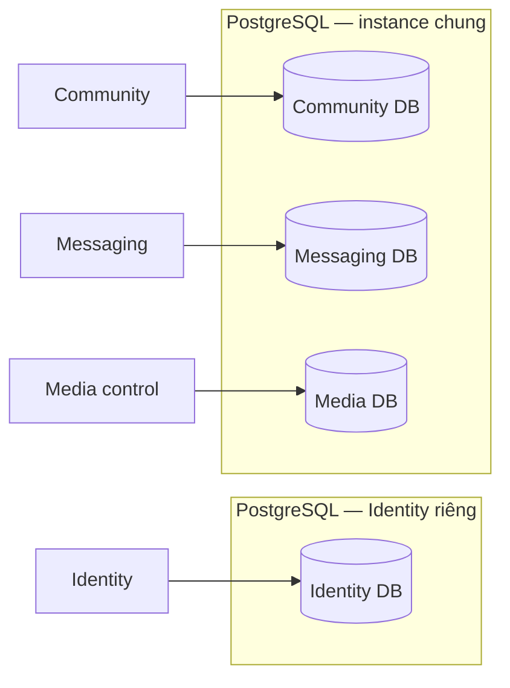

# SCDC — Môi trường

Trang này mô tả các môi trường chạy SCDC: môi trường phát triển hiện tại, hạ tầng đang có, và các quyết định v1 về cách bố trí service, database, LiveKit, Redis, bí mật và backup trên máy.

Cách cài đặt, chạy và test xem [hướng dẫn phát triển](../guides/development.md); thao tác phát hành xem [vận hành](../guides/operations.md).

**Trạng thái:** môi trường phát triển hiện tại là stack MVP (`900e226`). Toàn bộ bố trí v1 (D03, D21 đến D26, D32, D36, D38) đã chốt nhưng chưa triển khai.

## Môi trường phát triển hiện tại

| Thành phần | Vai trò | Cấu hình |
|---|---|---|
| WebClient | React và Vite khi debug; Nginx phục vụ bản build trong container | [Vite](../../clients/WebClient/vite.config.js), [Nginx](../../clients/WebClient/nginx.conf), [Dockerfile](../../clients/WebClient/Dockerfile) |
| SCDC.Api | Một ứng dụng chứa Identity, Community, Messaging (gồm ChatHub, outbox, reconciler DM) | [Program](../../services/SCDC.Api/Program.cs), [appsettings](../../services/SCDC.Api/appsettings.json), [Dockerfile](../../services/SCDC.Api/Dockerfile) |
| PostgreSQL | Một database | [Compose](../../compose.yaml), [schema.sql](../../database/postgres/schema.sql) |
| Volume `scdc-postgres-data` | Giữ dữ liệu DB qua khởi động lại | Compose |
| Volume `scdc-community-keys` | Key ring cursor Community | Compose |
| Volume `identity-user-search-keys` | Key ring cursor tìm người, hộp thư, lịch sử DM | Compose |
| Volume `scdc-messaging-keys` | Khóa fingerprint DM (tạo bằng `make init-dm-key`) | Compose |

- WebClient chuyển tiếp `/api`, `/hubs`, `/swagger` tới API.
- API chờ PostgreSQL sẵn sàng (`pg_isready`) mới khởi động. Thứ tự khởi động không thay cho kiểm thử hành trình.
- Địa chỉ, công cụ, giá trị trên máy: [hướng dẫn](../guides/development.md#setup); danh sách khóa cấu hình: [cấu hình](../guides/development.md#configuration).
- Không ghi bí mật production vào tài liệu. Hồ sơ chỉ ghi tên khóa, ID khóa và nguồn cấp.

**Test tích hợp:** dùng database riêng có hậu tố `_test`, dữ liệu giả, quyền tạo và xóa database fixture. Không dùng dữ liệu cần giữ. Xem [hướng dẫn Community](../guides/development.md#community).

**Staging và production:** chưa chọn máy, domain, tài nguyên, nhà cung cấp email, kho bí mật, công cụ backup, người trực hay manifest. Compose hiện tại chỉ cho phát triển. Còn mở tại [OQ-008, 010, 011](../project/open-questions.md#open-questions).

## Hạ tầng đang có (2026-10-12)

- **Một máy vật lý chạy Linux**, nối mạng ở nhiều địa điểm khác nhau. Dùng cho phát triển và demo; nơi chạy bản công khai chọn sau. Chưa đo cấu hình phần cứng và khả năng chịu tải; chưa chọn bản Linux, cách chia Docker host hay máy ảo.
- **Gói Google One 5 TB.** Dung lượng dùng chung cho Drive, Gmail, Photos ([Google](https://support.google.com/googleone/answer/9004014?hl=en)), chưa kiểm tra dung lượng trống hay có cùng tài khoản Gmail của D37 không. Dự kiến dùng lưu backup sau v1 ([D38](#v1-postgres-backup-storage)).
- **Không có máy thứ hai** để chia tải. Chưa chọn đường vào Internet, relay, tunnel hay Cloud cho bản công khai.
- Nếu thử tải không đạt, có thể cân nhắc chuyển LiveKit sang laptop khác hoặc LiveKit Cloud. Đây chỉ là khả năng, chưa thay quyết định tự host (DEC-084).

### Bố trí v1 trên máy (tóm tắt)

| Thành phần | Bố trí | Quyết định |
|---|---|---|
| 4 service (Identity, Community, Messaging, Media control) | Mỗi service một container, một bản chạy (API + worker + Hub nếu có) | [D21](#v1-service-replicas), [D23](#v1-container-deployment) |
| Nginx + WebClient | Chung một container: phục vụ file build và làm Gateway | [D22](#v1-gateway-webclient-hosting) |
| PostgreSQL | Hai instance, mỗi instance một container: Identity riêng; Community, Messaging, Media dùng chung | [D03](#v1-postgres-instances), [D25](#v1-postgres-placement), [D26](#v1-infrastructure-deployment) |
| LiveKit | Container riêng, cùng máy | [D24](#v1-sfu-host-placement) |
| Redis (xác thực) | Container riêng, cùng máy | [D32](#v1-auth-redis-deployment) |
| OpenTelemetry Collector, OpenObserve | Container riêng, cùng máy | [Giám sát](observability.md) |
| Bí mật | File ngoài repo, cấp qua Compose secrets | [D36](#v1-secret-provisioning) |
| Email | Gmail cá nhân qua SMTP | [D37](../features/accounts/email-links.md#v1-email-delivery-model) |
| Backup | Google Drive, sau v1 | [D38](#v1-postgres-backup-storage) |

Tất cả quản lý bằng Docker Compose trên một máy, cho phát triển và demo. Các quyết định liên quan khác: ranh giới service ([kiến trúc](architecture.md#service-boundaries)), mỗi service một database ([D02](database.md#v1-database-layout)), cổng vào chung bằng Nginx ([D09, D10](api-conventions.md#v1-public-routing)), worker và Hub chạy cùng API ([D12, D13](backend.md#v1-application-workers)), mTLS giữa service ([D20](api-conventions.md#v1-service-authentication)), sự kiện không dùng broker ([D27](api-conventions.md#v1-integration-event-transport)), Redis xác thực ([D30, D31](access-revocation.md#v1-session-validation)).

Điều kiện môi trường trước phát hành: [điều kiện phát hành](../releases/acceptance.md#release-gates). Runbook chỉ dùng được khi có manifest và lệnh đã diễn tập.

## Cập nhật offline

**Quyết định (2026-10-12):** trong giai đoạn hiện tại, mọi lần triển khai, đổi cấu hình, đổi hạ tầng và migration đều làm offline: ngừng phục vụ trong lúc cập nhật và kiểm tra. Lý do: chưa có người dùng trước khi xong v1. Mục tiêu phát hành công khai vẫn giữ.

**Trình tự:**

1. Đóng cổng vào, ngừng phục vụ.
2. Dừng an toàn API, worker, job đang ghi và transaction đang chạy.
3. Cập nhật và chạy migration.
4. Kiểm tra, rồi mở lại.

Giữ PostgreSQL và các thành phần cần cho migration, đối chiếu; giữ volume, dữ liệu và khóa. Thao tác cụ thể: [runbook triển khai](../guides/operations.md#deploy); dữ liệu MVP: [D51](database.md#v1-mvp-data-transition).

Không cần triển khai online, đồng bộ liên tục hay HA chỉ để không gián đoạn khi cập nhật. Quyền, thu hồi, dữ liệu bền và kiểm tra trước khi mở lại vẫn bắt buộc. Đánh giá lại khi cần phục vụ liên tục.

---

## Thiết kế v1

### D03 — Hai instance PostgreSQL

**Quyết định:** bốn database nằm trên hai instance: Identity riêng một instance; Community, Messaging và Media control dùng chung instance thứ hai. Mỗi service vẫn có database và tài khoản riêng ([DEC-120](../records/decisions/README.md#dec-120)).

**Lý do:** tách Identity để sau này có thể chuyển lên database cloud; ba service còn lại dùng chung một chỗ vận hành.

**Lưu ý:**

- Ba database trong instance chung cùng chia tài nguyên, WAL, và cùng bị ảnh hưởng khi instance khởi động lại hay gặp sự cố.
- Khôi phục theo thời điểm (PITR) làm trên cả cluster; muốn khôi phục riêng một database cần thêm quy trình ([quản lý database](https://www.postgresql.org/docs/18/manage-ag-overview.html), [PITR](https://www.postgresql.org/docs/18/continuous-archiving.html)).
- Khôi phục hai instance cần cơ chế đối chiếu giữa các service (sau v1).

### D25 — PostgreSQL tự host trên máy hiện có

**Quyết định:** cả hai instance tự host trên cùng máy với ứng dụng và LiveKit.

**Lý do:** dùng hạ tầng sẵn có, chưa cần nhà cung cấp database. **Đổi lại:** nhóm tự vận hành và phục hồi; hai instance chung tài nguyên và cùng dừng khi máy dừng. Bản sao trên cùng máy không bảo vệ khỏi mất máy. PostgreSQL cho phép nhiều instance trên một máy ([Postgres](https://www.postgresql.org/docs/18/server-start.html)).

Identity có thể chuyển lên Cloud sau; chưa chọn nhà cung cấp.

### D21 — Mỗi service một bản chạy

**Quyết định:** mỗi service có đúng một tiến trình API đang chạy; worker và Hub (nếu có) chạy trong cùng tiến trình ([D12, D13](backend.md#v1-application-workers)).

| Mục | Chọn |
|---|---|
| Số bản | Một tiến trình API mỗi service |
| Phục hồi | Tiến trình, job, outbox lưu bền trong DB của service; xử lý trùng, khởi động lại, kết nối lại theo hợp đồng từng tính năng |
| Hub | Không thêm backplane |
| Mở rộng sau | Phải thiết kế định tuyến, phối hợp Hub, worker, thu hồi và kiểm thử trước khi chạy nhiều bản |

**Lý do:** ít thành phần phải vận hành cho nhóm ba người. **Đổi lại:** khởi động lại tiến trình làm gián đoạn API, worker và kết nối Hub của service đó. Chưa đo một tiến trình có đủ tải không.

Mỗi tiến trình SignalR chỉ biết kết nối của nó; chạy nhiều bản thì cần cơ chế chuyển cập nhật tới đúng kết nối ([Microsoft](https://learn.microsoft.com/en-us/aspnet/core/signalr/scale?view=aspnetcore-10.0)). D21 không chọn số máy, số bản Gateway, database hay LiveKit, cũng không chọn HA.

### D22 — Nginx và WebClient chung một container

**Quyết định:** Nginx và file build WebClient nằm chung container. Nginx vừa trả file giao diện, vừa chuyển tiếp REST và SignalR tới service ([D09, D10](api-conventions.md#v1-public-routing)).

| Request | Xử lý |
|---|---|
| Tải giao diện | Nginx trả file HTML, CSS, JavaScript; trình duyệt chạy React |
| REST hoặc SignalR | Nginx chuyển tới service sở hữu; service xử lý nghiệp vụ và quyền |

**Lý do:** ít thành phần, ít cấu hình. **Đổi lại:** phát hành giao diện bằng cách thay container thì cổng vào API và SignalR cũng bị thay, có thể gián đoạn. Chỉ đổi file tĩnh thì không cần khởi động lại ([Nginx](https://nginx.org/en/docs/beginners_guide.html)).

[Dockerfile](../../clients/WebClient/Dockerfile) và [cấu hình Nginx](../../clients/WebClient/nginx.conf) hiện làm như vậy cho monolith. Trước khi triển khai v1 phải kiểm tra định tuyến, SPA fallback, SignalR và kết nối lại.

### D23 — Docker Compose quản lý container ứng dụng

**Quyết định:** Docker Compose quản lý bốn service và container Nginx, WebClient.

**Lý do:** đã dùng sẵn, ít thành phần cho nhóm ba người. **Đổi lại:** tự thiết kế quy trình cập nhật, phục hồi khi máy lỗi và kiểm thử vận hành. Kubernetes không được chọn cho cấu hình ban đầu. Tham khảo [Compose trong production](https://docs.docker.com/compose/how-tos/production/).

Compose trong repo hiện chỉ cho phát triển; staging và production cần cấu hình riêng.

### D26 — Compose cũng quản lý PostgreSQL và LiveKit

**Quyết định:** ngoài container ứng dụng, Compose quản lý hai container PostgreSQL và một container LiveKit. (Redis thêm vào theo D32.)

**Lý do:** dùng một công cụ cho mọi container trên máy. Nhóm vẫn phải tự thiết kế lưu trữ bền, nâng cấp, khởi động lại, phục hồi cho database và LiveKit. Có [image PostgreSQL chính thức](https://hub.docker.com/_/postgres) và [ví dụ LiveKit bằng Compose](https://docs.livekit.io/transport/self-hosting/vm/) (không có nghĩa chọn Caddy, Redis hay cấu hình mạng trong ví dụ).

- Các service vẫn triển khai riêng; không bắt buộc chung một file Compose hay cập nhật cùng lúc. Phát hành API không cần khởi động lại PostgreSQL hay LiveKit ([cập nhật riêng một service](https://docs.docker.com/compose/how-tos/production/)).
- Dữ liệu PostgreSQL phải nằm ngoài vòng đời container ([volume](https://docs.docker.com/engine/storage/volumes/)). Volume không thay cho backup.

### D24 — LiveKit trên cùng máy

**Quyết định:** LiveKit tự host trên cùng máy với ứng dụng, trong container riêng. Media control (quản lý cuộc gọi, quyền, trạng thái) là service riêng, không gộp vào LiveKit (chỉ chuyển tiếp âm thanh và hình).

**Lý do:** không cần thêm máy để bắt đầu. **Đổi lại:** container chung CPU, RAM, đĩa và mạng; máy dừng thì tất cả dừng. Container riêng không thêm sức mạnh phần cứng ([Docker](https://docs.docker.com/get-started/docker-concepts/the-basics/what-is-a-container/)).

Khả năng của LiveKit phụ thuộc CPU và băng thông ([LiveKit](https://docs.livekit.io/transport/self-hosting/deployment/)); phải đo theo [tải media](quality.md#quality-targets) trước khi kết luận. Chuyển sang máy khác hay Cloud cần đánh giá riêng.

### D32 — Redis xác thực trên cùng máy

**Quyết định:** Redis của D30 tự host trên cùng máy, container riêng, Compose quản lý. Áp dụng cho phát triển và demo.

**Lý do:** dùng hạ tầng và công cụ sẵn có. **Đổi lại:** tự vận hành; chung tài nguyên và cùng chịu sự cố máy; phải đo tải. Dịch vụ Redis bên ngoài không được chọn.

Identity vẫn là bên duy nhất ghi; service khác chỉ đọc; không gọi Identity dự phòng ([D31](access-revocation.md#v1-session-validation-fallback)). Redis này không dùng làm backplane, broker hay Redis của LiveKit.

### D36 — Cấp bí mật bằng file và Compose secrets

**Quyết định:** mật khẩu, API key, khóa riêng lưu trong file được bảo vệ, nằm ngoài repo trên máy; cấp cho từng container bằng Compose secrets. Áp dụng cho phát triển và demo.

| Mục | Chọn |
|---|---|
| Nguồn | File được bảo vệ trên máy, ngoài repo |
| Cấp cho container | Compose secrets; mỗi service chỉ nhận file nó cần |
| Khóa ký access token | Chỉ Identity nhận ([D28](api-conventions.md#v1-user-token-signing)) |
| Khóa riêng mTLS | Theo danh tính từng service ([D20](api-conventions.md#v1-service-authentication)) |

**Lý do:** dùng công cụ sẵn có, không thêm dịch vụ quản lý bí mật. **Đổi lại:** tự quản lý quyền file, cập nhật, thu hồi, phục hồi; an toàn phụ thuộc vào an toàn của máy.

- Compose gắn secret dưới dạng file và chỉ cấp cho service được khai báo ([Docker](https://docs.docker.com/compose/how-tos/use-secrets/)). Nó không mã hóa file nguồn, không cấp hay gia hạn chứng chỉ. Không phải image nào cũng hỗ trợ biến `_FILE`.
- Khóa công khai phân phối theo [D29](api-conventions.md#v1-user-token-key-distribution).
- Key ring Data Protection do ứng dụng tự ghi, nên cần volume bền có quyền ghi ([email](../features/accounts/email-links.md#delivery)); không phải file secret chỉ đọc.
- Không ghi giá trị thật vào tài liệu, code, image hay log.

### D38 — Lưu backup trên Google Drive (sau v1)

**Quyết định:** Google Drive (gói Google One sẵn có) là nơi lưu backup ngoài máy cho giai đoạn sau v1. Backup và khôi phục không thuộc v1 ([phạm vi](../project/overview.md#backup-scope)).

| Mục | Chọn |
|---|---|
| Kho ngoài máy | Google Drive, gói 5 TB; dung lượng dành cho backup chưa xác định |
| Dữ liệu | Bản sao base backup và WAL hoàn chỉnh của hai instance, cùng catalogue để khôi phục |
| Thời điểm | Sau v1; chưa có lịch |
| Công cụ | Chưa chọn |

**Lưu ý:**

- Drive chỉ lưu file backup đã hoàn chỉnh; không đồng bộ thư mục PostgreSQL đang chạy.
- pgBackRest không hỗ trợ Drive làm repository (chỉ Azure, CIFS, GCS, POSIX, S3, SFTP); Google Cloud Storage khác Google One. rclone chuyển được file lên Drive nhưng chưa chọn. Tham khảo [pgBackRest](https://pgbackrest.org/configuration.html#section-repository/option-repo-type), [rclone](https://rclone.org/drive/).
- Khi làm, phải xác nhận tải lên xong, kích thước, checksum, catalogue, và chuỗi base–WAL khôi phục được. Drive hỗ trợ tải tiếp sau gián đoạn và có giới hạn API ([upload](https://developers.google.com/workspace/drive/api/guides/manage-uploads), [giới hạn](https://developers.google.com/workspace/drive/api/guides/limits)).
- Mạng gián đoạn có thể làm bản sao bị trễ. 5 TB không chứng minh tốc độ hay khả năng khôi phục. Dọn file phải tính cả Thùng rác và quan hệ base–WAL ([chính sách backup](data-lifecycle.md#tuổi-backup-và-cửa-sổ-pitr)).
- [Sổ bảo vệ độc lập](data-lifecycle.md#sổ-bảo-vệ-độc-lập) không mặc định dùng chung kho hay thời hạn với backup.

## Còn mở

- **Chung:** manifest, image và phiên bản, tài nguyên CPU và RAM, mạng và cổng, health check, CI/CD, bản Linux, cách chia Docker host hay máy ảo, HA. Cấu hình staging và production.
- **D03, D25:** tên cấu hình; volume; nhà cung cấp cloud cho Identity sau này; replica và failover.
- **D21:** backplane khi mở rộng; lịch triển khai.
- **D22:** số bản Gateway; domain, TLS công khai; cache; readiness; DNS.
- **D24:** số node, network mode, TURN, Redis của LiveKit, proxy, kiểm soát vào phòng.
- **D32:** số bản, TLS, ACL, thông tin đăng nhập, lưu trữ bền, eviction, HA; schema và phối hợp với PostgreSQL theo D30.
- **D36:** đường dẫn, định dạng, UID và GID, bảo vệ file, CA, vòng đời khóa và chứng chỉ, nạp lại khi đổi, sao lưu; ma trận quyền.
- **D38:** công cụ và phiên bản, OAuth, runner, bộ đệm trên máy, lịch, dung lượng dành riêng, thời hạn giữ.

---

Nguồn: DEC-084, [DEC-121](../records/decisions/README.md#dec-121) (D03), [DEC-139](../records/decisions/README.md#dec-139) (D21), [DEC-140](../records/decisions/README.md#dec-140) (D22), [DEC-141](../records/decisions/README.md#dec-141) (D23), [DEC-142](../records/decisions/README.md#dec-142) (D24), [DEC-143](../records/decisions/README.md#dec-143) (D25), [DEC-144](../records/decisions/README.md#dec-144) (D26), [DEC-150](../records/decisions/README.md#dec-150) (D32), [DEC-154](../records/decisions/README.md#dec-154) (D36), [DEC-156](../records/decisions/README.md#dec-156) (D38), [DEC-170](../records/decisions/README.md#dec-170) (cập nhật offline). Các phương án đã cân nhắc ghi trong hồ sơ quyết định.
